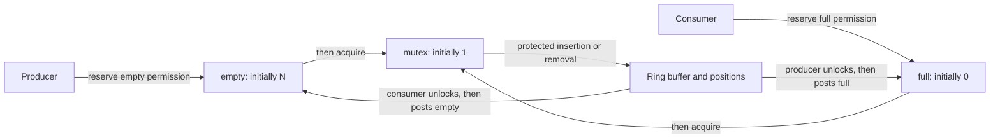

# Semaphores: counted permissions and acquisition order

> A semaphore can represent exclusive access, completed work, or available capacity. Its initial value and the order of waits determine which meaning the program actually implements.

Source: Chapter 31, *Semaphores*, PDF pages 361–378.

## Define the count before using it

A **semaphore** combines an integer state with wait and post operations. In the chapter's Dijkstra-style definition, `sem_wait()` decrements the state and blocks if the result is negative; `sem_post()` increments it and wakes a waiter if there is one. A negative state's magnitude represents waiting threads in that abstract accounting model. These transitions require synchronization inside the primitive itself.

Equivalently, successful wait consumes a permission and post supplies one. Unlike a condition-variable signal, post can preserve a permission for a later caller. Actual implementations need not expose the abstract negative-value representation.

`sem_init(&semaphore, 0, initial)` initializes the POSIX example for same-process threads. The last argument is the initial count. Historical `P` and `V`, or down and up, name the wait and post roles. The chapter attributes the primitive to Dijkstra and colleagues while acknowledging uncertain early history.

## Exclusive access starts with one permission

Initialize a semaphore to 1 to use it as the chapter's **binary semaphore**. Surround the critical section with wait and post. The first caller consumes the available permission and enters; later callers wait until a post supplies the next opportunity.

Binary describes exclusive-access behavior, not necessarily internal values: the abstract state becomes negative with waiters. Pair operations correctly; an extra post can destroy exclusion. Count-based permission is not identical to mutex ownership.

## Completion starts with no permissions

To let a coordinator wait for one worker's completion, initialize the semaphore to 0. The worker posts after performing the required work; the coordinator waits before using that work.

Coordinator-first blocks until the post; worker-first preserves a permission consumed later without blocking. Condition variables solve early notification with a separate predicate instead. Completion semaphores do not replace arbitrary predicate-and-mutex protocols.

## A bounded buffer needs counts and a mutex

For capacity `N`, initialize `empty` to `N`, `full` to 0, and a binary `mutex` to 1. Empty and full track permissions to insert or remove; mutex protects the shared array and insertion/removal positions.

The counts coordinate a one-slot buffer, but larger buffers expose shared-position races: producers can reserve different permissions yet both write at the same unchanged insertion index. Eligibility does not make the update atomic.

Adding mutex in the wrong place creates deadlock. A consumer that locks mutex and then waits on an empty `full` semaphore keeps mutex while asleep. The producer that could insert and post `full` cannot obtain mutex. Unlike condition-variable wait, semaphore wait does **not** release a separately held lock.

The working order reserves capacity or data before locking the buffer, performs the update under the lock, and releases the lock before publishing the opposite permission:

In a job dispatcher, reserve capacity, insert under mutex, unlock, then publish a full permission; consumption mirrors this. Reservations precede mutation, so semaphore states are not instantaneous counts of unreserved buffer contents.

## Reader–writer locks admit a reader cohort

A **reader–writer lock** allows either one writer or multiple readers, excluding writers while readers inspect shared state. The chapter's semaphore implementation has a short-held lock protecting a reader count and a separate write-exclusion semaphore, both initialized to 1; the reader count starts at zero.

A reader acquires the count lock and increments the count. The first reader also waits on write exclusion before releasing the count lock. Subsequent readers join that admitted cohort. On departure, a reader updates the count under its lock; the last reader posts write exclusion. Writers simply wait and post on write exclusion around their modification.

Continuous reader arrivals can starve a writer. Blocking new reader admission once a writer waits addresses that policy at added complexity and overhead. Reader–writer locks are not automatically faster than mutexes.

## Dining philosophers illustrate circular acquisition

The source's problem has five participants and five shared forks; each needs its two neighboring forks to proceed. One semaphore initialized to 1 protects each fork. If everybody takes the left fork before the right, everybody can hold one and wait indefinitely for another.

The highest-numbered participant instead takes the right fork first. This breaks the acquisition cycle and the demonstrated deadlock, not every possible starvation scenario. The lesson is resource order. See the [dining-philosophers practice](../../operating-systems/3-practice/project-dining-philosophers.md).

## Building a semaphore exposes the representation difference

The source's **Zemaphore** uses one mutex, one condition variable, and a nonnegative count. Wait locks, loops while no permission exists, decrements after obtaining one, and unlocks. Post locks, increments, signals, and unlocks. The condition-variable loop handles contention for newly posted permissions.

Unlike the abstract definition, this implementation never encodes negative waiter counts. The reverse construction—faithful condition variables from semaphores—is harder, warns the chapter. Generalization does not erase semantic differences.

## What to take away

- Define what each semaphore permission represents and derive its initial count from that meaning.
- Wait for buffer capacity or data before acquiring the buffer mutex; release it before posting the opposite count.
- Separate counted eligibility from mutual exclusion of index and data updates.
- Distinguish deadlock freedom, fairness, and internal counter representation when evaluating a semaphore protocol.

---

Previous: [Condition variables](30-condition-variables.md) · Next: [Concurrency bugs](32-concurrency-bugs.md)
