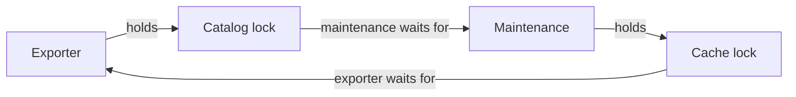

# Concurrency bugs: atomicity, order, and deadlock

> Many concurrency failures follow a few recurring patterns. Identify the missing guarantee before adding synchronization, then account for the new dependencies that synchronization creates.

Source: Chapter 32, *Common Concurrency Problems*, PDF pages 379–393.

## Learn from failures, without universalizing one sample

The chapter draws on Lu and colleagues' study of previously found and fixed bugs in MySQL, Apache, Mozilla, and OpenOffice. Its sample contains 105 bugs: 74 non-deadlock bugs and 31 deadlocks. These are the study's selected cases, not prevalence measurements for all concurrent software.

The main non-deadlock patterns are **atomicity violations** and **order violations**. Deadlock handling divides into prevention, avoidance, and detection with recovery. Each needs a different guarantee, not indiscriminately added locks.

## Atomicity violations split an operation that must stay together

An atomicity violation admits interference into accesses intended to behave indivisibly. A renderer checks that a shared status pointer exists, then prints through it; another thread clears it between check and use.

Protect the entire check-and-use sequence, requiring the clearing thread and all other relevant paths to use the same lock. Separately locking check and use leaves the dangerous interval open: protect the operation's invariant.

## Order violations omit a required before-and-after relationship

An order violation runs an access before its dependency. A controller creates a worker, then records a handle the worker needs. The worker may start before that store: creation does not order subsequent creator-side initialization.

Publish a readiness predicate under a mutex and signal a condition variable after initialization. The worker waits in a loop under the same mutex before using the initialized state. If initialization happens first, the recorded predicate prevents an unnecessary wait; if the worker arrives first, atomic release-and-wait prevents a lost wakeup. A semaphore can also express a suitable completion dependency.

These patterns account for 97% of the sampled non-deadlock bugs, motivating review without implying every fix is local. Some require reorganizing shared state. See [race conditions](../../operating-systems/1-knowledge/concurrency/race-conditions.md).

## Deadlock is a dependency cycle, not just a slow lock

Suppose an exporter owns the catalog lock and waits for the cache lock, while a cache-maintenance task owns cache and waits for catalog. Neither can reach the release that would permit the other to proceed.

Subsystem dependencies and encapsulated multi-object methods hide cycles. A method locking destination then source can conflict with a call using reversed object roles. An interface boundary is not automatically a lock-order boundary.

The chapter gives four necessary conditions for resource deadlock:

1. **Mutual exclusion:** some required resource is exclusively held.
2. **Hold-and-wait:** a thread retains resources while requesting additional ones.
3. **No preemption:** the held resources cannot simply be taken away.
4. **Circular wait:** a chain of owners waits around a cycle.

Breaking any necessary condition prevents the corresponding deadlock. CPU scheduling preemption is not resource preemption: pausing a thread does not release its locks.

## Prevention changes the resource protocol

Prevent circular wait with a **lock acquisition order**: catalog before cache everywhere. A total order is simple; an acyclic partial order permits flexibility. Dynamic objects need a stable ordering rule, not parameter order. The source's address-order example assumes distinct locks; reacquiring the same nonrecursive lock is a separate error.

Avoid hold-and-wait by acquiring the complete needed lock set through a coordinated phase. The source sketches a global prevention lock serializing those phases, not disabling interrupts. Every participant must follow it and identify resources ahead of time. Early acquisition reduces concurrency; hidden later acquisitions undermine it.

The source next releases and retries after failed second acquisition: lock the first, try the second, and release the first on failure. Roll back other acquired resources too. Repeated collisions can produce **livelock**: contenders execute without progress. Random delay reduces collisions but does not guarantee bounded progress.

Finally, **non-blocking** structures can avoid explicit lock ownership. A compare-and-swap update installs a new value only if the observed old value is still current; failure retries with a fresh observation. The source demonstrates an increment and list-head insertion and broadly calls these examples “wait-free.” More precisely, **lock-free** guarantees system-wide progress—some operation completes—while **wait-free** guarantees each process completes its operation within a finite bound on its own steps, independent of others' speeds. The unbounded retries shown do not establish that stronger guarantee. See [Herlihy's primary formulation](https://doi.org/10.1145/161468.161469). Removing locks does not ensure every contender finishes promptly; insertion alone is also not a complete concurrent list with deletion and safe lifetimes.

## Avoidance controls which work may overlap

**Deadlock avoidance** uses advance knowledge of possible resource demands to admit or schedule only combinations that remain safe. If two tasks might take the same pair of locks in conflicting orders, serializing their whole executions avoids that overlap. A task requiring only one of those locks cannot independently complete the two-lock cycle.

The source relates this family to Dijkstra's Banker's algorithm. Such knowledge is feasible in some controlled environments but difficult in general-purpose applications. Conservative scheduling sacrifices concurrency. Merely assigning preemptible conflicting threads to one CPU is not enough: their execution can still interleave while retaining locks.

## Detection and recovery accept occasional failure

A detector can look for dependency-graph cycles in the exclusive-lock case. Recovery must break the dependency and restore usable state, potentially through restart or repair. The source discusses database detectors without prescribing universal recovery.

Choose according to failure cost and repair semantics, not rarity alone. The chapter also suggests constrained parallel models such as MapReduce, keeping some coordination out of application code.

## What to take away

- Review operations for both atomicity assumptions and required initialization order.
- Make lock ordering a cross-component contract, including multi-object methods.
- Treat rollback, starvation, and livelock as separate obligations when using try-and-retry acquisition.
- Do not label unbounded atomic retry loops wait-free or mistake one-CPU placement for serialized execution.

---

Previous: [Semaphores](31-semaphores.md) · Next: [Event loops](33-event-loops.md)
