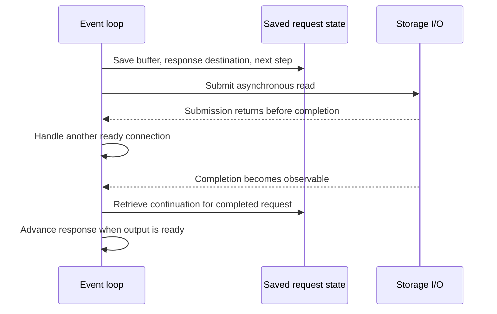

# Event loops: explicit scheduling, explicit state

> An event loop coordinates many in-flight operations with short handlers rather than a thread for each activity. It removes some interleavings by accepting responsibility for scheduling and suspended state.

Source: Chapter 33, *Event-based Concurrency (Advanced)*, PDF pages 394–403; closing lessons from Chapter 34, *Summary Dialogue on Concurrency*, pages 404–405.

## Handle events one at a time

Threaded applications delegate execution order to the OS. An **event-based** application waits for events, chooses one, runs a short handler, and returns to the loop. Handlers consume input, advance requests, issue I/O, or arrange later processing.

A single event-loop thread does not run ordinary handlers concurrently. It can have many unfinished requests without giving each request an independently executing thread. Choosing the next handler is application-level scheduling; a long handler delays everything waiting behind it.

A server might accept a connection, process an arrived request, and send another response in successive handlers. Requests overlap while waiting for I/O, but their CPU portions are serialized.

## Readiness APIs provide the events

The chapter uses `select()` and `poll()` to discover I/O readiness. With `select()`, the application supplies sets of descriptors to inspect for reading, writing, and exceptional conditions. The `nfds` argument specifies an exclusive upper bound: descriptors from zero through `nfds - 1` are considered. On return, the sets identify the descriptors ready for the requested operations.

Prepare interest sets with operations such as `FD_ZERO` and `FD_SET`, then inspect returned sets with `FD_ISSET`. Rebuild them next iteration because the call changes them. Readiness identifies available input or output capacity, not completion of an application request.

A `NULL` timeout waits indefinitely for readiness. A zero timeout checks and returns immediately. Repeated immediate checks can waste CPU when no useful event exists. Waiting for events while the application has no runnable work is different from blocking inside one active request and preventing other ready work from running.

## Why the single-loop model avoids some locks

Serialized handlers need no lock to exclude other ordinary handlers on the same loop. OS preemption does not create another application handler mutating their state. This benefit relies on controlled ownership; not every event-based system is race-free.

The cost appears when one handler must wait. A blocking file operation can stop the sole event-loop thread. A thread-based server can run another worker while one sleeps on I/O; the pure single-loop server has no such worker to take over. Both opening a file and reading its data can require storage access if needed metadata or data is not cached.

## Asynchronous I/O separates submission from completion

An asynchronous I/O interface starts an operation and returns before it finishes. The chapter's example uses an AIO control block containing the file descriptor, file offset, destination buffer, and transfer length. After populating it, the application submits with `aio_read()` and continues serving other events.

Completion is separate: `aio_error()` reports `EINPROGRESS` while outstanding and zero for successful completion. Submission success is not completion success. Retain request state and handle failures according to the interface contract.

Checking many outstanding requests repeatedly adds polling work. The source also discusses completion notification through UNIX signals: a signal can interrupt process execution to invoke a configured signal handler, after which execution resumes. Signals are a separate mechanism from condition-variable signals, despite the shared word.

A hybrid can combine event-driven networking with a thread pool for blocking storage work when asynchronous interfaces are unavailable. It does not make blocking safe on the loop itself. Nonblocking calls avoid waiting in the caller; asynchronous operations separate submission from completion. Keep the loop available for other ready work.

## A continuation replaces the suspended stack

A thread blocked in a read still has its local variables and return path on its stack. When it resumes, it already knows which client should receive the data. Splitting that operation into event handlers loses this implicit storage of what happens next.

A **continuation** records enough state to finish later. For a document download, save the output socket, buffer, and next step in a request record; retrieve it on completion. The source calls this **manual stack management**, a central complexity cost.

## Events do not eliminate system constraints

A single loop cannot use several CPUs for simultaneous handler execution. Running multiple handlers in parallel restores ordinary shared-state synchronization requirements where their data overlaps. Even carefully avoiding explicit blocking calls cannot prevent every implicit stall: a handler's page fault can block the loop while the OS fetches the page.

Maintenance also matters. A formerly nonblocking helper can become blocking, forcing its caller to split into submission and continuation stages. The chapter describes historical networking-readiness and storage-AIO interfaces that do not compose as uniformly as a programmer might wish; these are its interface examples, not a survey of all later OS facilities.

The closing dialogue offers the broader design rule: use concurrency only for a real need, keep interactions simple, and prefer established patterns such as protected state and producer–consumer queues. When appropriate, restricted models such as MapReduce expose useful parallelism without making application authors manage arbitrary lock interactions. Events and threads remain trade-offs, not a winner and an obsolete alternative. See [synchronous and asynchronous communication](../../system-design/1-knowledge/communication/sync-vs-async.md).

## What to take away

- Keep handlers short; an event loop owns the scheduling responsibility it removes from the OS.
- Distinguish readiness, successful submission, and successful completion.
- Preserve continuation state explicitly whenever work spans several handlers.
- Audit blocking behavior, page-fault exposure, and shared state before scaling loops across CPUs.

---

Previous: [Concurrency bugs](32-concurrency-bugs.md) · Next: [Persistence](../4-persistence/README.md)
