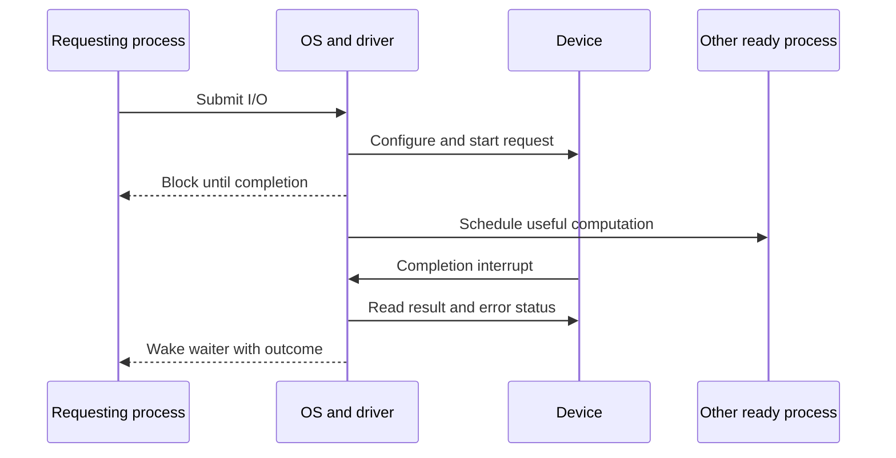

# I/O Devices: Let Hardware Work While the CPU Computes

> Device interfaces turn physical activity into software protocols. Efficient I/O separates waiting for completion from moving bytes, then hides hardware-specific details behind drivers.

Source: Chapter 36, “I/O Devices,” PDF pp. 410–422. The opening perspective also incorporates Chapter 35, “A Dialogue on Persistence,” PDF pp. 408–409.

## Devices live in a hierarchy

Persistence means retaining information despite power loss, crashes, and failed hardware—not merely storing it somewhere outside a process. Before a file system can provide that promise, the operating system must communicate with devices whose timing and failure behavior differ from ordinary memory.

The chapter's system architecture places the CPU and memory on a fast interconnect, higher-bandwidth devices on a general I/O bus, and slower peripherals behind additional buses. This hierarchy reflects physics and cost: fast connections are expensive and have tighter physical constraints. A mouse does not need the same connection as a graphics device. The particular bus names in this historical model are less important than matching connectivity to the device's performance needs.

A device has an external **interface** and an internal **implementation**. The interface might be a handful of registers; behind it could be a controller CPU, memory, firmware, and specialized hardware. Software should rely on the interface protocol rather than guessing what happens internally.

## A simple protocol exposes two different costs

Consider an imaginary controller with three registers. **Status** reports readiness and errors, **data** carries bytes, and **command** starts an operation. The OS first waits until the device is ready, supplies data, issues a command, and waits until the operation finishes.

Repeatedly reading status is **polling**. When the CPU explicitly transfers each word through the data register, the movement is **programmed I/O**, or **PIO**. These are different choices: polling concerns completion notification; PIO concerns who moves the bytes.

For example, an application submits a 32-KiB export. A polling implementation may occupy a core while the controller works. A PIO implementation also occupies the CPU while it copies the export into device registers. Fixing one cost does not automatically fix the other.

## Interrupts replace long waits, not every wait

With an interrupt-driven protocol, the OS submits a request, blocks the requesting process, and runs another ready process. On completion, hardware interrupts the CPU. An **interrupt service routine** checks the result, finishes the request, and wakes its waiter. Computation and device activity can now overlap.

Interrupts have handling and scheduling overhead. If a device usually finishes before the first status check, polling may be cheaper than sleeping and waking. A hybrid polls briefly and switches to interrupts for longer waits.

At the other extreme, a packet storm can cause **livelock**: the machine services interrupts continuously but does not schedule the application that needs to consume the packets. Polling under software control can restore that scheduling balance. **Interrupt coalescing** batches several completions into one notification. It lowers CPU overhead but adds latency while the device waits to form a batch.

## DMA removes the CPU from bulk movement

**Direct memory access**, or **DMA**, lets a dedicated engine transfer between memory and a device. The OS configures the memory address, transfer length, and destination; hardware performs the copy and reports completion. The CPU can execute another process during the transfer instead of issuing a long series of data-register writes.

For the export above, DMA still requires CPU setup and completion handling. It does not make the physical transfer instantaneous. Its benefit is freeing the CPU from a repetitive movement task. DMA and interrupts commonly work together, but one describes the data path and the other the notification path.

## Register access and driver abstraction

Software reaches device registers through either explicit I/O instructions, such as x86 `in` and `out`, or **memory-mapped I/O**. In the latter case, a load or store to a designated address reaches hardware registers rather than RAM. Direct access must remain protected: unrestricted disk commands would bypass file permissions and let an application overwrite the system.

A **device driver** implements the specific protocol. Above it, a file system can request generic block reads and writes without knowing which controller is attached. This makes hardware replacement practical, but a common interface may discard useful capabilities or detailed errors. Driver correctness also matters disproportionately because drivers execute privileged, hardware-dependent code.

The chapter's IDE example illustrates a reusable lifecycle: queue a request, wait for readiness, program its address and size, start it, transfer data at the appropriate point, inspect completion errors, wake the waiting process, and start the next queued request. A write and a read do not necessarily move data at the same phase. Although IDE is a historical example, that distinction remains useful when reading a driver's state machine. Interrupts and DMA themselves are longstanding ideas; the source notes uncertainty about which early machines introduced particular variants.

See also [I/O systems](../../operating-systems/1-knowledge/storage-fs/io-systems.md) and [interrupts and traps](../../operating-systems/1-knowledge/fundamentals/interrupts-and-traps.md).

## What to take away

- Separate completion strategy—polling or interrupts—from byte movement—PIO or DMA.
- Compare notification overhead with actual device latency before choosing a waiting strategy.
- Under heavy interrupt load, check whether applications still receive CPU time.
- Keep hardware protocols inside drivers, without silently discarding errors that higher layers need.

---

Previous: [Persistence](./README.md) · Next: [Hard disks](./37-hard-disks.md)
