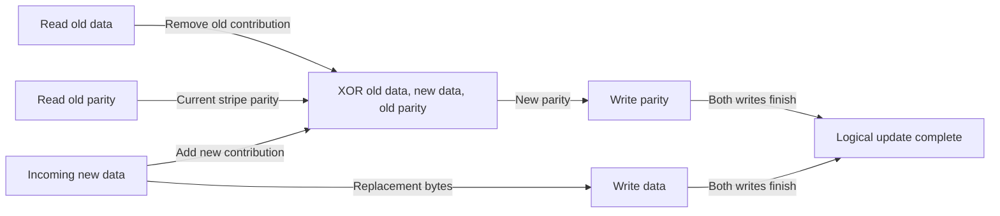

# RAID: Trade Capacity for Recovery and Parallelism

> Combining disks can increase capacity, throughput, and fault tolerance, but not all three for free. The right comparison starts with the failure model and the workload's physical I/O costs.

Source: Chapter 38, “Redundant Arrays of Inexpensive Disks (RAIDs),” PDF pp. 440–458.

## One logical disk, several physical requests

A **RAID** exports the same logical block interface as a disk. Internally, its controller maps each request to one or more disks, buffers data, and may calculate parity. A hardware array is effectively a specialized computer with firmware and memory; software can implement the same mapping above ordinary disks.

This transparency makes deployment easier: a file system can use an array without rewriting its application-facing APIs. It does not eliminate the need to understand what lies below that interface. A logical write might generate several physical reads and writes.

The chapter assumes **fail-stop disks**: a disk either works correctly or becomes permanently unavailable, and the controller can identify the failed disk. Silent corruption and unreadable sectors on otherwise working disks are excluded from this first analysis. They return in [data integrity](./44-data-integrity.md). In particular, parity reconstruction assumes the remaining inputs are readable and correct.

Evaluate arrays on useful capacity, tolerable failures, single-request latency, and steady-state throughput. Those last two are different: using more disks can increase the rate of independent requests without making one small request faster.

## RAID 0: striping buys parallelism, not redundancy

**Striping** distributes successive chunks across disks. A **chunk** is the contiguous allocation on one disk before moving to another; a **stripe** comprises corresponding chunks across the participating disks.

For one-block chunks on `N` disks, logical block `A` maps to disk `A mod N`, at local block offset `floor(A / N)`. With six disks, logical block 23 maps to disk 5, local offset 3. Larger chunks change the mapping and the performance balance.

Small chunks expose more parallelism within a file, but a request spanning disks waits for the slowest participating operation. Large chunks reduce that fan-out and depend more on concurrent requests to keep all disks busy.

RAID 0 offers all raw capacity and no failure tolerance: losing one disk loses part of the logical volume. In the chapter's balanced ideal model, its throughput scales with the number of disks for both sequential and random workloads. One small request still reaches only one disk.

## RAID 1: duplicate blocks and choose a read copy

**Mirroring** stores a block on two different disks. A read chooses either copy; a write must update both. The chapter analyzes striping over mirrored pairs, also called **RAID 10**, and distinguishes that arrangement from mirroring two striped arrays, **RAID 01**.

Six 2-TiB disks provide 12 TiB with striping but 6 TiB with two-copy mirroring. Any one disk may fail without losing data. Multiple failures survive only if every pair retains a copy: losing one member from each pair is different from losing both members of a single pair.

Mirrored writes proceed in parallel but finish only when both copies finish. Under balanced random reads, every disk can serve useful work; random writes consume two physical writes per logical write. For the chapter's block-striped sequential workload, alternating reads between mirror members skips sectors on each disk, so using all disks does not automatically produce all their sequential bandwidth.

There is also a **consistent-update problem**: power loss can interrupt a write after one mirror changes but before the other does. A durable write-ahead record lets recovery finish the operation. Hardware controllers may use nonvolatile or battery-backed memory for that record rather than adding a disk-log write to every request.

## RAID 4: parity saves capacity but taxes small writes

Parity uses bitwise XOR. For three data blocks, `P = D0 XOR D1 XOR D2`; if `D1` is lost, `D1 = P XOR D0 XOR D2`. The missing location must be known. This is reconstruction of one unavailable input, not a general mechanism for identifying which returned value is wrong.

RAID 4 dedicates one disk to parity. Six 2-TiB disks therefore provide 10 TiB and tolerate one disk failure. A **full-stripe write** computes parity from all new data and writes data and parity in parallel, avoiding reads of the old stripe.

A small update has two options. **Additive parity** reads the other data blocks and combines them with the replacement. **Subtractive parity**, or read-modify-write, reads old data and old parity, then computes:

`new parity = old parity XOR old data XOR new data`

Read-modify-write costs four physical I/Os. Its read pair precedes its write pair, so latency is roughly two disk-service phases. Worse, every small write accesses the same parity disk. That bottleneck does not disappear when more data disks are added.

## RAID 5 distributes the bottleneck, not the work

RAID 5 rotates parity placement across disks. Capacity and one-disk failure tolerance remain the same as RAID 4. Sequential full-stripe behavior is similar, but independent small updates can involve different disk pairs. In a balanced ideal random-write workload, four physical operations per logical write still limit throughput to roughly one-quarter of the aggregate disk-operation budget.

These are simplified workload models, not product benchmarks. Reconstruction, hot spares, additional parity such as RAID 6, partial failures, and controller persistence change the operational picture. Mirroring favors random I/O at a capacity cost; single-parity arrays favor space efficiency and large writes at a small-write cost. See also [RAID](../../operating-systems/1-knowledge/storage-fs/raid.md).

## What to take away

- State the fault model before claiming that an array tolerates a failure.
- Count physical I/Os and their dependency phases, not just logical requests.
- Prefer full-stripe writes when using parity and the workload permits batching.
- Include interrupted multi-disk updates and reconstruction behavior in the design.

---

Previous: [Hard disks](./37-hard-disks.md) · Next: [Files and directories](./39-files-directories.md)
