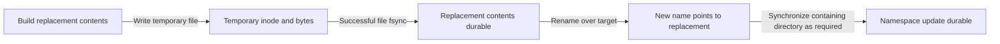

# Files and Directories: Names, Handles, and Durability

> The file-system API separates human-readable names from stored objects and open handles. Correct use requires distinguishing successful access, atomic namespace changes, and durable storage.

Source: Chapter 39, “Interlude: Files and Directories,” PDF pp. 459–477.

## A byte array and a naming hierarchy

A **file** is a linear array of bytes. The file system normally does not interpret those bytes: an extension such as `.png` is a naming convention, not proof of an image's contents. A file also has a low-level identity, commonly an **inode number**.

A **directory** maps readable names to low-level identities. Directories can refer to other directories, producing a hierarchy rooted at `/`. An absolute path begins there; a relative path begins from the current working directory. Names need be unique within a directory, not across the entire tree. `/reports/current` and `/exports/current` may identify different files.

This naming scheme extends beyond ordinary disk files. Devices and interfaces such as process information can appear in the same tree. Uniform naming simplifies access while leaving the underlying implementation free to vary.

## Opening creates a handle, not another name

`open()` selects an existing file or creates one with `O_CREAT`, returning a **file descriptor**: a process-local integer used for later operations. `O_RDONLY` and `O_WRONLY` select access modes; `O_TRUNC` discards the previous contents of an existing file. The older `creat()` interface corresponds to creating a writable, truncated file.

For example, `open("report.tmp", O_CREAT | O_WRONLY | O_TRUNC, 0600)` requests a fresh writable report with restricted requested permissions. Real code must check errors; creation also requires a permissions argument, even though some simplified examples omit it.

Standard input, standard output, and standard error conventionally occupy descriptors 0, 1, and 2. A newly opened file often gets 3, but programs should use the returned descriptor rather than assume that number. The descriptor is a handle authorizing operations, not the file's persistent identity.

`read()` fills a supplied buffer and returns the number of bytes obtained; zero indicates end-of-file. `write()` similarly reports bytes written. A requested buffer size is not a promise that one call transfers that much. `close()` releases the handle when access is finished.

The chapter recommends system-call tracing to reveal these operations. For example, tracing a directory listing distinguishes enumeration from the additional metadata requests used for a detailed listing. `strace` can also follow child processes or filter particular calls.

## Logical offsets are not physical seeks

An open file has a current byte offset. Successful sequential reads and writes advance it by the bytes transferred. `lseek()` changes it explicitly: `SEEK_SET` uses a position from the beginning, `SEEK_CUR` adjusts the current position, and `SEEK_END` positions relative to file length.

To inspect the final 256 bytes of a sufficiently large file, an application can position at `-256` relative to the end and then read. The `lseek()` itself changes kernel state; it does not move a disk head or perform storage I/O. The subsequent read may require a physical seek, or may be served entirely from cache.

## Buffering, synchronization, and replacement

A successful `write()` often means that the OS accepted bytes into memory. Write buffering improves performance, but a crash before persistence can lose them. `fsync(fd)` requests that the file's dirty data and necessary metadata become durable before it returns successfully. A newly created name may additionally require synchronization of its containing directory.

`rename()` changes the namespace atomically in the supported circumstances: observers should not see a half-renamed file. Atomicity is not the same question as post-crash durability, and actual guarantees depend on the file system.

For a settings update, writing and synchronizing a temporary file before replacing the target prevents exposing a partly rewritten target. The chapter's replacement pattern must be read alongside its warning about directory synchronization; merely calling `close()` is not a persistence protocol.

## Metadata, directories, and links

`stat()` retrieves metadata by pathname; `fstat()` uses a descriptor. Useful fields include inode number, ownership, permissions, logical byte length, allocated blocks, link count, and timestamps. Logical length and allocated storage are different measurements.

`mkdir()` creates a directory. Its conventional `.` and `..` entries refer to itself and its parent. `opendir()`, `readdir()`, and `closedir()` enumerate entries; detailed file information may require separate metadata queries. Ordinary applications do not directly rewrite directory data. `rmdir()` requires an empty directory rather than silently removing an entire subtree.

A **hard link** adds another directory name for the same inode. It does not copy contents, and neither name is privileged as the original. `unlink()` removes one name and decrements the link count; reclamation also waits for outstanding open references. Thus deleting `/reports/current` need not remove the object if another hard link still names it. Normal hard links cannot cross file systems or create arbitrary directory cycles.

A **symbolic link** is instead a distinct object storing a pathname. It can name another directory or another mounted file system, but the target can disappear, leaving a dangling link. Removing its target does not rewrite the link.

Finally, `mkfs` initializes a file system on a device, while `mount` attaches its root at a directory in the existing namespace. Mounting an archive volume at `/archive` makes its contents accessible beneath that path without giving it a separate global naming scheme. See [file systems](../../operating-systems/1-knowledge/storage-fs/file-systems.md).

## What to take away

- Keep pathname, inode identity, and file descriptor distinct in your mental model.
- Check transfer results rather than equating requested bytes with completed bytes.
- Use explicit file and directory synchronization when the application needs durable updates.
- Treat hard links as additional names and symlinks as potentially dangling pathname references.

---

Previous: [RAID](./38-raid.md) · Next: [File-system implementation](./40-file-system-implementation.md)
