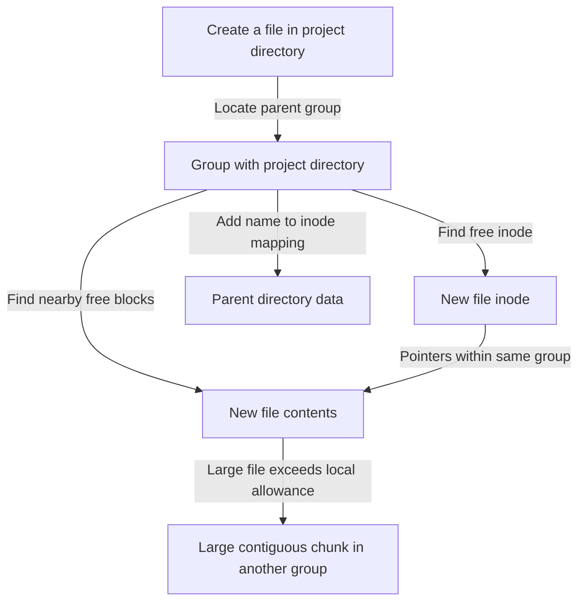

# FFS: Place Related Data Near Its Metadata

> The Fast File System improved performance without changing the familiar file API. Its central lesson is to choose persistent layouts using the storage medium's real costs, rather than treating a disk like RAM.

Source: Chapter 41, “Locality and The Fast File System,” PDF pp. 496–507.

## Why a correct file system can still be slow

The old Unix file system kept a centralized inode region and allocated data through a free list. It supported files and directories, but the source reports very low utilization of the disk's available bandwidth as layouts aged.

Three issues interacted. Inodes could be far from their data, so reading metadata followed by contents caused a long seek. A free list could become scattered after allocations and deletions, turning a logically sequential file into physically separated pieces. Small blocks reduced wasted space inside allocations but did little to amortize positioning costs.

For example, suppose deleting several temporary build outputs leaves two free runs separated by a live archive. A new file larger than either run can occupy both. Reading it now requires transferring one run, repositioning, and transferring the other. Having enough total free bytes is not the same as having a useful contiguous allocation.

FFS retained the existing calls such as `open()`, `read()`, and `write()`, while changing the on-disk organization and placement policies. Preserving the interface allowed applications to benefit without being rewritten.

## Groups make locality possible

FFS divides the device into **cylinder groups**. A cylinder contains tracks at the same radius across different surfaces; a group combines neighboring cylinders. When drives hide geometry, the same idea becomes a **block group**, a consecutive region in the exported logical address space.

Each group contains local allocation bitmaps, inode space, data space, and a copy of the superblock. Local metadata makes it possible to keep an object's inode near its contents. Bitmaps help find contiguous free runs more directly than a scattered free list. Multiple superblock copies also provide an alternate mount-time description if one copy is damaged.

The grouped layout does not eliminate metadata work. Creating a one-block file still changes allocation information, its inode and data, and the parent directory's metadata. It reduces the distance between related updates and accesses.

## Policies decide what is related

For a new directory, FFS looks for a group with relatively few directories and many free inodes. Spreading directories avoids filling every group with unrelated branches while leaving room for each directory's future children.

For ordinary files, two heuristics apply: place data in the same group as its inode, and place files in the group of their parent directory. A compiler accessing several source files in one directory benefits because the likely sequence of opens stays near the same part of the disk.

These heuristics are plausible rather than universal. The chapter checks **namespace locality** using access traces. Reopening the same file has distance zero; opening a sibling file has distance one; accesses in sibling subdirectories share a more distant ancestor. The traces support substantial same-directory locality but also expose cases that FFS does not capture well.

For example, a build alternating between `project/source/module.c` and `project/output/module.o` crosses sibling directories. Keeping each directory's files together does not necessarily keep this particular pair together. A placement policy should be judged against the access relationships of its workload, not just how tidy the namespace appears.

## Large files need a controlled exception

Putting all of a large file in its initial group could consume the space needed for future related files. FFS therefore keeps an initial portion local, then distributes subsequent large chunks into other groups. The historical policy follows the inode's structure: direct blocks remain near the inode, while indirect blocks and the data they describe can occupy other groups.

This deliberately adds positioning between chunks, so the chunks must be large enough to amortize it. If positioning costs `p` seconds, peak transfer rate is `R`, and a chunk contains `D` units of data, effective bandwidth is:

`D / (p + D / R)`

To reach a fraction `F` of peak bandwidth, solve for:

`D = (F / (1 - F)) × R × p`

For an original example, let `p = 8 ms` and `R = 200 MiB/s`. Reaching 80% of peak requires `4 × 200 × 0.008 = 6.4 MiB` per positioning event. Reaching 95% requires `19 × 200 × 0.008 = 30.4 MiB`. Approaching peak performance needs disproportionately larger chunks, not merely a slightly larger block size.

## Space efficiency and historical device awareness

Large blocks create **internal fragmentation** for small files. FFS introduced smaller **sub-blocks** to store short contents more economically. A 1.5-KiB file could occupy three 512-byte sub-blocks instead of a whole 4-KiB block. Growth can require copying fragments into a complete block and releasing the old fragments. Buffering application writes into block-sized units reduces that conversion work.

Historical FFS also parameterized sector placement to leave enough rotational time between sequential requests. Placing logically consecutive blocks a little apart could avoid missing the next sector and waiting a full revolution. Smarter drives with track buffers made much of this host-side geometry management unnecessary. The lasting rule is awareness of device behavior, not preserving every historical optimization.

FFS also improved usability through longer names, symbolic links, and atomic rename. These features mattered alongside throughput: preserving a useful interface and making ordinary tasks easier can be as important to adoption as a sophisticated allocation policy.

## What to take away

- Keep frequently accessed data near the metadata required to locate it.
- Measure namespace locality before assuming directories capture all access relationships.
- Preserve room for related future allocations instead of letting one large file consume it.
- Size chunks using positioning amortization, with explicit and consistent units.

---

Previous: [File-system implementation](./40-file-system-implementation.md) · Next: [Crash consistency](./42-crash-consistency.md)
