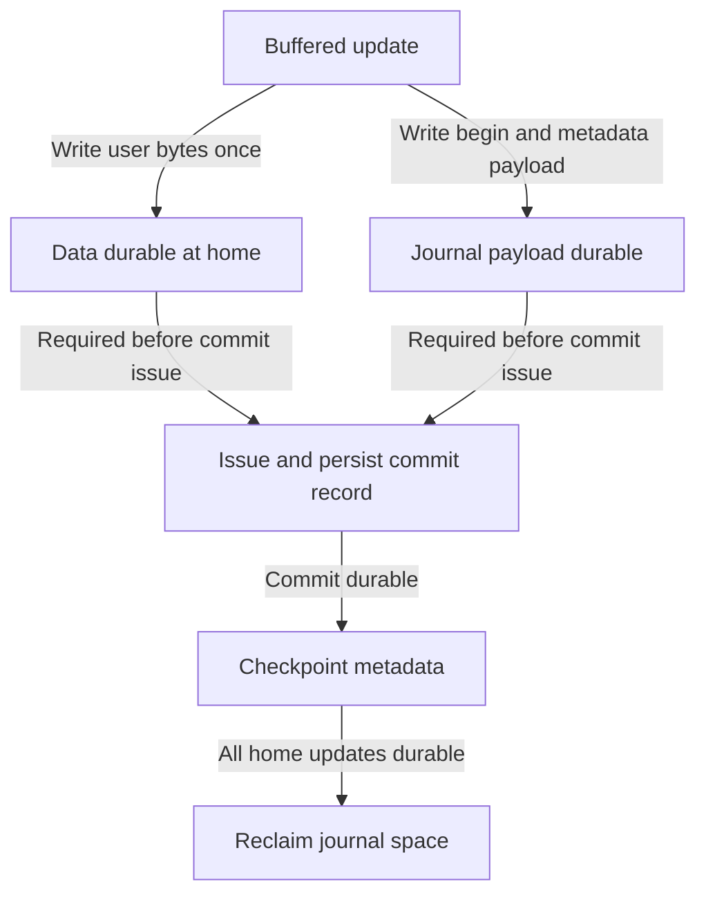

# Crash Consistency: Make Recovery Part of the Write Protocol

> Persistent structures can outlive a crash in a partly updated state. Journaling makes recovery local and repeatable by recording a committed update before installing it in its final locations.

Source: Chapter 42, “Crash Consistency: FSCK and Journaling,” PDF pp. 508–527.

## The problem is a partially completed transition

Appending a new block changes at least its contents, an inode pointer and length, and an allocation bitmap. These updates are not one atomic disk operation. If a crash interrupts them, persistent structures can disagree.

Imagine adding block 17 to a file. Persisting only the inode makes the file point to old contents in a block still marked free. Persisting only the bitmap leaks space. Persisting the inode and bitmap without the data creates a subtler failure: metadata is internally consistent, but reading the appended bytes returns unrelated old data. Conversely, writing only the data can leave a structurally consistent file system with the append absent.

Thus **metadata consistency** and **user-data durability** are different goals. A valid file-system structure does not prove that an application's last write survived.

## FSCK repairs structure after the fact

A **file-system checker**, or **fsck**, reconstructs a consistent view while the file system is not serving concurrent operations. It checks the superblock for plausibility, rebuilds free-space information from allocated objects, validates inode states, recounts directory links, detects duplicate block ownership, removes out-of-range block pointers, and checks directory structure. An allocated inode with no name may be recovered into `lost+found`.

This requires intimate knowledge of the format and decisions about which conflicting information to trust. It cannot recreate arbitrary user bytes that never reached storage. Its other weakness is scale: scanning the metadata of a large volume can take far longer than the interrupted update that caused the problem.

## Write ahead, commit, then checkpoint

**Journaling**, also called **write-ahead logging**, records an update in a known log before overwriting its home locations. Recovery then examines that log rather than searching the entire volume.

In **physical logging**, the journal stores the exact replacement blocks and their destination addresses. **Logical logging** records operations instead; it can be smaller but requires more interpretation during recovery. The chapter's protocol uses physical **redo logging**.

A transaction contains a begin record, replacement contents, and an end or commit record carrying a matching transaction identifier. **Checkpointing** copies the committed replacements from the journal to their final locations. Merely submitting all these writes together is unsafe: the device might persist the commit record before part of the payload.

For full **data journaling**, the necessary dependencies are:

1. Write the begin record, data, and metadata into the journal; make them durable.
2. Write an atomic commit record; make it durable.
3. Checkpoint data and metadata to their home locations.
4. After checkpoint completion, reclaim the transaction's journal space.

The source makes its commit record fit the modeled atomic 512-byte write. Real implementations must establish their own atomic-write assumption. Device write caches also mean that an acknowledgment need not prove persistence; barriers and the required durable-write controls must enforce the protocol, and the device must honor them.

Before commitment, recovery ignores an incomplete transaction. After commitment, it replays replacement blocks in transaction order, even if some checkpoint writes already completed. Rewriting the same physical contents is safe. Recovery itself may also be interrupted and repeated.

## A finite journal needs reclamation

A journal cannot grow forever. A circular log reuses space once its transaction has been fully checkpointed; a journal superblock tracks the relevant live range. Freeing it earlier would discard the only complete recovery record while home locations might still disagree.

Batching several operations into one transaction avoids repeatedly logging the same dirty bitmap, inode block, or directory block. The trade-off is delayed commitment. Full data journaling also writes user data twice, once to the journal and again to its home, adding traffic and positioning costs.

The source describes a transaction-checksum optimization: recovery can reject an incomplete payload even when begin and end records exist. This permits a less serialized journal write. Checksums reduce undetected incompleteness; they are not mathematically collision-free, and do not remove every storage-ordering requirement.

## Ordered metadata journaling writes user data once

**Metadata journaling** records structural updates but not ordinary file contents. Directory contents still count as metadata. Without additional ordering, committed metadata could point to an unwritten new data block.

**Ordered journaling** prevents that exposure by requiring both the home data write and the journal's metadata payload to become durable before issuing the commit record. The two prerequisites may proceed concurrently; data need not finish before metadata-log writing begins.

Unordered metadata journaling preserves structural consistency but offers weaker data semantics. Ordered mode's protection for newly exposed data is not an application-level all-or-nothing guarantee for arbitrary overwrites or multi-file transactions. Choose guarantees, not just a mode name.

## Reused blocks change the meaning of old log records

Suppose a directory block is journaled, freed, then reused as unjournaled regular-file data. After a crash, blindly replaying the old directory image would overwrite the new file's contents.

One solution delays reuse until the deletion is checkpointed. Ext3 instead uses **revoke records**: recovery first identifies revoked blocks and suppresses obsolete replay for them. Transaction order alone is insufficient when a later data write was never logged.

## Other approaches move the complexity

**Soft Updates** orders writes according to detailed structural dependencies, such as persisting a target before its pointer. It avoids some logging costs but requires intricate format knowledge.

**Copy-on-write** writes replacements to unused locations and later publishes a new root, preserving the old reachable structure until publication. [LFS](./43-lfs.md) develops this direction.

**Backpointer-based consistency** records ownership in blocks and checks that forward and backward references agree when accessed; inconsistency becomes an error instead of requiring every write to be ordered. **Optimistic crash consistency** uses generalized checksums and fewer waits to detect incomplete updates, but the source notes additional interface requirements. None makes recovery irrelevant; each chooses where to pay its cost.

## What to take away

- Separate structural consistency, durable bytes, and application transaction atomicity.
- Draw durable-write dependencies; submission order alone is not a recovery proof.
- Do not reclaim journal space until every required checkpoint write is durable.
- Include block deletion and reuse when reasoning about journal replay.

---

Previous: [FFS and locality](./41-ffs.md) · Next: [Log-structured file systems](./43-lfs.md)
