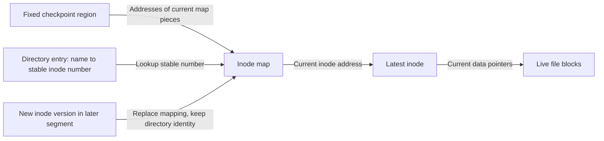

# LFS: Turn Scattered Updates into Sequential Writes

> A log-structured file system writes new versions together rather than updating blocks in place. Indirection preserves stable names; cleaning recovers the space left behind by obsolete versions.

Source: Chapter 43, “Log-structured File Systems,” PDF pp. 528–542.

## Why optimize the write path?

The chapter motivates **LFS** with four observations. Larger memories serve more reads from cache, leaving disk traffic increasingly write-heavy. Sequential hard-disk bandwidth greatly exceeds small random-I/O bandwidth. Existing file systems still perform many separate metadata writes for small operations. Parity RAID amplifies those small writes further.

For example, creating a short file updates its contents, inode, allocation information, and parent directory. Keeping those structures near one another helps, but separate requests can still pay repeated positioning costs. LFS instead buffers data and metadata together and writes them sequentially to an unused region. The log contains the actual file-system state, not merely a journal that will later be copied to fixed home locations.

## Adjacency alone is not enough

Writing block `A` and then, much later, block `A+1` does not ensure efficient disk use. The next sector may already have rotated past the head before the second request arrives. LFS therefore groups updates into a large in-memory **segment** and transfers that segment as contiguous work.

Buffering amortizes a positioning cost rather than abolishing it. With positioning time `p`, peak transfer rate `R`, and segment size `D`, effective bandwidth is `D / (p + D / R)`. To obtain fraction `F` of peak, choose `D = F / (1 - F) × R × p`.

For a hypothetical device with `p = 12 ms` and `R = 150 MiB/s`, reaching 90% requires `9 × 150 × 0.012 = 16.2 MiB`. A forced synchronous update may prevent filling such a segment, so this calculation describes the batching opportunity, not a promise for every workload. Larger batches can also make unrelated reads wait behind bursts of writes, a cost the source's references discuss.

## Moving inodes requires stable indirection

Traditional inode tables make finding an inode easy because its number identifies a fixed table position. LFS moves an inode whenever it writes a new version. It therefore introduces an **inode map**, or **imap**, from stable inode number to the latest inode's disk address.

The imap must itself persist. Updating it at a fixed location after every file update would reintroduce scattered writes, so LFS writes changed imap pieces alongside data and inodes in the segment.

That leaves a bootstrapping problem: where are the latest imap pieces? A fixed **checkpoint region**, or **CR**, holds their addresses. It is updated periodically, rather than after every ordinary write.

After reading the CR, the chapter's model loads and caches the imap. Normal file reads then use the map to find the inode and use the inode's direct or indirect pointers as usual. The extra indirection need not add a disk I/O to each read when the map is cached.

Directories still contain names and inode numbers. They do not contain the changing physical addresses of their children's inodes. This avoids the **recursive update problem**: otherwise moving one inode would force rewriting its parent, the parent's parent, and so on to the root. Stable identity stops that cascade.

## Obsolete versions become garbage

An overwrite writes a new data block and a new inode, leaving the old versions unreachable from the current imap. An append differs: the old inode becomes obsolete, but old data blocks may remain live because the new inode still points to them. Age alone cannot tell the cleaner what is safe to discard.

LFS retains the current live state rather than automatically offering all old versions as snapshots. It must reclaim **garbage**. Freeing isolated obsolete blocks would leave small holes and destroy the supply of large sequential write regions.

Instead, a **segment cleaner** reads several partially occupied segments, copies their live blocks into fewer new segments, updates the necessary metadata, and frees the old segments. The cleaned space is again suitable for large writes. That work consumes bandwidth, so excellent foreground write behavior can coexist with expensive background maintenance.

## Liveness needs ownership information

A **segment summary block** identifies each stored data block's inode number and logical file-block offset. For a block at disk address `A`, the cleaner uses that summary to find the file through the current imap, then checks its current block pointer. If the pointer for that logical offset still equals `A`, the block is live. Otherwise this copy is obsolete.

For example, a summary says address 900 belongs to inode 21, file block 3. If the current inode now maps file block 3 to address 1400, address 900 is dead. If it still maps to 900, the cleaner must preserve it. Version numbers recorded in the imap and segment metadata can shortcut some checks after deletion or truncation.

Cleaning can run periodically, during idle time, or under space pressure. The original policy distinguishes frequently overwritten **hot** segments from relatively stable **cold** ones. Waiting on hot segments lets more blocks become obsolete before copying; cold segments with reclaimable space can be cleaned earlier. The choice trades recoverable free space against the cost of relocating live data, and later research improves these heuristics.

## Checkpoints and roll-forward recovery

A crash can interrupt either a segment write or a CR update. LFS keeps two checkpoint regions and alternates between them. A header and final block contain matching timestamps; recovery selects the newest consistent checkpoint rather than trusting a partly rewritten one.

That checkpoint may predate recent durable segments. **Roll forward** starts from its recorded log position, examines subsequent segments, and incorporates valid updates. It recovers work written since the checkpoint without assuming that every post-checkpoint byte is complete.

LFS's cleaning costs were disputed, including in comparisons by Seltzer and colleagues cited in the source. Its enduring contribution is the copy-on-write design family: related ideas appear in WAFL, ZFS, btrfs, and flash translation layers. Snapshots can make retained versions useful, but eventual reclamation still matters.

## What to take away

- Batch contiguous updates; adjacent addresses issued separately can still be slow.
- Separate stable object identity from a physical address when objects move.
- Determine liveness from current reachability, not a block's age.
- Include cleaning and checkpoint recovery in any performance or reliability claim.

---

Previous: [Crash consistency](./42-crash-consistency.md) · Next: [Data integrity](./44-data-integrity.md)
