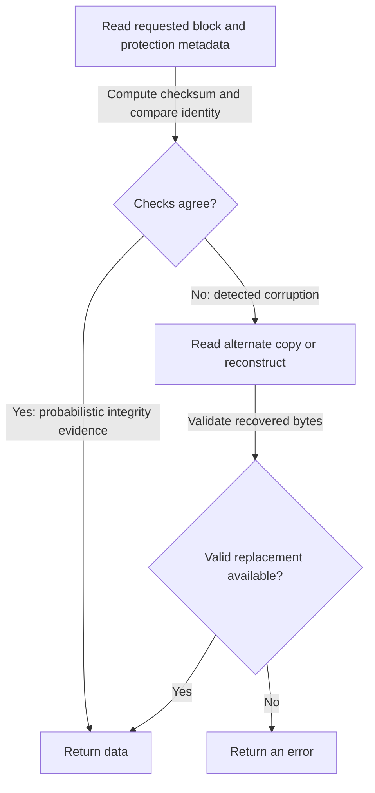

# Data Integrity: Detect the Wrong Bytes Before Repairing Them

> Redundancy can reconstruct missing data only when the system knows what is wrong and still has trustworthy inputs. Checksums, identity checks, and scrubbing extend protection beyond whole-disk failure.

Source: Chapter 44, “Data Integrity and Protection,” PDF pp. 543–555. The closing perspective incorporates Chapter 45, “Summary Dialogue on Persistence,” PDF pp. 556–557.

## A working disk can contain a failed block

The earlier RAID model assumed a disk worked correctly or failed completely and detectably. The **fail-partial** model adds block-level failures to that picture.

A **latent-sector error**, or **LSE**, becomes visible when an attempted access reports that the sector cannot be read. The drive's error-correcting code may detect or repair some damaged bits; an uncorrectable error reaches the storage software.

**Silent corruption** is different: an access succeeds but returns incorrect bytes. A faulty transfer path might alter data before the drive computes its own protection information. Buggy firmware might write valid bytes to the wrong address. Internal drive checks can then report success while the application receives the wrong contents.

The chapter's large-drive studies establish that both kinds occur, even with more expensive drives. Their findings also warn against assuming uniform, independent errors: failures show locality, earlier problems can signal future ones, and corruption varies across models. A whole-disk survival count is therefore an incomplete reliability argument.

## Redundancy handles detected missing data

For an LSE, the storage system knows which block is unavailable. A mirror can read another copy; a parity array can reconstruct from the stripe's remaining data and parity.

But a one-disk-tolerant array has already consumed its redundancy when a disk fails. If rebuilding that disk encounters an LSE in another member of the same stripe, there are two unknown inputs and single parity cannot recover both. Additional independent parity, as in the source's double-parity example, extends protection at a capacity and update cost. Reconstruction is not guaranteed simply because the unreadable sector is on an otherwise functioning disk.

## Checksums provide a detection mechanism

A **checksum** reduces a data block to a smaller summary. Store that summary when writing; recompute it when reading; compare the result to the stored value. A mismatch means the data or its protection information has changed. Agreement is evidence of integrity, not proof against every possible change.

The chapter surveys four families. XOR combines corresponding bits across chunks and is inexpensive, but two changes in the same bit position can cancel. Addition sums chunks while ignoring overflow; compensating changes or reordered chunks can evade it. The **Fletcher checksum** maintains both a running byte sum and a sum of those running sums modulo 255, giving more sensitivity to order. A **cyclic redundancy check**, or **CRC**, treats the bit sequence using a binary polynomial-division remainder, providing different error-detection properties.

For an original XOR example, take byte chunks `0x12` and `0x34`. Their XOR is `0x26`. Changing the same low bit in both produces `0x13` and `0x35`, whose XOR remains `0x26`. The payload changed while this checksum did not.

All compact checksums admit **collisions** because there are more possible blocks than summaries. The chapter's discussion of stronger functions should not be read as a universal promise for every block length or corruption pattern. Choose a function using its actual error properties and computation cost.

## Placement changes both protection and I/O cost

A drive can provide extra bytes beside each sector for protection information. Otherwise, a file system can pack many checksums into separate sectors. The latter works with ordinary sector interfaces but may require a checksum-sector read and an additional write when updating one data block. It also introduces consistency requirements between the bytes and their recorded checksum.

Detection alone cannot restore lost information. Without a valid redundant source, an error is more honest than returning corrupt bytes. Even an alternate copy should be validated rather than assumed good.

## The checksum must describe the right object and version

A **misdirected write** sends correct data and its checksum to the wrong location. Those two still agree, so a content checksum alone can miss the mistake. Adding a **physical identifier**, such as the expected disk and block address, lets the reader reject a valid-looking block that belongs elsewhere.

A **lost write** is acknowledged but never persists, leaving the previous contents in place. Their old checksum and physical identity may both be correct. A checksum stored beside the data therefore does not establish freshness.

One approach is read-after-write verification, at the cost of another I/O and with a need to observe persisted media rather than merely a cached copy. Another, illustrated by ZFS in the source, stores an expected child checksum in a parent inode or indirect block. If the parent update succeeds but the child's write is lost, the old child contents no longer match that expectation. If both updates disappear together, this protection can still fail. The location and independence of the expected value matter as much as the checksum algorithm.

## Scrubbing discovers faults before redundancy disappears

Many blocks are rarely read. Checking only on application access can let an unreadable or corrupt copy remain undiscovered until another copy fails. **Scrubbing** periodically reads the stored blocks and validates their protection information, allowing detected damage to be repaired while trustworthy redundancy remains.

Protection consumes disk space, memory, CPU, and background I/O. An 8-byte checksum per 4-KiB block adds `8 / 4096 × 100 = 0.1953125%` relative to the data bytes, before accounting for layout padding or identifiers. Combining copying and checksum computation can avoid an extra memory pass. Scheduling scrub work during quieter periods reduces interference but does not remove its bandwidth cost.

The closing dialogue ties these mechanisms together: persistence requires recovery reasoning that transient memory does not. Device-aware locality and log structuring remain useful as hardware changes; flash translation layers reuse related ideas. The enduring discipline is to ask what survives each failure, not merely whether the last API call succeeded.

## What to take away

- Model sector errors and silent corruption alongside complete disk loss.
- Distinguish content integrity, correct location, and freshness; one check does not establish all three.
- Validate recovery inputs and report an error when no trustworthy replacement remains.
- Scrub cold data before accumulating faults exhaust redundancy.

---

Previous: [Log-structured file systems](./43-lfs.md) · Next: [Distribution](../5-distribution/README.md)
