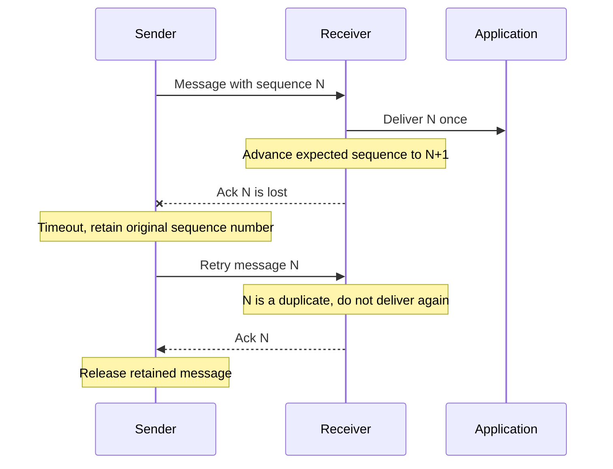
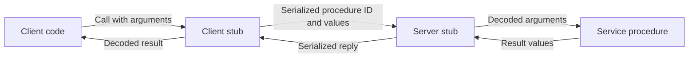

# Distributed systems: communication under failure

> A remote call crosses a boundary where messages can disappear and machines can stop independently. Reliable communication comes from explicit mechanisms, not from making the call look local.

Source: Chapter 47, *Distributed Systems*, PDF pages 560–574; introductory lessons from Chapter 46, *A Dialogue on Distribution*, pages 558–559.

## Why distribution changes the problem

A distributed system is a collection of cooperating machines. A browser contacting a server is a simple example; a service spread over many machines adds more opportunities for components to fail. Machines, disks, networks, and software can all fail without everything failing simultaneously. That creates both the central difficulty and the opportunity: replication and recovery can keep a service useful even when individual parts are unavailable.

Failure is not the only concern. Communication adds latency and consumes bandwidth, while security requires authenticating the remote party and protecting messages against observation or alteration. This chapter concentrates on communication rather than pretending to cover all of distributed systems.

## Messages start unreliable

Packets can be corrupted, encounter broken links, or reach an unavailable machine. Even healthy equipment drops packets when incoming traffic exceeds its available buffers. For example, several clients can send requests faster than one receiver can process them; a functioning network still cannot retain every request.

UDP exposes a datagram interface: an application creates a socket endpoint, sends a bounded message to an address and port, and receives messages from other endpoints. It does not promise delivery or notify the sender whenever a message disappears. A checksum can detect some corruption, but it neither recovers missing packets nor proves that application work completed. Stronger corruption detection also has computation costs.

Exposing unreliability can be appropriate when the application already knows how to handle it. Otherwise, a higher layer must provide more machinery.

## Acknowledgments, retries, and duplicates

An **acknowledgment**, or ack, tells a sender that the receiver obtained a message. The sender retains a copy and starts a timer. If the ack does not arrive before the **timeout**, it retransmits the retained message.

A lost request and a lost ack look identical to the sender. However, retrying after a lost ack delivers the request twice. A reliable delivery layer therefore needs duplicate detection as well as retransmission.

Keeping every identifier forever would require unbounded memory. The chapter's simplified ordered exchange instead uses a **sequence counter**: the receiver accepts its expected number, advances its counter, and acknowledges an older duplicate without passing it to the application again. This is a delivery mechanism, not proof that arbitrary remote operations execute exactly once through crashes.

TCP implements a much richer reliable transport, including handling multiple outstanding transmissions and network congestion. The simplified exchange is an explanation of its ingredients, not a complete TCP specification. For more detail, see [TCP](../../computer-networks/1-knowledge/transport-layer/tcp.md).

Timeout selection trades needless work against recovery delay. Too short creates redundant traffic; too long makes a lost request stall the caller. Under overload, immediate repeated retries worsen the congestion that caused loss. Increasing the wait after failures, as in exponential backoff, reduces this feedback loop.

## Choosing an abstraction

**Distributed shared memory** extends a virtual address space across machines. A local page is cheap to access; a remote page faults, is fetched over the network, and is installed before execution continues. This hides a major performance distinction inside an ordinary memory access. Failure is awkward too: a linked structure can become unusable when a machine holding some of its pages disappears. The chapter presents these as reasons this abstraction did not become the mainstream basis for reliable distributed services.

**Remote procedure call**, or RPC, instead exposes a service as callable procedures. The caller invokes a function and eventually receives results. Two pieces implement the illusion: generated stubs and a run-time library. The syntax becomes convenient, but latency and partial failure remain real.

## Generated stubs move values, not addresses

A protocol compiler takes the service's declared interface and generates client and server stubs. The client stub creates a message buffer, packages a procedure identifier and arguments, sends the request, waits, unpacks the reply, and returns. Packaging is **marshaling**, also called serialization; unpacking is unmarshaling or deserialization.

A pointer into client memory is not useful as a server address. For example, uploading a buffer requires transmitting its contents and length, not merely its numeric pointer. Known buffer types or interface annotations tell the generator what to serialize.

Servers commonly dispatch requests to a fixed thread pool so one blocked I/O operation does not stop all service. That improves utilization but introduces ordinary shared-state synchronization requirements.

## The run time carries the hard details

The run time locates the service, for example through a hostname and port, and handles transport behavior. The source explains why some historical RPC systems used UDP: the RPC reply itself can acknowledge receipt, avoiding redundant acknowledgment traffic in a simple request/reply exchange. Reliability then belongs to the RPC implementation. Sequence numbering supports duplicate suppression, but execution guarantees must be stated with their failure assumptions; transport reliability alone is insufficient.

Long-running procedures may acknowledge receipt separately and answer progress queries so a slow operation is not mistaken for a lost request. Large arguments need fragmentation and reassembly. Machines with different byte orders need an agreed wire representation; Sun RPC's XDR supplies one, with conversion costs where necessary. Asynchronous RPC permits useful work while a request is outstanding, followed by an explicit wait to obtain its results.

Finally, the **end-to-end argument** distinguishes useful lower-layer reliability from application correctness. A reliably transported file can still be corrupted before transmission or during destination storage. Comparing the source with a checksum computed from the file read back at the destination checks the actual transfer outcome. Lower layers help, but cannot replace that check.

## What to take away

- Treat missing replies as ambiguous: the request, reply, or remote machine may have failed.
- Pair retries with duplicate detection or operations whose repeated effects are safe.
- Choose timeouts and backoff with overload in mind, not just nominal latency.
- Define serializable values and concurrency rules explicitly at RPC boundaries.
- Check correctness at the application endpoints, even when the transport is reliable.

---

Previous: [Distribution](README.md) · Next: [NFSv2](48-nfs.md)
