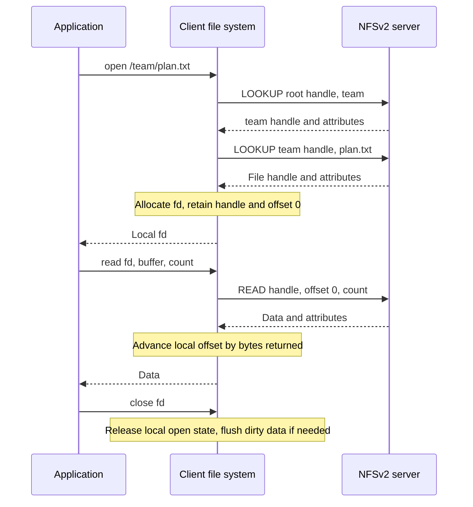
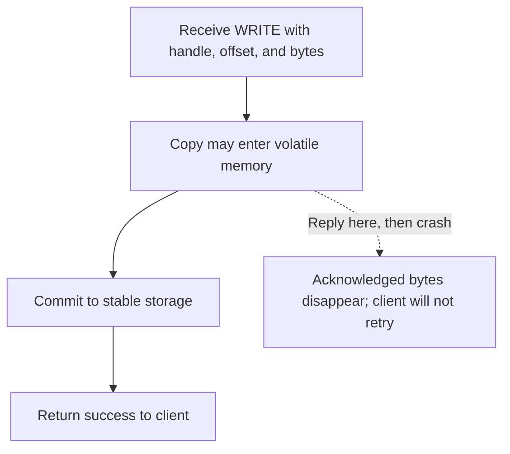

# NFSv2: simple recovery through stateless requests

> Classic NFS keeps server recovery simple by making each request self-contained. Client caching improves speed, but complicates what another machine sees and when.

Source: Chapter 48, *Sun's Network File System (NFS)*, PDF pages 575–590.

## A familiar API over a network

A client/server file system stores authoritative files on servers and lets clients access them through ordinary calls such as `open()`, `read()`, and `write()`. Sharing follows naturally: a developer can use the same project files from different machines. Centralized servers also simplify backup and physical protection of storage.

The client-side file system translates application calls into protocol messages. The file server reads its disk or cache and replies; the client copies returned bytes into the application's buffer. A client cache can satisfy later requests without another network trip. Transparent access preserves the API, not local-disk latency or immunity to failures.

Sun published an open protocol, allowing independently implemented clients and servers to interoperate. The design discussed here is **NFS version 2**, not a description of present-day NFS. The source distinguishes later versions, but their behavior must not be inferred from this historical protocol.

## Recovery drives the protocol

NFSv2 prioritizes simple, fast server crash recovery. A server outage affects many clients at once; a network partition can also make a running server appear unavailable.

The key choice is **statelessness**: the server does not remember which client has a file open, its current offset, or which blocks it caches. Each request contains everything needed to execute that operation. Stateless does not mean the server has no files, persistent metadata, or caches; it means requests do not depend on remembered client sessions.

A remote descriptor-based `open()` would create distributed state. After a server reboot, a client's descriptor would refer to a mapping the server had forgotten. Client crashes would also leave server-side open resources whose cleanup requires detecting failure. NFSv2 instead keeps descriptor and offset state at the client, avoiding that recovery conversation.

## Handles replace remote open state

A **file handle** identifies the object independently of an open session. Conceptually it contains a volume identifier, inode number, and generation number. The volume selects an exported file system, the inode selects its object, and the generation distinguishes a deleted object from a later object reusing its inode. An old handle must not silently name the replacement file.

`LOOKUP` takes a directory handle and a name and returns the target handle and attributes. Opening `/team/plan.txt`, starting from a known root handle, requires looking up `team` and then `plan.txt`. The client retains the resulting handle in its local open-file table.

`READ` specifies the handle, explicit offset, and byte count; `WRITE` additionally carries the data. `GETATTR` retrieves metadata, including the modification time used for cache validation. The protocol also supports changing attributes, creating and removing files and directories, and reading directory entries. Directory enumeration uses a cookie to continue a listing. These are object operations, not a server-side record of the application's open session.

A close of a read-only file needs no remote close operation. Dirty data, however, can require writeback at close.

## Retries work because effects repeat safely

If a reply never arrives, the client cannot distinguish a lost request, an unavailable server, and a lost reply after successful execution. NFSv2 uses timeout/retry for all three.

Most important operations are **idempotent**: repeating them has the same effect as performing them once. Reading information changes nothing. Writing the same bytes at the same specified offset overwrites the same range rather than advancing a remote file pointer. In contrast, repeating an increment would change a value again.

This is not blanket exactly-once execution. A repeated `MKDIR` can report that the directory already exists even though the first attempt created it successfully and only its reply disappeared. Retry safety and repeatable responses are distinct concerns.

## Caching creates two consistency problems

Client memory caches data and metadata. Buffered writes also let an application's `write()` return before network writeback. This improves latency but introduces two separate questions:

- **Update visibility:** while one client's new bytes remain buffered, the server still supplies old bytes to another client.
- **Stale caches:** after writeback, another client may continue reading an older cached copy.

The implementations described use **flush-on-close**, also called close-to-open consistency: closing a modified file sends dirty data to the server. A client opening a cached file checks attributes; a newer server modification time invalidates its cached contents, forcing a fresh read.

Validation itself became expensive because repeated `GETATTR` requests consumed server resources even when nobody else modified the file. An attribute cache reduces that traffic by retaining metadata temporarily. The cost is weaker freshness: until cached attributes expire, a client can accept old data even after another client closes an updated file. Thus, the intended close-to-open behavior is qualified by actual validation policy; it is not a guarantee of immediate visibility under every cache implementation.

Flush-on-close also sends short-lived temporary files to the server even if the application soon deletes them. Caching decisions are therefore observable semantics, not merely invisible performance optimizations.

For the local performance motivation, see [memory hierarchy and caching](../../operating-systems/1-knowledge/memory/memory-hierarchy-and-caching.md); the distributed complication is keeping independent copies acceptably fresh.

## A successful protocol write must survive reboot

Server read caching is straightforward. Server write buffering has a stricter boundary: NFSv2 must not return success for a `WRITE` until it reaches **stable storage**.

Suppose several writes succeed, but one was acknowledged only in server RAM. A reboot can erase that write while preserving earlier and later updates. The client has no reason to resend an operation already reported successful. Persisting before acknowledgment closes this recovery hole, at the cost of write latency. The source describes battery-backed memory as one way historical appliances satisfied persistence quickly, followed by efficient disk writeback.

Early NFS security was also weak: clients could misrepresent user identities. The source notes later authentication integration, including Kerberos. Neither physical server protection nor protocol interoperability substitutes for authenticating access.

## What to take away

- Keep NFSv2's historical guarantees separate from later NFS versions.
- Make requests self-contained when avoiding session recovery is the design priority.
- Evaluate retries for both repeated effects and ambiguous returned errors.
- Specify writeback visibility separately from cache revalidation freshness.
- Place acknowledgment after the persistence boundary promised by the protocol.

---

Previous: [Distributed systems](47-distributed-systems.md) · Next: [AFSv2](49-afs.md)
