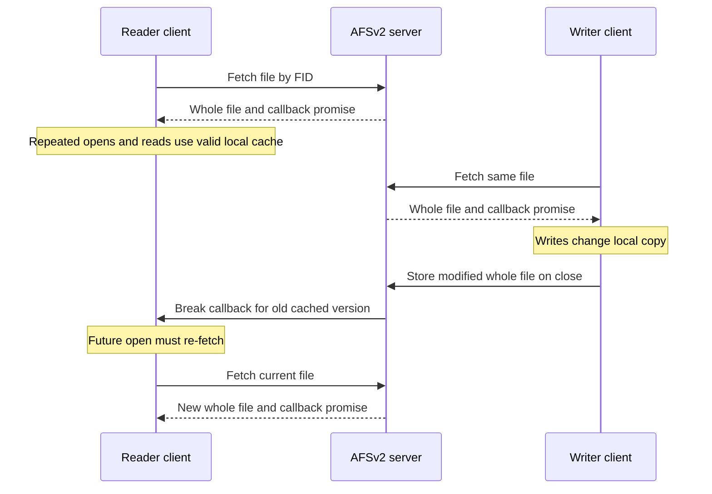

# AFSv2: scale through caching and callbacks

> A server serves more clients when unchanged files require no conversation. AFS buys that quiet common case with whole-file caching and a promise to notify clients of changes.

Source: Chapter 49, *The Andrew File System (AFS)*, PDF pages 591–604; concluding lessons from Chapter 50, *Summary Dialogue on Distribution*, pages 605–606.

## Start with the goal: scale

The Andrew File System grew from a Carnegie Mellon project in the 1980s. Its main question was how many clients a server could support. Protocol design mattered because every validation request used server CPU and network capacity, even when the answer was simply that nothing had changed.

The source distinguishes an initial design, called **AFSv1** here, from a redesigned **AFSv2**. These are historical designs, not claims about every subsequent AFS implementation. Their other explicit concern was understandable user-visible behavior, rather than freshness emerging accidentally from cache timeout settings.

## Version 1: whole files on client disks

AFS caches entire files on a client's local disk. The client component, **Venus**, fetches a file from the servers, collectively called **Vice**, when it opens the file. Application reads and writes then operate on that local copy. Modified contents return to the server when the file closes. The local file system can also cache the disk copy's blocks in memory.

For example, opening an uncached project configuration fetches the whole file; rereading and editing it happen locally; closing the modified file sends the new contents back. This removes per-read and per-write network exchanges, but transfers more data than necessary if the application touches only a small portion.

AFSv1 sends whole pathnames in `Fetch` and `Store` requests. Before reusing a cached file, it asks the server to validate it with `TestAuth`. Despite its name, the operation discussed here tests cache validity. Other operations retrieve or change file metadata and list directories; only file contents, not directories, were cached in this first version.

## Measurement exposes protocol costs

The designers measured their prototype before redesigning it. Two costs dominated:

- **Repeated pathname traversal:** each `Fetch` or `Store` makes the server walk the full directory hierarchy again.
- **Repeated validation:** many `TestAuth` requests consume resources while usually confirming that a cached copy is still usable.

Other problems included uneven load across servers and the overhead of a separate server process per client. Movable volumes helped administrators balance load; threads reduced process-related overhead. The lesson is to measure the work the protocol creates, not merely the time spent transferring file bytes.

## Version 2: name objects and promise invalidations

AFSv2 adds a **callback**: the server promises to tell the client when a cached object changes. The client can then reuse that object without polling until the promise is broken.

It also uses a **file identifier**, or FID, containing a volume identifier, file identifier, and uniquifier. The uniquifier distinguishes reused identities after deletion. Rather than repeatedly asking the server to traverse a whole pathname, the client walks it component by component and caches the directories as well as the final file.

Opening `/work/team/settings` can initially fetch several directories and the file, establishing callbacks for each. Later opens use cached directory entries and file contents when their callbacks remain valid, avoiding server interaction altogether.

The quiet common case depends on state at the server: it must remember which clients hold callback promises. This is the deliberate opposite of NFSv2's stateless recovery priority.

## Visibility is tied to close

For processes on different machines, closing a modified file sends its new contents to the server and triggers callback invalidations. Subsequent opens elsewhere must fetch the new version rather than reuse an invalidated copy. This describes an open/close visibility boundary, not live propagation of every write into another process's already-open file.

On the same machine, local processes see writes immediately through the shared local file-system view. A process need not wait for the writer to close before observing that local update.

Concurrent cross-machine writers are not merged. If two clients edit different parts of the same cached document, each eventually stores a whole file. The last client to close supplies the final version: **last writer wins** is more precisely last closer wins here. This avoids a blockwise mixture of two versions, but can discard another client's edits. Cache consistency is not conflict resolution; applications needing coordinated updates still require explicit locking or other synchronization. See [race conditions](../../operating-systems/1-knowledge/concurrency/race-conditions.md) for the underlying shared-state problem.

## Callback state complicates recovery

A client may miss invalidations while rebooting or temporarily unreachable. On returning, it must treat cached contents as suspect and validate them before reuse; unchanged files can remain in the local disk cache rather than being downloaded needlessly.

A server reboot loses its in-memory callback records. Clients must discover the reboot, distrust old callback promises, and reestablish validity before relying on cached files. The source describes server notifications or periodic client heartbeats as possible recovery approaches, not one universally mandated implementation. The [failure-model discussion](../../distributed-systems/1-knowledge/fundamentals/failure-models.md) provides broader context for reasoning about unreachable components.

AFS reduces routine communication by accepting distributed state and its recovery work. The recovery cost is part of the design, not an exception to it.

## Performance follows workload assumptions

The historical measurements reported about 50 clients per AFSv2 server versus 20 for the first version. Those numbers describe the evaluated systems, not a modern capacity limit.

The source's simplified comparison assumes remote access is slower than local disk, which is slower than memory; large files fit on client disk but not in memory. Under that model, repeated full reads of a large file favor AFS's disk cache over the described memory-caching NFS client. Small repeated reads may hit memory in either system, while new-file sequential writes transfer broadly similar amounts of data.

Whole-file caching loses when locality is smaller than the file. Reading one record from an uncached large file downloads everything. Updating one record also uploads everything at close. Overwriting an existing file can fetch old contents only to replace them; the source excludes truncating opens from that example. NFS's block-oriented operations avoid that initial fetch for aligned full-block overwrites. Frequent log appends and random database updates therefore challenge AFS's assumptions of mostly private files accessed sequentially in full.

AFS also adds a global namespace, authentication, flexible access-control lists, and administration facilities. Its significance is not a universal performance victory. It shows how protocol choices determine scalability, recovery, and visible semantics—the closing dialogue's central lesson. Replication and retries can hide failures, but only carefully specified exchanges make that machinery dependable.

## What to take away

- Measure validation and naming work before optimizing data transfer.
- Use callbacks when reduced polling justifies tracking clients and recovering that state.
- State exactly when remote updates become visible and what concurrent writers lose.
- Match cache granularity to actual access patterns, especially large-file partial updates.
- Include missed invalidations and server reboot in the cache-validity model.

---

Previous: [NFSv2](48-nfs.md) · Next: [Appendices](../6-appendices/README.md)
