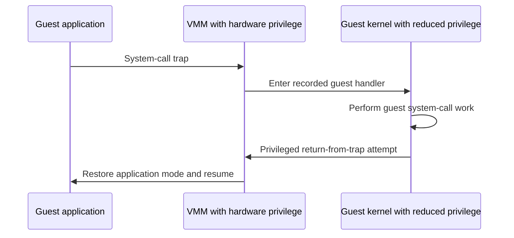
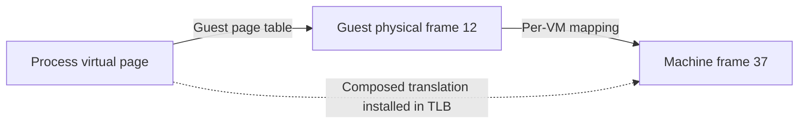

# Virtual machine monitors: virtualizing beneath the kernel

> A hypervisor gives an operating system the machine-shaped illusion that an operating system normally gives its applications. The difficult part is retaining control without changing what the guest believes it owns.

Source: Appendix A, “A Dialogue on Virtual Machine Monitors,” PDF p. 607; Appendix B, “Virtual Machine Monitors,” PDF pp. 608–620.

## Another owner beneath the operating system

A **virtual machine monitor (VMM)**, also called a **hypervisor**, multiplexes hardware among operating systems and their applications. Each guest OS behaves as if it controls a real machine; the VMM is actually responsible for allocation and isolation. Appendix A's lesson is that this is another layer of virtualization, not a replacement for the OS abstractions already studied.

Unlike a process interface, the guest-facing interface deliberately resembles hardware. The VMM does not primarily make hardware pleasant to program; it preserves the environment that an existing kernel expects. This transparency lets an administrator consolidate lightly used services, a desktop user run applications for another OS, or a developer test multiple OS versions on one computer. The price is another resource manager and another boundary on sensitive operations.

The chapter explains these mechanisms through Disco, a research VMM for MIPS. Treat it as a worked model of software virtualization, not as a complete specification of current hypervisors.

## CPU: direct execution with a lower privilege ceiling

Ordinary instructions execute directly on the processor. To switch guests, the VMM saves and restores **machine state**: registers and program counter, but also the privileged state that an ordinary process context switch need not treat as a separate machine. The saved program counter might lie in an application or inside its guest kernel.

Privileged operations must instead come under VMM control. Suppose an application requests a file open. It executes the guest's normal system-call instruction. The hardware enters the VMM's handler, not a handler installed directly by the guest. During guest startup, the VMM intercepted the guest's attempt to register handlers and recorded their locations. It can therefore forward this trap to the appropriate guest handler without knowing the meaning of that OS's system calls.

The guest must be powerful enough to protect its own kernel data, but not powerful enough to seize the hardware. Disco uses MIPS **supervisor mode**: more memory access than user mode, without privileged instructions. Without an intermediate mode, the VMM can run the guest kernel at user privilege and change page protections when moving between the guest kernel and its applications. Extra traps and transitions make system calls more expensive.

## Memory: guest physical is not machine physical

There are now three address domains. An application generates a **virtual address**. Its OS maps that address to a **guest physical address**. The VMM maps guest physical memory to **machine memory**, the actual RAM. Each guest has its own physical-to-machine mapping, just as each process has an OS-managed virtual-to-physical mapping.

For example, a process page might map to guest frame 12, which the VMM places in machine frame 37. The process still uses its virtual address; the guest still believes frame 12 is its RAM. Neither must know frame 37.

On a **software-managed TLB** miss, the VMM forwards to the guest's TLB handler. The guest looks up its page table and tries to install a virtual-to-guest-physical translation. That privileged operation traps again. The VMM substitutes a virtual-to-machine translation; the retried application instruction can then hit in the TLB. The VMM can also discover that a guest frame is absent from RAM, for example because it has swapped that frame out.

Disco caches observed translations in a VMM-level **software TLB**. A later miss can be satisfied directly from this cache, avoiding the round trip through the guest. With a **hardware-managed TLB**, a page walk does not naturally trap to the VMM. The software solution described here is a **shadow page table** mapping process virtual pages directly to machine pages. The VMM tracks guest page-table changes and installs the shadow instead of the guest table. Faster hardware walks then depend on the VMM maintaining this extra state correctly.

## The information gap, I/O boundary, and hardware evolution

The VMM sees machine activity, not necessarily guest intent. An idle-looping guest may look busy, and both layers may zero the same page for isolation. Inference can identify useful clues, such as entry into a low-power state. **Para-virtualization** instead changes the guest to communicate or cooperate explicitly; Disco modified IRIX to avoid zeroing pages already cleared by the VMM. That saves work but sacrifices the goal of running an entirely unmodified OS.

I/O has its own virtualization problems, but Appendix B explicitly leaves their mechanisms outside its treatment. Its hosted-VMM reference identifies one useful technique: exploit the underlying host OS's native facilities instead of reimplementing them all inside the VMM. This source does not describe device-emulation, interrupt-routing, or passthrough algorithms. The CPU and memory diagrams should not be mistaken for an I/O implementation.

The appendix also notes that Intel and AMD added hardware virtualization support that changes the need for these software techniques. Its Disco-era mechanisms explain the control problem; they are not a claim that every present-day guest trap or translation follows this exact path.

Related foundation: [operating systems](../../operating-systems/README.md).

## What to take away

- Separate virtual, guest physical, and machine addresses when debugging VM memory behavior.
- Ask which layer owns privileged state before assuming the guest can install a handler or translation directly.
- Account for expensive boundary crossings, not just the cost of ordinary guest instructions.
- Distinguish transparent virtualization from deliberate guest cooperation; each solves a different deployment problem.

---

Previous: [Appendices](README.md) · Next: [Monitors](D-monitors.md)
