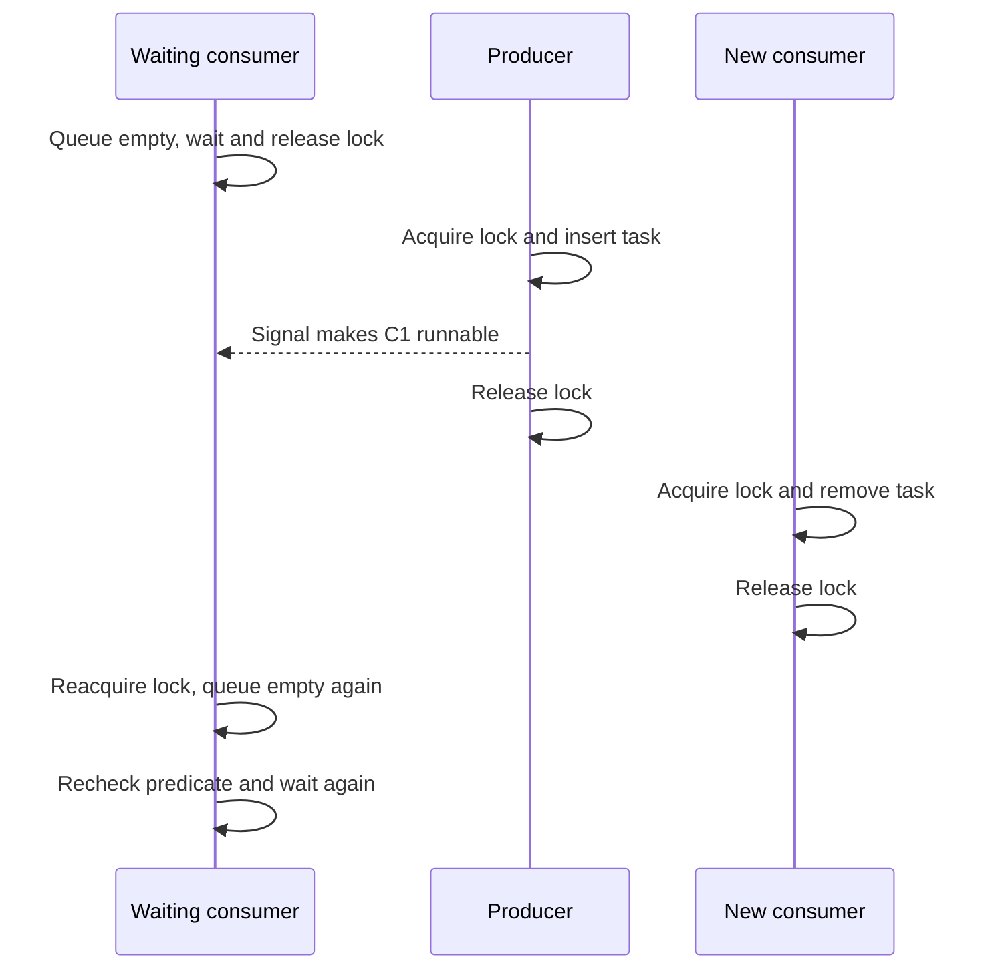

# Monitors: exclusion is not a promise about a wakeup

> A monitor packages shared state, its lock, and its waiting rules together. Correctness still depends on precisely what signaling means and on checking the state that permits progress.

Source: Appendix C, “A Dialogue on Monitors,” PDF p. 621; Appendix D, “Monitors (Deprecated),” PDF pp. 622–634.

## Put the synchronization beside the data

The dialogue introduces monitors as a way to incorporate locking into object-oriented programs. They sit outside the book's main C/POSIX sequence because those interfaces expose locks explicitly. The appendix's “Deprecated” label is its chapter title, not a claim that synchronized objects or condition variables are irrelevant.

A **monitor** permits only one thread to execute inside it at a time. Calling a monitor method implicitly acquires its lock; returning releases it. An account object can therefore update its balance without losing an update to a competing method. In C++ notation, the source's `monitor` keyword is imaginary. The same exclusion can be built with a mutex around every operation on the protected state. Java's `synchronized` methods provide a language-supported counterpart.

The point is structure rather than stronger locking: the invariant and the operations that preserve it live together. If some method touches the same balance without using the same lock, the object-shaped packaging has not made that access safe.

## Add predicates and condition variables

Mutual exclusion does not tell a consumer what to do when a queue is empty. A monitor can also contain **condition variables**, on which a thread waits for a relevant state change. The state itself is separate: a bounded queue tracks its occupancy, and a consumer can proceed only when occupancy is positive. Producers wait when capacity is exhausted.

Waiting must release the monitor lock so that another thread can change the predicate. Before returning to the waiting method, the thread must hold that lock again. A condition variable is therefore neither the queue's occupancy counter nor a stored permission to consume. In contrast, a semaphore maintains a numerical value internally.

Consider a task queue with condition variables for “not empty” and “not full.” A producer inserts a task and signals not-empty; a consumer removes a task and signals not-full. The important question is whether a signaled waiter immediately owns the monitor.

## Hoare semantics: immediate handoff

Under **Hoare semantics**, signaling transfers the monitor lock and execution to one waiting thread immediately. The signaler cannot continue inside the monitor until the awakened thread blocks or exits. If the signaler established the desired predicate, the waiter sees that state before another thread changes it.

For the simple bounded-buffer example, this makes a single `if` check before waiting sufficient: the consumer that wakes runs before a newcomer can take the item. This guarantee helps reasoning, but enforcing immediate control transfer complicates a real implementation.

## Mesa semantics: a hint, not ownership of the item

Lampson and Redell's Mesa implementation uses a weaker and more practical contract. A signal makes a waiter runnable; it does not immediately give it the CPU or the lock. The signaler continues. Another thread can enter before the awakened waiter, changing the predicate again.

The repair is a **while loop** around the predicate test, not an assumption that a signal reserves a resource. The waiter reacquires the lock, tests the current occupancy, and waits again if necessary. This pattern is also correct under Hoare semantics, where the extra test is redundant. The source emphasizes Mesa-style behavior as the practical default for the condition-variable interfaces it discusses.

A monitor implementation manages distinct queues: runnable threads, threads waiting for a monitor lock, and threads waiting on each condition variable. A signal moves a thread out of a condition queue; scheduling and lock acquisition remain separate steps. This explains why “was signaled” and “can now consume” are different facts.

## When one signal is insufficient

Different waiters may have different predicates even when they use the same condition variable. Suppose one allocation request needs 30 units of memory and another needs 12. Freeing 18 units allows the smaller request to proceed, but a single signal might wake the larger request. It correctly goes back to sleep while the eligible request remains blocked.

**Broadcast** wakes all waiters, letting each test its own predicate under the lock. This solves the missed-opportunity problem, but may cause a **thundering herd**: many wakeups, lock competitions, and context switches for very little useful work. Use it when the signaling operation cannot identify which waiter can progress, rather than assuming it is free.

A semaphore can be implemented inside a monitor using a count and a condition variable. Its wait operation loops while the count is nonpositive, then decrements; post increments and signals. Initializing the count to one gives a binary semaphore. The count remembers permissions; the condition variable supplies sleeping and waking.

## POSIX and Java: inspect the actual interface

With POSIX, `pthread_cond_wait()` takes both the condition variable and the held mutex. It releases the mutex while sleeping and reacquires it before returning. Code must initialize its synchronization objects and perform every predicate check and state update under the same lock.

Java's built-in monitor waiting uses `wait()`, `notify()`, and `notifyAll()`. The single intrinsic wait set is awkward when producers and consumers wait for different predicates. A consumer's `notify()` might awaken another consumer instead of the blocked producer, leaving no thread able to make progress. `notifyAll()` plus predicate loops avoids that failure, with herd costs. The later explicit `Condition` interface allows separate waiting conditions and more targeted signaling.

Related foundation: [operating systems](../../operating-systems/README.md).

## What to take away

- Define each waiting predicate in shared state; do not treat a condition variable as the predicate itself.
- Hold the same lock for testing the predicate, waiting, and changing the state.
- Use `while` around waits: a Mesa signal announces a possible change, not a reserved resource.
- Distinguish lock-wait queues from condition-wait queues when tracing blocked threads.
- Use separate conditions or broadcast when a single arbitrary wakeup can choose the wrong kind of waiter.

---

Previous: [Virtual machine monitors](B-virtual-machine-monitors.md) · Next: [Laboratory tools](F-laboratory-tools.md)
