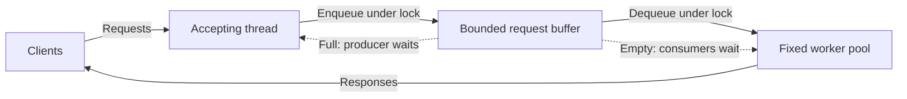

# Systems projects: learn the kernel through its interfaces

> User-space projects connect operating-system abstractions to working C programs. Each exercise changes which invariant you must preserve: data ordering, process lifetime, memory ownership, concurrency, or persistent structure.

Source: Appendix G, “Laboratory: Systems Projects,” PDF pp. 649–652.

## Practice with observable contracts

These projects use the Linux/C systems-programming environment rather than modifying a kernel. The source describes a progression from smaller individual exercises toward larger collaborative ones, while allowing variants of each project. The useful spine is the learning objective, not one semester's exact assignment.

A demonstration can show a program behaving correctly but takes attention to assess. Automated scripts scale better, yet need carefully selected corner cases. A test that only checks successful input does not establish that a utility handles failed system calls or preserves an on-disk invariant. The chapter also describes Moss as a tool used to detect copied submissions; that is course administration, not a systems mechanism.

## 1. Introductory utility: data and errors

A sorting utility introduces input processing, simple data structures, and system calls with their error returns. Text and binary variants expose different assumptions about record boundaries and representation. For example, a utility that sorts binary records cannot use a newline as its universal record delimiter.

The central skill is finishing a complete systems program: interpret inputs, represent records, apply the operation, and report failures. A correct comparison function is only one part of that contract.

## 2. UNIX shell: process management becomes concrete

A shell connects command parsing to process creation, execution, and waiting. Pipes and redirects stop being mysterious syntax once you must arrange the descriptor connections yourself. A pipeline is a relationship among processes and open endpoints, not one function call that computes a string.

Variants can include compressed redirection through `gzip`, or batch execution with different scheduling disciplines. These teach composition and policy respectively: who produces bytes, who consumes them, and which pending command runs next. The challenge is managing lifetimes and resource ownership, not merely splitting command text on spaces.

## 3. Memory-allocation library: manage a region

An allocator obtains anonymous memory with `mmap()` and subdivides that region using a free list or another representation. Pointer manipulation now encodes ownership: a free region must be discoverable without also being handed to a live allocation.

Best-fit, worst-fit, buddy, and other variants change selection and subdivision policy. They let you compare searching costs and fragmentation rather than treating all successful allocations as equivalent. A region containing enough total free bytes may still be unable to satisfy one contiguous request.

## 4. Introductory concurrency: protect real structures

Thread-safe lists, hash tables, and more involved structures introduce POSIX threads and locks. Begin by stating the invariant that each operation preserves, then compare coarse- and fine-grained locking. A single table lock simplifies exclusion but serializes unrelated accesses; smaller lock domains can expose parallelism while making multi-part operations harder to reason about.

The chapter explicitly includes measuring performance. More locks are not automatically faster: useful work, contention, and synchronization overhead determine the result.

## 5. Concurrent web server: bounded handoff

A server accepts requests in a main thread and passes them through a bounded producer/consumer buffer to a fixed-size worker pool. This connects threads, mutexes, and condition variables to an application with real waiting and queueing behavior.

The bounded queue makes overload visible rather than creating unlimited new workers. Scheduling variants ask which queued request a worker chooses; changing that policy does not remove the need for correct handoff and predicate checks.

## 6. File-system checker: distinguish bytes from invariants

A checker reads a file-system image and validates relationships among its on-disk structures. Linux `debugfs` can help produce real images for exploration. Pointer validity, link counts, and indirect-block use are named variants: each requires comparing multiple pieces of metadata, not inspecting a field in isolation.

Repair is a more demanding extension. Detecting a mismatch does not by itself establish which representation is authoritative or what modification preserves other relationships. The learning objective is understanding consistency before changing the evidence.

## 7. File-system defragmenter: preserve meaning, change placement

A defragmenter finds files whose blocks are not laid out sequentially and writes a new image with improved placement. It connects on-disk representations to performance: the bytes and directory relationships should stay meaningful even though physical block locations change.

Reporting fragmentation statistics helps distinguish doing work from improving the intended property. This is a different objective from checking consistency; a fragmented image can be perfectly valid.

## 8. Concurrent file server: combine the boundaries

The final project combines networking, concurrency, and file-system implementation. Its protocol resembles NFS operations—lookups, reads, writes, and file statistics—while storing the file system within one disk-image file. On-disk formats and network protocols can vary.

A read request therefore crosses several representations: a network message identifies an operation, the server locates the file's metadata, and the image layout locates its bytes. Concurrent clients require shared-state protection around these steps. This project tests whether the earlier abstractions fit together, not just whether each component works alone.

Related foundation: [operating systems](../../operating-systems/README.md).

## What to take away

- Tie each project to a named invariant and observable error behavior before adding variants.
- Trace descriptor, memory, and thread ownership across boundaries rather than testing only output values.
- Measure the tradeoff you changed: allocator fragmentation, locking contention, or file placement.
- Keep consistency checking separate from repair and placement optimization.

---

Previous: [Laboratory tools](F-laboratory-tools.md) · Next: [xv6 projects](H-xv6-projects.md)
