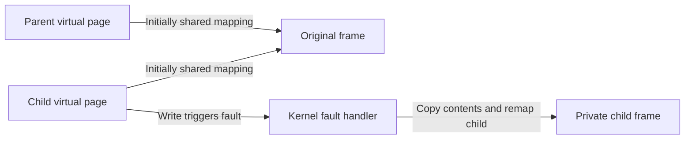

# xv6 projects: change the machinery behind the interface

> A small teaching kernel makes the OS's hidden work inspectable. These projects move from tracing an existing boundary to changing scheduling, address spaces, threads, and persistent state.

Source: Appendix H, “Laboratory: xv6 Projects,” PDF pp. 653–655; kernel context from Appendix E, PDF p. 635.

## Learn inside the kernel

The supplied edition uses MIT's xv6, a teaching implementation of an older UNIX design on x86. Its purpose here is not production completeness but a kernel small enough to understand while modifying it. These are kernel projects, unlike the preceding user-space systems projects. The source suggests collaboration for most of the larger exercises because reasoning through unfamiliar kernel paths is demanding.

The following objectives preserve the source's project order. They describe the concepts to learn, not a replacement assignment specification. In particular, names and starting behavior belong to this edition's teaching environment.

## 1. Introduce a system call

Add a small information-gathering call, such as counters of how often each system call executes. This teaches the complete system-call path: user code requests an operation, execution enters the kernel, dispatch selects a handler, and the result returns to the caller.

A counter is deliberately simple so that the boundary is the hard part. The lesson is that a user-visible function declaration alone cannot create a kernel service.

## 2. Change process scheduling

Replace default round-robin scheduling with a policy such as lottery scheduling or a multilevel feedback queue. The objective includes both runnable-process selection and the context switch that makes the selection real. For example, adding ticket counts does nothing until the scheduler consults them when choosing a process.

The source also proposes carrying a process's exit status through to `wait()`. This teaches a different piece of the process lifecycle: termination must retain information long enough for the waiting parent to retrieve it. Scheduling policy and process-state mechanics must work together without being confused.

## 3. Inspect virtual-memory translation

A call that translates a supplied virtual address to a physical address—or reports an invalid address—makes page-table setup visible. It forces a distinction between an address having a numerical value and that address having a valid mapping.

An alternative changes xv6 so a null-pointer dereference faults. That exercise shows how protection follows from mappings, rather than from the C language's spelling of a pointer. Page-table layout determines whether an erroneous access reaches memory or traps.

## 4. Add copy-on-write mappings

The chapter proposes a lightweight fork-like operation, labeled `vfork()` in this exercise, based on **copy-on-write** pages. Do not infer conventional platform `vfork` semantics from that project label. The learning objective is sharing initial contents while postponing copying until a write requires separation.

Parent and child initially map shared pages without writable access. A write fault must make a private copy where needed and update the relevant page table so execution can continue. The payoff is avoiding copies for pages that neither process changes; the cost moves into fault handling and shared-page lifetime management.

## 5. Add memory mappings

A simpler version lazily loads executable code pages instead of reading them all immediately. The more general version adds memory-mapped files and infrastructure to bring disk-backed pages into memory on a fault.

The central connection is between a virtual-memory reference and backing storage. The kernel must know which file data supplies an absent page and establish a usable mapping before retrying the instruction. Lazy loading reduces upfront work, but makes accesses depend on fault handling and disk I/O.

## 6. Add kernel threads

A `clone()`-like call creates another execution context sharing an address space, unlike a fork that gives a process its own address-space view. A small library above that call supplies initial thread operations and simple locks.

This teaches which parts of execution are per thread and which are shared. Sharing memory makes communication cheap; it also means an update by one thread becomes another thread's concurrency problem. A working creation call is therefore not a complete usable thread environment.

## 7. Extend the thread library

Add spin locks, sleeping locks, and condition variables, together with the kernel support they require. The objective is choosing whether a waiting thread consumes CPU or relinquishes it, and making sleep/wakeup cooperate with shared-state protection.

For example, a lock protecting a brief operation and a condition waiting for work to arrive have different waiting requirements. A full thread library must handle both exclusion and coordination; wakeups still require the predicate discipline explained in the monitor appendix.

## 8. Introduce an extent-based file type

For files of type `EXTENT`, replace individual block pointers in the inode with **extents**, each represented by a starting pointer and a length. This is a light introduction to changing persistent representations.

A contiguous range can then be described compactly, while a fragmented file needs multiple ranges. The exercise connects inode representation to the allocation patterns that make that representation useful.

## 9. Build an FFS-style file system

Transform the basic layout toward Berkeley Fast File System ideas: a new `mkfs` tool, block groups, a block-allocation policy, and the large-file exception. This teaches that format creation and runtime allocation must agree.

Local placement keeps related data near one another, while spreading a large file prevents it from monopolizing one group. It is a policy implemented across multiple structures, not merely a renamed allocator routine.

## 10. Add journaling and demonstrate recovery

Batch the blocks dirtied by a write into an on-disk log before modifying their home locations. The learning objective is ordering persistent updates so interrupted work can recover consistently.

The source explicitly asks for crash points and recovery demonstrations. A successful uninterrupted write is insufficient evidence: interrupting the update exposes whether the log and replay procedure actually preserve consistency. This is the project's testing objective, not a claim that checks were run for this distillation.

## 11. Build a file-system checker

Finally, a checker for xv6's image makes consistency rules explicit and examines whether the disk structures satisfy them. It complements journaling: journaling constructs a crash-recovery protocol; checking independently reasons about the resulting state.

Related foundation: [operating systems](../../operating-systems/README.md).

## What to take away

- Trace a system call end to end before implementing a more complex kernel API.
- Separate shared address-space state from per-thread execution state.
- Treat page faults as mechanisms that complete deferred work, not only as errors.
- Update image creation, metadata representation, and runtime policy together when changing a file system.
- Judge crash consistency through interrupted execution and recovery, not only successful writes.

---

Previous: [Systems projects](G-systems-projects.md) · Next: [Flash-based SSDs](I-flash-ssds.md)
