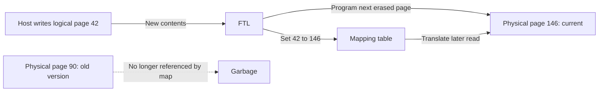

# Flash-based SSDs: hiding erase blocks behind a block interface

> An SSD makes flash look like an overwritable disk even though its pages cannot simply be overwritten. Translation, cleaning, and wear management make that illusion fast enough and durable enough to use.

Source: Appendix I, “Flash-based SSDs,” PDF pp. 656–675.

## Cells, pages, and erase blocks

NAND flash stores information as charge in transistors and retains it without power. **Single-level cells (SLC)** encode one bit per cell; **multi-level cells (MLC)** encode two; **triple-level cells (TLC)** encode three. More distinguishable charge levels increase capacity per cell, while the source describes SLC as faster and more expensive.

Cells form banks or planes, subdivided into **erase blocks** and **pages**. A flash page is a read/program unit; an erase block contains many pages and is the erase unit. These names are not interchangeable with virtual-memory pages or the logical blocks exposed by a disk interface. The chapter's illustrative physical sizes—pages of a few kilobytes and much larger erase blocks—explain the mismatch, rather than specifying every device's geometry.

Three operations matter:

- **Read a page:** fetch its contents without first moving a mechanical head. Access location has much less effect than on a disk.
- **Erase a block:** reset its bits to ones and make its pages programmable. Every page's previous contents are destroyed.
- **Program a page:** change selected ones to zeros to encode the new contents. In the model used here, a programmed page cannot simply be programmed again with arbitrary new data.

```mermaid
stateDiagram-v2
    [*] --> Unprepared
    Unprepared --> Erased: Erase containing block
    Erased --> Programmed: Program page
    Programmed --> Programmed: Read page
    Programmed --> Erased: Erase entire block; all contents lost
```

If one page must change, erasing its block also destroys neighboring pages that may still matter. A design must preserve that live data before erasure. This is the constraint behind the rest of the chapter.

## Raw performance and reliability

The source's raw-chip measurements put reads in tens of microseconds, programs in hundreds or more, and erases in milliseconds. Packing more bits into cells raises operation costs in its examples. These are historical orders of magnitude, not current product guarantees. Parallel flash chips help build high throughput despite individual operation latency.

Repeated **program/erase (P/E) cycles** degrade the ability to distinguish charge levels: a frequently reused block eventually becomes unreliable. The chapter reports different manufacturer endurance ratings for SLC and MLC, but also research finding longer lifetimes than ratings suggest. A rating is not a universal physical lifetime. Another issue is **disturbance**: reading or programming a page can alter bits in neighboring pages. Programming pages in low-to-high order within an erased block helps reduce program disturbance.

## The flash translation layer

An SSD exposes ordinary logical-block reads and writes so existing operating systems and file systems can use it. Internally, it contains flash chips, volatile memory for buffering and mappings, and control logic. The **flash translation layer (FTL)** converts logical requests into physical page reads, block erases, and page programs.

Compatibility lets flash replace a disk without redesigning every client, but hides information across the interface. The controller must recover mappings after power loss and manage extra internal work that the host does not directly request.

Two goals recur. **Write amplification** is flash bytes written divided by client bytes written. If a 4-KiB client write causes 12 KiB of flash programming including relocated data, amplification is 3. **Wear leveling** spreads erase/program work across physical blocks so a small hot subset does not fail early.

## Why direct mapping fails

A direct-mapped FTL puts logical page N at physical page N. To overwrite it safely, the controller reads the other pages in that erase block, erases the block, and programs the preserved pages together with the update. A tiny change therefore entails block-sized work.

This both amplifies writes and lets the workload choose which physical blocks wear out. Repeated updates to one metadata location repeatedly erase the same block. Fast raw reads do not rescue a design whose writes must rebuild a whole block every time.

## Log-structured writes and recoverable mappings

A **log-structured FTL** appends each update to a free, erased page rather than overwriting its previous location. A mapping table associates each logical address with its latest physical page. Reads consult that table. Rewriting logical page 42 can therefore move it from physical page 90 to page 146 without changing the host-visible address.

Logging amortizes erases across many page programs and lets the FTL choose physical placement. It also creates obsolete versions and a potentially large translation table.

Mapping information cannot exist only in volatile memory. One technique stores identifying metadata in each page's **out-of-band (OOB)** area and reconstructs the map by scanning after restart. A full-device scan is slow; more elaborate logging and checkpointing accelerate recovery. Persistent contents without recoverable address mappings would not be a usable persistent device.

## Garbage collection: reclaim blocks, not isolated pages

A page can remain physically programmed while its contents are logically dead. The map, not merely the raw page state, determines whether it holds the current version. Garbage collection uses page identity metadata and the map to identify live pages in a victim block, copies those pages into the log, updates their mappings, and only then erases the victim.

A block containing only dead pages is ideal: nothing needs copying. A mostly live block is expensive to reclaim because cleaning writes data without satisfying a new host write. **Overprovisioning** provides extra physical capacity beyond the exposed logical capacity, allowing cleaning to be delayed or moved into less busy periods. It spends capacity and money to reduce pressure and preserve usable bandwidth.

## Mapping granularity changes the cleaning bill

A **page-level map** supports arbitrary relocation but needs an entry per page. Its memory cost grows with capacity divided by page size. A **block-level map** uses one pointer per erase-block-sized logical chunk. Reads combine that pointer with the page offset, but a small update may require copying the chunk's other live pages into a new block. Saving mapping memory can therefore recreate write amplification.

A **hybrid map** keeps most data block-mapped and a small set of log blocks page-mapped. Reads check the log table first for newer versions, then the data table. Keeping the fine-grained part small requires converting log contents back into block-mapped data:

- A **switch merge** applies when the log already contains a complete, correctly ordered logical chunk. Change the block pointer; no live-page assembly is needed.
- A **partial merge** completes an ordered partial chunk by copying its missing current pages into the log block, then changes the block pointer.
- A **full merge** handles scattered updates spanning chunks. Assemble each affected chunk's newest pages into appropriate data blocks before freeing the log block.

The farther the workload is from the switch-merge case, the more copying the controller must do. The source's further-reading references also identify selective caching of page-level mappings as another approach to mapping-memory costs; they do not make hybrid mapping the only possible design.

## Wear leveling and the meaning of performance

Logging and cleaning spread writes, but a block full of long-lived, unchanged data can escape both. Wear leveling periodically relocates such cold data so the previously untouched block can participate in future writes. This improves distribution of wear while adding traffic and lowering immediate performance. Cleaning seeks reusable space; wear leveling seeks a healthier distribution of use. Their goals overlap without being identical.

The chapter's device comparisons show SSDs' most dramatic advantage on random I/O, where disks pay seek and rotation costs. Sequential workloads narrow that gap. In its examples, random writes can even outperform random reads because the FTL converts host-random writes into internally sequential logging. That is a result for those devices and workloads, not a universal ranking. Sequentiality can still help an SSD, so file-system layout is not suddenly irrelevant.

Its cost-per-capacity comparison is explicitly from 2015. Preserve the decision rule, not those prices: select storage against workload and current capacity cost, and consider SSDs for hot data with disks for colder data where that tradeoff is useful. The source also describes combining fast SLC buffering with denser TLC storage, another way to trade latency against capacity inside one device.

Related foundation: [operating systems](../../operating-systems/README.md).

## What to take away

- Distinguish host logical blocks, flash pages, and erase blocks in every storage diagram.
- Include relocation and cleaning in the write-cost model; a host overwrite is not one physical overwrite.
- Ask how the device recovers mappings after power loss, not only whether flash retains bits.
- Treat free-space pressure, mapping granularity, and workload locality as coupled performance decisions.
- Compare lifetime and throughput together: wear leveling deliberately spends writes to improve endurance.

---

Previous: [xv6 projects](H-xv6-projects.md) · Next: [Book overview](../README.md)
