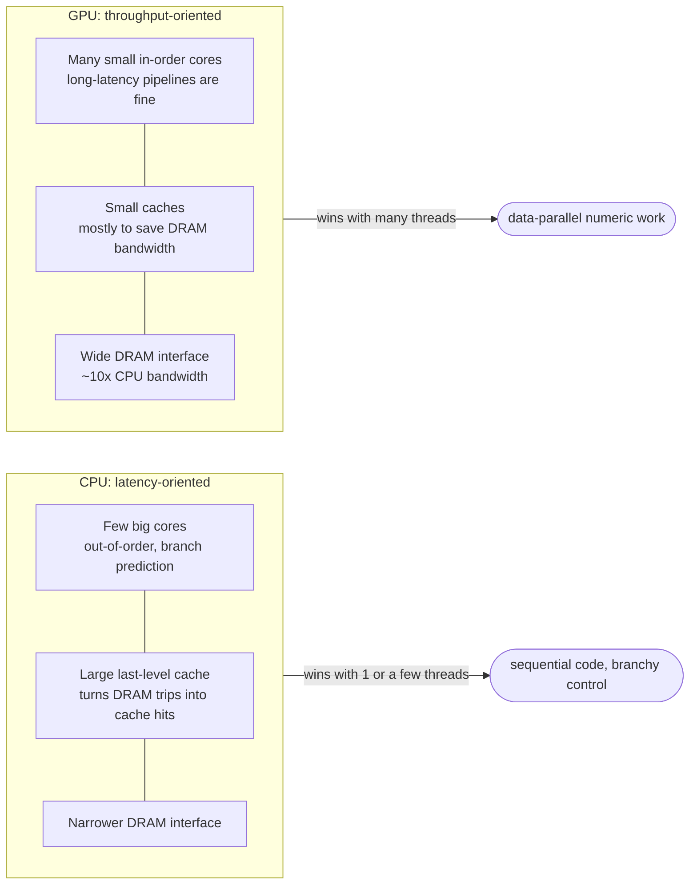
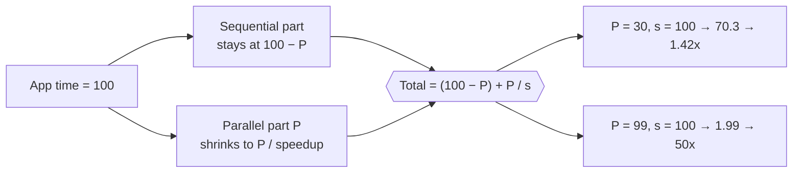
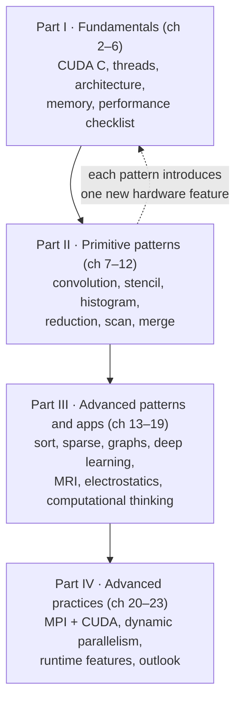

# Introduction

> Why GPUs exist, why they are so much faster than CPUs on some work and so much
> slower on other work, and the four things that make parallel programming hard.
> Everything later in the book is an answer to one of those four.

## The free lunch ended in 2003

For two decades a single CPU core got faster every year. Clock rates rose,
and the hardware found more instructions to run at once without the program
noticing. Old code simply ran faster on new chips. Around 2003, power and
heat stopped that. Clock rates stalled, and vendors spent the extra
transistors on **more cores** instead.

A sequential program runs on one core, and one core no longer gets much
faster. From then on, the only software that keeps getting faster with each
hardware generation is **parallel** software: many **threads** of execution
cooperating on one job. A thread is the familiar sequential thing: a program,
a program counter saying where it is, and its variables. Sutter and Larus
called this shift the *concurrency revolution*. Parallel programming wasn't
new, since supercomputers had done it for decades. What was new is that every
chip is now parallel, so ordinary developers have to do it too.

## Two ways to build a processor

Since 2003 chips have followed two trajectories:

- **Multicore** (CPUs) keeps sequential code fast and adds cores. The book's
  examples are a 24-core Intel server part and a 128-core ARM Ampere part.
  Each core is out-of-order and multiple-issue, built to finish one thread
  quickly.
- **Many-thread** (GPUs) maximizes the total throughput of a huge number of
  threads. The NVIDIA A100 runs tens of thousands of threads on many simple,
  in-order pipelines.

The peak numbers the book quotes (as of 2021) show the gap:

| | FP64 | FP32 | FP16 |
| --- | --- | --- | --- |
| NVIDIA A100 GPU | 9.7 TFLOPS | 156 TFLOPS | 312 TFLOPS |
| Intel 24-core CPU | 0.33 TFLOPS | 0.66 TFLOPS | — |

Those are peak hardware rates, not what an application gets. Read the FP32
column carefully. The 156 TFLOPS is the A100's **tensor-core** rate for
matrix math. The book's own chapter 5 gives plain FP32 arithmetic as 19.5
TFLOPS. The gap is still huge, but it's a matrix-math gap more than a general
one.

### Latency-oriented versus throughput-oriented design

The gap comes from what each design spends its chip area and power on.

A **CPU** spends silicon on making *one* thread fast. Low-latency arithmetic,
big caches, branch prediction and clever control logic all shorten the time
any single instruction waits. That is **latency-oriented design**.

A **GPU** was shaped by video games, which need enormous numbers of
floating-point operations and memory accesses per frame. The key observation
is that **cutting latency costs far more than adding throughput**. Doubling
arithmetic throughput means doubling the units, so roughly double the area and
power. Halving the latency of one unit may need double the current, more
than double the area and four times the power. So a GPU lets each operation
and each memory access take a long time, fills the chip with more units and
more memory channels, and relies on having so many threads that some are
always ready to run while others wait. That is **throughput-oriented
design**. Graphics chips have run at about **10 times** the memory bandwidth
of contemporary CPUs, helped by the looser memory-ordering rules games
tolerate.

The consequence is the reason this whole field is called **heterogeneous**
computing. With one or a few threads, a CPU beats a GPU easily. With many
threads, a GPU wins. Real applications have both kinds of code, so you run
the sequential parts on the CPU and the numerically heavy parts on the GPU.
NVIDIA's **CUDA** (Compute Unified Device Architecture, 2007) was designed
for exactly that joint execution.

### Why GPUs, specifically

Speed alone doesn't decide what developers target. Two other things mattered:

- **Installed base.** Software costs are only worth paying for a large market.
  Earlier parallel machines never had one. GPUs ship in hundreds of millions
  of PCs, and the book counts over a billion CUDA-capable GPUs in use.
- **Form factor and access.** The book's example is MRI. A 64-node cluster was
  fine for a research paper, but no hospital will install racks of servers
  next to a scanner. A PC with a GPU fits, and today many MRI products ship
  with GPUs.

Before CUDA, using a GPU for general work, called **GPGPU**, meant disguising
your computation as a graphics operation that paints pixels through OpenGL or
Direct3D. That limited what you could write. CUDA added hardware to the chip
for general-purpose programs and a C/C++ toolchain on top. GPUs aren't the
only accelerators: FPGAs, for example, are common in networking. The book
argues its techniques carry over to them.

## Why want more speed at all?

Many of tomorrow's mass-market applications are yesterday's supercomputing
applications. The book's examples include molecular-level biology simulation,
HD video processing, natural interfaces, physics-based games and **digital
twins**. Its main example is **deep learning**. Neural networks were studied
from the 1970s but needed too much labeled data and too much computation.
Around 2012 the internet supplied the data and GPUs supplied the
computation, and computer vision and natural-language processing changed
almost overnight.

All of these simulate or represent a concurrent physical world with huge
amounts of data. That gives you plenty of parallelism. It also means that
**how you deliver data to the processors** usually decides the speed you
get, which is the book's recurring theme.

## How much faster can it get?

**Speedup** of system A over system B is B's time divided by A's time: 200 s
versus 10 s is a 20x speedup.

**Amdahl's Law** caps it by how much of the work you parallelize. If the
parallel part is 30% of the run time, a 100x speedup on that part cuts total
time by only 29.7%, about 1.42x overall. Even infinite speedup there gives at
most 1.43x. If the parallel part is 99%, the same 100x gives about 50x overall.
Speedups above 100x happen, but usually only after the algorithm has been
reworked so that more than 99.9% of the work is parallel.

The second limit is **memory bandwidth**. A straightforward port often
saturates DRAM bandwidth and stalls at about 10x. Getting past that means
using the GPU's small on-chip memories to cut DRAM traffic, then working
around how small they are. That is the core skill the book teaches.

Two more points round this out:

- **Be fair to the CPU.** A big speedup over one CPU core may mean the CPU was
  badly suited to the job, or badly used.
- **The peach.** The book pictures a real application as a peach. The
  sequential code is the pit: often most of the lines, rarely most of the
  run time, and best left to the CPU. The easily parallel code is the flesh.
  Early GPGPU reached only a sliver of the flesh, and CUDA reaches much more.

## Four reasons parallel programming is hard

If you don't care about performance, parallel programming is easy. Everything
hard about it is about performance:

1. **Work efficiency.** Some parallel algorithms do more total work than the
   best sequential one. They can end up *slower* on large inputs, which are
   exactly the inputs you parallelize for. Problems naturally written as
   recurrences need non-obvious reformulation, and primitives such as
   **prefix sum** ([chapter 11](./2-parallel-patterns/11-prefix-sum.md))
   are the standard tool.
2. **Memory-bound versus compute-bound.** A **memory-bound** program is
   limited by memory latency or bandwidth. A **compute-bound** program is
   limited by instructions per byte. Most naive GPU code is memory-bound
   ([chapters 5](./1-fundamentals/05-memory-architecture.md) and
   [6](./1-fundamentals/06-performance-considerations.md)).
3. **Sensitivity to input data.** Uneven sizes and skewed distributions hand
   threads unequal work. Parallel code is far more sensitive to this than
   sequential code.
4. **Synchronization.** **Embarrassingly parallel** problems need little
   cooperation between threads. Others need barriers or atomic operations,
   and threads waiting on each other are not doing useful work.

The good news is that researchers have solved most of these, and the
solutions repeat across domains as **patterns**. That is why Parts II and III
teach techniques through patterns and applications rather than in the
abstract.

## Other ways to program parallel machines

| Interface | Model | The book's view |
| --- | --- | --- |
| **OpenMP** | Compiler directives and pragmas on loops, for shared-memory machines. Extended to GPUs | Automation and **performance portability**, but you still need to understand the concepts underneath. Learning CUDA teaches them |
| **MPI** | No shared memory. Nodes exchange explicit messages. Runs on clusters of 100,000+ nodes | Porting is costly because you must do **domain decomposition** by hand. In practice clusters use MPI between nodes and CUDA within them ([chapter 20](./4-advanced-practices/20-heterogeneous-cluster.md)) |
| **OpenCL** (2009) | Standard from Apple, Intel, AMD/ATI and NVIDIA. More API, fewer language extensions | Very similar concepts to CUDA. Code runs unmodified across vendors but needs retuning for speed |
| **NCCL** | NVIDIA's library for multi-GPU collective communication | Mentioned as growing support for multi-GPU programming |

## The book's three goals

1. **High performance.** Enough intuition about the hardware to reason about
   why code is fast or slow. The book frames this as **computational
   thinking** (Wing, 2006): formulating problems so they suit massively
   parallel machines.
2. **Correctness and reliability.** Fast code you can't debug isn't useful.
   CUDA deliberately encourages simple barriers, simple memory consistency
   and simple atomics.
3. **Scalability across future hardware.** Code should speed up on future,
   more parallel chips. The key is to **regularize and localize memory
   accesses**.

## How the book is organized

Each Part II chapter teaches a pattern *and* a new feature or optimization,
such as constant memory, atomics, divergence or work efficiency. Part III
leans on application context. Part IV fills in what an expert needs. The book
uses explicit host↔device copies early on so you see what happens, and
introduces unified memory only in chapter 22.

> **Since this edition:** the 4th edition is from 2022, with the A100 (Ampere)
> as its newest GPU. Since then Hopper (H100) and Blackwell have pushed
> tensor-core throughput and memory bandwidth further, with lower precisions
> (FP8 and below) mainly for AI. The latency/throughput argument is
> unchanged. If anything, it now drives most of the industry's capital
> spending.

## What to take away

- A GPU is a throughput machine. Give it thousands of independent pieces of
  work, or it will lose to a CPU.
- Measure what fraction of your run time is parallelizable before porting.
  Amdahl's Law decides your ceiling before any kernel is written.
- Expect a naive port to stop at memory bandwidth (about 10x). The big
  speedups come from cutting DRAM traffic.
- When a parallel algorithm looks clever, ask whether it does more total work
  than the sequential one.

---

Previous: [Overview](./README.md) ·
Next: [Part I — Fundamental concepts](./1-fundamentals/README.md)
