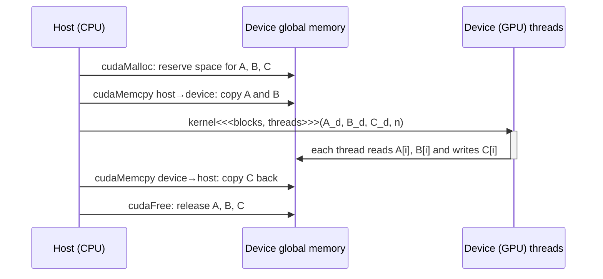
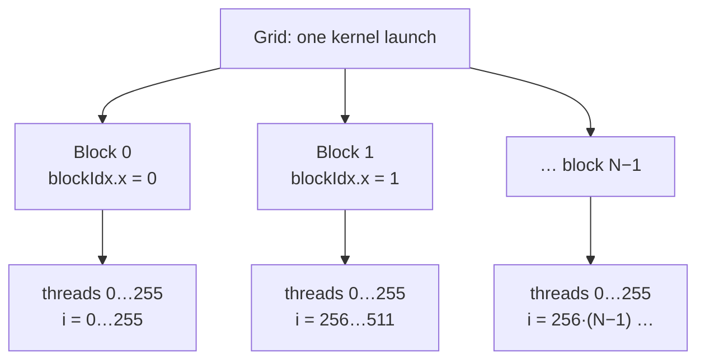
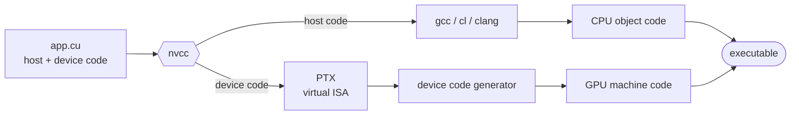

# Heterogeneous data parallel computing

> The smallest complete CUDA program: find the data parallelism, move the data
> to the GPU, launch a grid of threads that each do one piece, and bring the
> answer back. Every later chapter is this skeleton with a better middle.

## Data parallelism

Slow programs are usually slow because of **data**: millions of pixels,
billions of grid points, thousands of flights. Most of those items can be
handled independently of each other. **Data parallelism** is organizing the
computation around the data so that those independent pieces run at the
same time.

The book's example is converting a colour image to greyscale. Each output
pixel's luminance is a weighted sum of its own red, green and blue values
(`L = 0.21r + 0.72g + 0.07b`). No output pixel depends on any other, so all of
them can be computed at once. Even an apparently global result, such as the
average brightness of the image, breaks into many independent partial sums
([chapter 10](../2-parallel-patterns/10-reduction.md) shows how).

**Task parallelism** is the other kind: independent *jobs*, such as a vector
addition and a matrix-vector product that don't depend on each other, or I/O
alongside computation. Large applications have plenty of tasks. But data
parallelism is the main source of **scalability**, because it grows with the
data, and data keeps growing. The book comes back to task parallelism with
CUDA streams in [chapter 20](../4-advanced-practices/20-heterogeneous-cluster.md).

## The shape of a CUDA program

A CUDA C source file mixes **host** code (runs on the CPU) and **device** code
(runs on the GPU). A plain C program is a valid CUDA program with only host
code. Device code is marked with keywords, and its main unit is the
**kernel**, a function run by many threads at once.

Calling a kernel launches a **grid** of threads. When every thread in the
grid finishes, the grid ends and the host carries on.



CUDA threads are cheap. Creating and scheduling one takes a few clock cycles
thanks to hardware support. CPU threads take thousands of cycles. So it's
normal to launch one thread per output element: a million-pixel image gets a
million threads.

## Vector addition, step by step

The running example is `C = A + B` over `n` floats. The CPU version is a loop.
The CUDA version splits into three parts, wrapped in a host function the book
calls a **stub**:

1. Allocate device memory and copy the inputs to it.
2. Launch the kernel.
3. Copy the result back and free device memory.

The stub hides the GPU entirely from its caller. The book points out that
this "transparent outsourcing" is usually slow, because the copies cost more
than the arithmetic. Real programs keep large data structures on the device
across many kernel calls.

### Device global memory

A discrete GPU has its own DRAM, called **device global memory**. "Global"
separates it from the other, smaller device memories in
[chapter 5](./05-memory-architecture.md). The book's example is a Volta V100
with 16 or 32 GB.

The runtime API for managing it deliberately mirrors C:

| Call | Does | Notes |
| --- | --- | --- |
| `cudaMalloc(&ptr, bytes)` | Allocates global memory | Takes the *address* of your pointer and fills it in. The return value is left free for an error code |
| `cudaFree(ptr)` | Releases it | Takes the pointer's value |
| `cudaMemcpy(dst, src, bytes, kind)` | Copies bytes | `kind` is host→device, device→host, device→device or host→host |

Two rules follow. First, a device pointer must **never be dereferenced in host
code**. It's only an address for passing to API calls and kernels, and
dereferencing it crashes or corrupts. The book's `_h`/`_d` suffix convention
exists to keep the two kinds apart. Second, **check every return code**. Each
API call returns a `cudaError_t`. Wrapping calls in a checking macro that
prints `cudaGetErrorString` with the file and line turns hours of debugging
into seconds, for example when the device runs out of memory.

### The kernel

```c
__global__ void vecAddKernel(float* A, float* B, float* C, int n) {
    int i = threadIdx.x + blockDim.x * blockIdx.x;
    if (i < n) C[i] = A[i] + B[i];
}
```

All threads run this same code. That is the **SPMD** (single program,
multiple data) style. It isn't SIMD: SPMD threads needn't execute the same
instruction at the same moment, though chapter 4 shows that the hardware
groups them so they often do.

The grid is a two-level hierarchy:



- A grid is an array of **blocks**, all the same size. A block holds up to
  **1024 threads** (512 before CUDA 3.0).
- Three built-in variables tell each thread where it is. `blockDim` is the
  block size. `blockIdx` is the block's coordinate in the grid. `threadIdx` is
  the thread's coordinate within its block. Each has `x`, `y` and `z` fields.
  One-dimensional data uses only `x`.
- `i = blockIdx.x * blockDim.x + threadIdx.x` gives each thread a unique
  global index. The book compares it to a phone number: the block index is
  the area code and the thread index is the local number.
- Make block dimensions a **multiple of 32**, for reasons chapter 4 explains.

Local variables such as `i` are **private to each thread**: 10,000 threads
means 10,000 copies of `i`.

Notice what's missing: **the loop**. The grid *is* the loop, and each thread
is one iteration. The book calls this **loop parallelism**.

The `if (i < n)` guard is there because `n` is rarely a multiple of the block
size. With `n = 100` and 32-thread blocks you need four blocks, so 128
threads. The last 28 must do nothing.

### Function qualifiers

| Keyword | Runs on | Callable from | Notes |
| --- | --- | --- | --- |
| `__global__` | device | host (and device, with dynamic parallelism) | A kernel. Calling it launches a new grid |
| `__device__` | device | kernel or device function | Runs in the calling thread. No new threads are launched |
| `__host__` | host | host | The default when there is no keyword |
| `__host__ __device__` | both | either | The compiler builds two versions. Handy for shared helper code |

The last row answers a common complaint, that you have to write every helper
twice: you don't.

### Launching it

```c
vecAddKernel<<<ceil(n / 256.0), 256>>>(A_d, B_d, C_d, n);
```

The **execution configuration** between `<<<` and `>>>` gives the number of
blocks and then the threads per block. Use ceiling division so there are
enough threads. For `n = 1000` that's 4 blocks, 1024 threads, and 24 idle
ones. For `n = 2,000,000` it's 7813 blocks.

**Blocks may run in any order.** A small GPU may run one or two at a time and
a large one 64 or 128. Your code must not assume an order. That is exactly
what lets the same binary speed up on bigger chips.

Vector addition does one addition per three floats moved. Including the
copies, it is almost certainly **slower** than the CPU loop. The book uses it
for clarity only. Worthwhile kernels do much more arithmetic per byte.

## Compilation

`nvcc` splits the source file. Host code goes to the system's C/C++ compiler.
Device code becomes **PTX**, a virtual instruction set, which is then turned
into real machine code for the specific GPU (just-in-time at run time, or
ahead of time).



> **Since this edition:** the explicit `cudaMalloc`/`cudaMemcpy` style is still
> how you learn and how performance code is written, but much new code
> starts with **unified memory** (`cudaMallocManaged`, [chapter 22](../4-advanced-practices/22-advanced-practices.md))
> or works through a framework (PyTorch, JAX, CuPy) and never writes a stub at
> all. The kernel model underneath is unchanged.

## What to take away

- Look for the loop whose iterations are independent. That loop becomes the
  grid, and each iteration becomes a thread.
- Every kernel needs a bounds check, because the grid is rounded up to whole
  blocks.
- Count the bytes moved against the operations done. If a kernel does one
  operation per element, the copies will dominate.
- Check every CUDA API return value. Silent failures are the norm otherwise.

---

Previous: [Part I — Fundamental concepts](./README.md) ·
Next: [Multidimensional grids and data](./03-multidimensional-grids.md)
