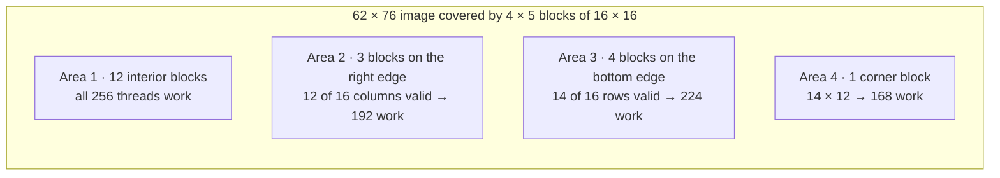
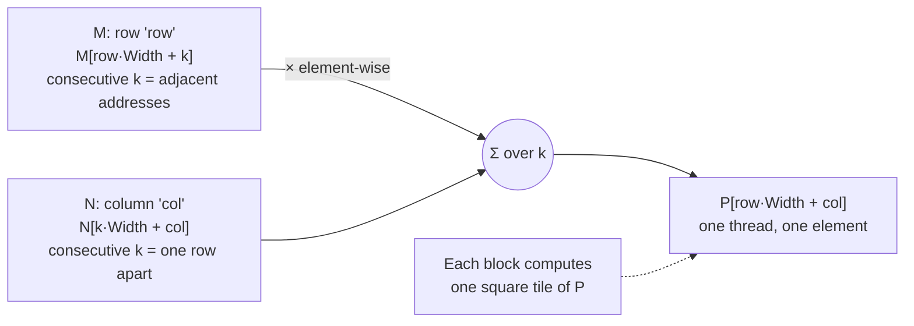

# Multidimensional grids and data

> Images, matrices and volumes are 2D and 3D, so CUDA lets the grid be 2D and
> 3D too. This chapter is about the bookkeeping: mapping thread coordinates to
> array elements, flattening arrays by hand, and keeping threads that fall
> off the edge out of trouble.

## Grids and blocks in up to three dimensions

A grid is a 3D array of blocks, and each block is a 3D array of threads. Both
shapes are given at launch as `dim3` values (`x`, `y`, `z`). Unused dimensions
are set to 1. Passing a plain integer is shorthand for `(n, 1, 1)`. It works
because the `dim3` constructor's parameters all default to 1.

```c
dim3 dimGrid(ceil(m / 16.0), ceil(n / 16.0), 1);
dim3 dimBlock(16, 16, 1);
colorToGrayscale<<<dimGrid, dimBlock>>>(Pout_d, Pin_d, m, n);
```

Inside the kernel, `gridDim` and `blockDim` hold those shapes. `blockIdx` and
`threadIdx` hold this thread's coordinates. The limits:

| Limit | Value |
| --- | --- |
| `gridDim.x` | 1 to 2³¹ − 1 (2¹⁶ − 1 before compute capability 3.0) |
| `gridDim.y`, `gridDim.z` | 1 to 65,535 |
| Threads per block, all dimensions multiplied | ≤ 1024. So (512,1,1), (8,16,4) and (32,16,2) are fine, and (32,32,2) is not |

A grid and its blocks needn't have the same dimensionality. A 2D grid of 3D
blocks is legal.

**A trap in the notation.** The book writes data indices highest dimension
first, like C arrays (`P[row][col]`, or `y` then `x`). But `dim3` lists `x`
first. When you size a grid from an `n × m` image (n rows, m columns), the
**x** dimension covers the **m columns**. Mixing these up is a classic bug.

## Mapping threads to pixels

To process a 62 × 76 image (62 rows, 76 columns) with 16 × 16 blocks, you
need 4 blocks down and 5 across: 20 blocks, 64 × 80 threads for 4712
pixels. Each thread finds its pixel with:

```c
int row = blockIdx.y * blockDim.y + threadIdx.y;
int col = blockIdx.x * blockDim.x + threadIdx.x;
if (row < height && col < width) { /* ... */ }
```

The guard now has two conditions. The blocks fall into four kinds:



A 1500 × 2000 photo with the same blocks takes 94 × 125 = 11,750 blocks. The
idle edge threads matter less and less as the image grows. Chapter 4 puts a
number on that.

## Flattening arrays yourself

C needs the row width at compile time to compile `A[j][i]`. A dynamically
sized array doesn't have one, so in CUDA C you **linearize** the index
yourself. In fact the compiler flattens even static arrays, because memory is
a flat sequence of byte addresses.

- **Row-major** (C, CUDA): rows are stored one after another, so element
  `(j, i)` is at `j * width + i`. In a 4 × 4 matrix, `M[2][1]` is at index 9.
- **Column-major** (Fortran, and many libraries written for it): columns are
  stored one after another. A column-major matrix is the row-major layout of
  its transpose. That's why BLAS manual pages tell C users to transpose their
  inputs, or to swap the operands.
- **3D**: planes are stored one after another, so the index is
  `plane * m * n + row * m + col`, with a guard on all three coordinates.

For the greyscale kernel, the output is one byte per pixel at
`row * width + col`. The input is three bytes per pixel (r, g, b), so it
starts at three times that offset.

## Image blur: threads that read a neighbourhood

Blurring sets each output pixel to the average of an N × N patch around it.
This is a simplified version of the convolution pattern in
[chapter 7](../2-parallel-patterns/07-convolution.md). The thread-to-output
mapping stays one thread per output pixel. Each thread now loops over
`(2·BLUR_SIZE + 1)²` input pixels, so `BLUR_SIZE = 1` gives a 3 × 3 patch.

The interesting part is the **edges**. Near a border part of the patch is
outside the image, so the inner loop skips coordinates below 0 or at or
beyond the height and width. It also **counts** the pixels it actually
added, so the average is right. A corner thread averages 4 pixels, an edge
thread 6, and an interior thread 9. Every output thread now reads several
inputs, and neighbouring threads read overlapping inputs. That overlap is
the redundancy chapters 5 and 7 learn to exploit.

## Matrix multiplication

Matrix multiply is a BLAS **level 3** function. Level 1 is vector-vector
(`y = αx + y`, of which vector add is a case), level 2 is matrix-vector, and
level 3 is matrix-matrix (`C = αAB + βC`). Each level does more arithmetic
per data element. Matrix multiply also underpins LU decomposition and, as
[chapter 16](../3-advanced-patterns/16-deep-learning.md) shows, deep learning.

`P = M × N` for square `Width × Width` matrices. Each `P[row][col]` is the dot
product of row `row` of M and column `col` of N. One thread per output
element gives:

```c
__global__ void matrixMulKernel(float* M, float* N, float* P, int Width) {
    int row = blockIdx.y * blockDim.y + threadIdx.y;
    int col = blockIdx.x * blockDim.x + threadIdx.x;
    if (row < Width && col < Width) {
        float Pvalue = 0;
        for (int k = 0; k < Width; ++k)
            Pvalue += M[row * Width + k] * N[k * Width + col];
        P[row * Width + col] = Pvalue;
    }
}
```



Walking the row of M steps by one element. Walking the column of N steps by a
whole row, `Width` elements. Each thread reads `2·Width` floats from global
memory to do `Width` multiply-adds. Chapter 5 shows this ratio is the
kernel's real bottleneck.

For matrices bigger than one grid can cover, either launch several grids
over sub-matrices from the host, or have each thread compute more than one
output. The book returns to both.

## What to take away

- Shape the grid like the data: 2D for images and matrices, 3D for volumes.
  Remember `x` is the column (fastest-varying) dimension.
- Flatten by hand with `row * width + col`, and know whether your library
  expects row-major or column-major.
- Every multidimensional kernel needs a guard on every dimension, and
  neighbourhood kernels need a second guard inside the loop for the edges.
- Count global-memory reads per useful operation. For naive matrix multiply
  it's two loads per multiply-add, which is why it is slow.

---

Previous: [Heterogeneous data parallel computing](./02-data-parallel-computing.md) ·
Next: [Compute architecture and scheduling](./04-compute-architecture.md)
