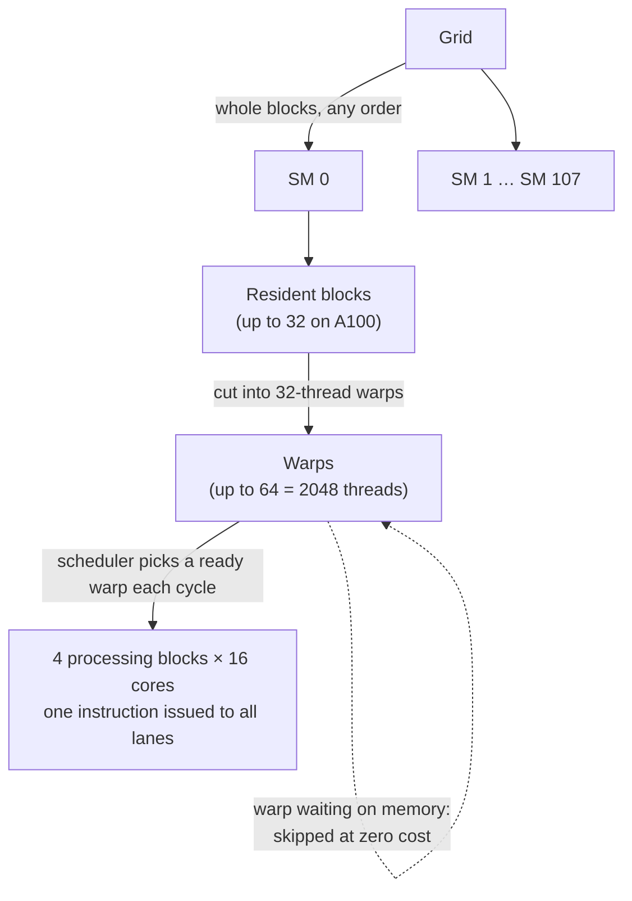
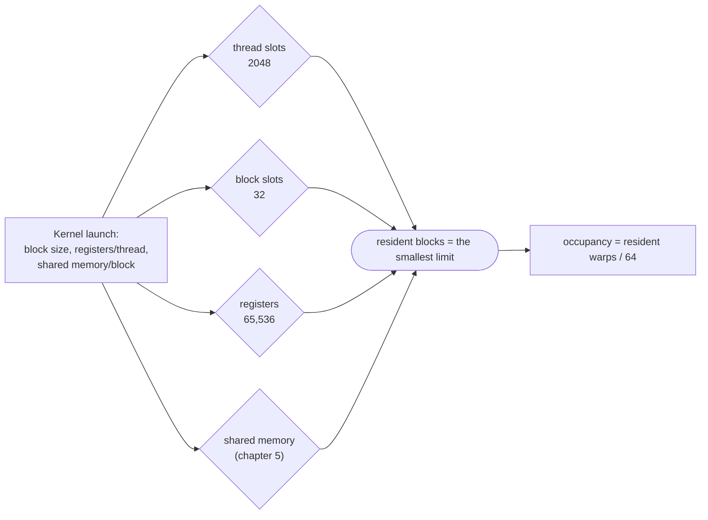

# Compute architecture and scheduling

> What the hardware actually does with your grid: blocks land on streaming
> multiprocessors, threads are executed 32 at a time as warps, and the chip
> hides memory latency by always having another warp ready to run. Divergence
> and occupancy are the two numbers that fall out of this.

## The shape of a GPU

A CUDA GPU is an array of **streaming multiprocessors (SMs)**. Each SM holds
many simple **cores** (also called streaming processors or CUDA cores) that
share control logic and on-chip memory. The Ampere **A100** has 108 SMs with
64 cores each, 6912 in total. Off-chip there are gigabytes of **global
memory**. On newer parts (from Pascal on) this may be **HBM**, DRAM stacked in
the same package as the GPU. The book just calls all of it DRAM.

## Block scheduling

A grid's threads are assigned to SMs **a whole block at a time**. All threads
of a block go to the same SM at the same moment, and several blocks can share
an SM. Each SM can hold only so many blocks, so the runtime keeps a queue and
hands out new blocks as old ones finish. A grid usually has far more blocks
than the GPU can hold at once.

Putting a whole block on one SM is what lets threads within a block
cooperate, through barriers and through the SM's fast shared memory. Threads
in different blocks can't. (Cooperative Groups allows grid-wide barriers
under strict conditions. The book only points at the programming guide.)

## Barriers and transparent scalability

`__syncthreads()` is a **barrier**: no thread in the block passes it until
every thread in the block reaches it. The book's analogy is friends shopping
separately and meeting at the car before driving home. Two rules come with
it:

- **Every thread in the block must reach the same barrier.** Putting
  `__syncthreads()` in both branches of an `if` that splits on `threadIdx`
  creates two *different* barriers. That is undefined behaviour, typically a
  wrong result or a **deadlock**.
- **A block starts only when it can finish.** The runtime starts a block only
  once it has reserved resources for all its threads, so no thread waits at a
  barrier for a sibling that can't be scheduled.

The trade-off is deliberate. Because blocks can never wait for each other,
they can run **in any order**. A cheap GPU runs two at a time, a big one runs
hundreds, and the same binary works on both. That is **transparent
scalability**, and its price is that you can't synchronize across blocks
inside a kernel.

## Warps and SIMD

Inside an SM, a block is cut into **warps** of 32 threads with consecutive
thread indices: threads 0–31, 32–63, and so on. A 2D or 3D block is first
flattened row-major (x fastest, then y, then z) and then cut. A block of 48
threads makes two warps, the second padded with 16 inactive slots. So an 8 ×
8 block is two warps, rows 0–3 and rows 4–7.

The warp is the unit of scheduling, and the hardware runs it **SIMD**: one
instruction is fetched and issued for all 32 threads, each working on its own
registers. Cores are grouped into **processing blocks** that share one
fetch/dispatch unit. The A100's 64-core SM is four processing blocks of 16.
Sharing the control logic among many arithmetic units is how the GPU spends
its area on arithmetic. The book calls this **SIMT**, single instruction,
multiple threads. Warp size has been 32 on every CUDA GPU so far, but it is
an implementation detail. Query it rather than assume it.



## Control divergence

SIMD is efficient when all 32 threads take the same path. When they don't,
for example threads 0–23 take the `if` and 24–31 the `else`, the hardware runs
**both paths, one after the other**, masking off the threads that didn't
take each one. Then the warp reconverges. Loops whose trip count varies per
thread diverge too: once the shortest thread finishes, its lane sits idle.

The cost is the extra passes plus the idle lanes in each pass. Up to Pascal
the passes ran strictly one after another. From **Volta** on, **independent
thread scheduling** lets them interleave. That affects correctness more than
speed: you can't assume the threads of a warp are in lockstep, so if they
must all finish a phase, use `__syncwarp()`.

To spot divergence, look at the condition. If it depends on `threadIdx`, or
on data that varies by thread, it can diverge. The commonest source is the
**boundary check**, and the book shows how little that usually costs:

| Case | Divergent warps | Impact |
| --- | --- | --- |
| Vector of 1003, blocks of 64 | 1 of 32 (the last) | small |
| Vector of 100 | 1 of 4 | can be significant |
| Vector of 1000 | 1 of 32 | about 3% at most |
| Vector of 10,000 | 1 of 313 | well under 1% |
| 62 × 76 image, 16 × 16 blocks | 31 of 160 | noticeable |
| 200 × 150 image | 80 of 1040 | under 8% |
| real photos, more than 1000 px wide | — | under 2% |

So boundary divergence fades as the data grows. Divergence *inside* the
algorithm doesn't, and chapter 10 shows it can halve a kernel's speed.

## Latency tolerance

An SM has far more threads assigned than it has cores. The A100's SM has 64
cores and holds up to **2048 threads**, 32 times as many. That isn't waste.
When a warp's next instruction needs the result of a long operation, such as a
global-memory load, the scheduler simply **picks another warp that's ready**.
With enough warps, the cores never idle. The book's sidebar compares it to a
post-office clerk who serves the next customer while one fills out a form.

This is **zero-overhead scheduling**. A CPU context switch saves and restores
registers through memory. An SM keeps *every* resident warp's registers on
chip, so switching warps costs nothing. It's the deepest reason GPUs can skip
big caches and branch predictors: they **hide latency with parallelism**
rather than shortening it. It also works for arithmetic pipeline latency, not
just memory.

## Occupancy: how many warps you actually get

**Occupancy** is the number of warps resident on an SM divided by the maximum
it supports. High occupancy means more warps to choose from, so more latency
hidden. An SM's resources are partitioned **dynamically** among blocks:
thread slots, block slots, registers and shared memory. Whichever runs out
first sets the limit.

A100 limits: **2048 threads**, **32 blocks**, **65,536 registers** per SM, and
1024 threads per block.



The book's worked cases:

| Configuration | Binding limit | Occupancy |
| --- | --- | --- |
| Blocks of 64, 128, 256, 512 or 1024 threads | thread slots | 100% |
| Blocks of 32 threads | block slots: 32 × 32 = 1024 threads | 50% |
| Blocks of 768 threads | thread slots: only 2 fit (1536) | 75% |
| 64 registers per thread | registers: 65,536 / 64 = 1024 threads | 50% at any block size |
| 512-thread blocks, 31 registers each | none | 100% (63,488 registers) |
| Same kernel, two more variables → 33 registers | registers: only 3 blocks fit | **75%** |

The last row is a **performance cliff**: two extra local variables cost a
quarter of the chip's parallelism (Ryoo et al., 2008). The compiler can
**spill** registers to memory to stay under the limit, but spilled values are
slow to reach. The resources interact in complicated ways, so NVIDIA ships an
**occupancy calculator**. The occupancy APIs and Nsight Compute report the same
thing.

## Querying the device

Code can ask what it is running on:

```c
int devCount;  cudaGetDeviceCount(&devCount);
cudaDeviceProp p;  cudaGetDeviceProperties(&p, i);
// p.maxThreadsPerBlock, p.multiProcessorCount, p.clockRate,
// p.maxThreadsDim[3], p.maxGridSize[3], p.regsPerBlock, p.warpSize
```

A machine often has more than one CUDA device, for example a weak integrated
GPU next to a real one, so pick deliberately. **Compute capability** (8.0 for
the A100) summarizes how many resources each SM has. One naming quirk:
`regsPerBlock` is usually the whole SM's register count, which isn't always
the same as what one block may use.

> **Since this edition:** Hopper (compute capability 9.0) added **thread block
> clusters**. These are groups of blocks guaranteed to be co-scheduled on
> neighbouring SMs, which can synchronize and read each other's shared memory.
> That loosens the "blocks never cooperate" rule in exactly the controlled
> way this chapter's trade-off suggests. Occupancy is also less of a goal in
> itself than it was. Tensor-core GEMM kernels often run at low occupancy on
> purpose, hiding latency with asynchronous copies instead of extra warps.

## What to take away

- Never rely on block order or on threads in a warp running in lockstep.
  Barriers are the only ordering you get.
- Put `__syncthreads()` where every thread of the block will reach it, never
  inside a thread-dependent branch.
- Pick block sizes that are multiples of 32 and at least 64, and that divide
  the SM's thread limit evenly.
- Watch registers per thread. Crossing a register boundary can cost a quarter
  of your occupancy in one compile.
- Boundary-check divergence is cheap at scale. Divergence built into the
  algorithm isn't.

---

Previous: [Multidimensional grids and data](./03-multidimensional-grids.md) ·
Next: [Memory architecture and data locality](./05-memory-architecture.md)
