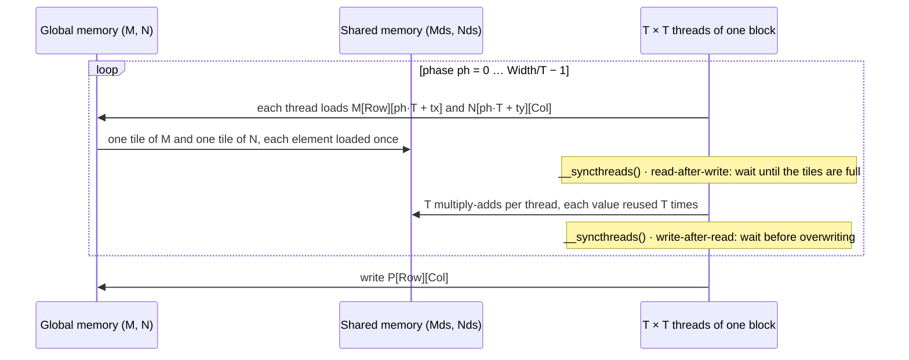

# Memory architecture and data locality

> The kernels so far reach about 2% of an A100's arithmetic peak, because
> they spend their time waiting on DRAM. This chapter introduces the GPU's
> small, fast on-chip memories and **tiling**, the technique of making
> threads share data through them. It's the single most important
> optimization in the book.

## Why naive kernels are slow

Look at the inner loop of chapter 3's matrix multiply. Each iteration loads
two floats (8 bytes) from global memory and does one multiply and one add (2
FLOP). That's **0.25 FLOP/B**. The book calls this ratio the **compute to
global memory access ratio**, also known as **arithmetic intensity** or
computational intensity.

Multiply that by the A100's memory bandwidth of 1555 GB/s and you get a
ceiling of **389 GFLOPS**. The A100 can do 19,500 GFLOPS of FP32 arithmetic,
or 156,000 on its tensor cores. So the kernel can reach at most 2% of the
first and 0.25% of the second, however many threads it has. It's
**memory-bound**. To use all 19,500 GFLOPS you'd need at least
19,500 / 1555 ≈ **12.5 FLOP/B**: about 50 operations for every 4-byte value
loaded.

### The roofline model

The book's sidebar introduces the **roofline**, which plots achieved
throughput (y) against arithmetic intensity (x). Two lines bound every
program. One is a sloped line set by memory bandwidth, and the other is a
flat line set by peak compute. They meet at the **ridge point**. A kernel left
of the ridge is memory-bound, and a kernel right of it is compute-bound.



Where a point sits tells you what to do. Close to the sloped roof and still
memory-bound, the only way up is to **raise intensity**, meaning fewer bytes
per FLOP. Far below the roof, you're not even using the bandwidth you have,
and chapter 6's coalescing is the fix.

## The CUDA memory types

| Declaration | Memory | Scope | Lifetime | Speed |
| --- | --- | --- | --- | --- |
| Automatic scalar variable | **Register** | thread | grid | fastest, on chip |
| Automatic array variable | **Local** (actually in global memory) | thread | grid | slow |
| `__shared__` | **Shared** | block | grid | very fast, on chip |
| `__device__` (at file scope) | **Global** | all grids | application | slow (cached on newer GPUs) |
| `__constant__` | **Constant** | all grids | application | fast when cached, read-only, 64 KB total |



**Registers** hold each thread's private variables. They're the fastest
storage for three reasons:

- Aggregate register bandwidth is at least two orders of magnitude above
  DRAM's.
- Arithmetic instructions take register operands directly. A value in global
  memory costs an extra load instruction first, and instruction slots are
  limited.
- Reading a register costs at least ten times less energy than reading DRAM.

GPU register files are big because they hold *every* resident warp's
registers. That's what makes warp switching free (chapter 4). They're also
dynamically partitioned, so a register-hungry kernel gets fewer threads.

**Shared memory** is an on-chip **scratchpad**. You reach it with load
instructions, so it's slower than registers, but much faster than DRAM.
Every thread in a block sees the same copy, which makes it the means for
threads to **cooperate**. **Local memory** is a misleading name: it lives in
DRAM, private per thread, and holds automatic arrays, spilled registers and
call stacks. The compiler may keep a small array in registers if every index
is a constant. **Constant memory** is cached global memory for read-only
inputs. Chapter 7 puts it to work. **Global variables** persist across kernel
launches and are visible to every thread. But there's no cheap way to
synchronize between blocks except atomics or ending the kernel, so they
mostly pass data from one kernel to the next.

## Tiling

Look at which threads read what. In a 2 × 2 block of the matrix multiply,
threads (0,0) and (0,1) both read the whole of row 0 of M. Threads (0,1) and
(1,1) both read column 1 of N. **Every input element is loaded from global
memory twice** by one block. With `T × T` blocks, it's loaded `T` times. If the
threads load each element once, together, and share it, global traffic drops
by a factor of `T`.

Shared memory is too small for whole rows of a large matrix, so the work is
cut into **phases**. In each phase the block:

1. **Loads** one `T × T` tile of M and one of N into shared memory, each
   thread loading one element of each.
2. Waits at a **barrier**, so nobody reads a tile that isn't fully loaded.
3. **Computes** `T` multiply-adds per thread from shared memory.
4. Waits at a second **barrier**, so nobody overwrites a tile still being
   read.



The two barriers guard two kinds of dependence the book names:

- **Read-after-write** is a *true* dependence. You need data another thread
  writes.
- **Write-after-read** is a *false* dependence. You're only reusing the same
  storage, and it would disappear with a separate buffer.

Turning the long `k` loop into an outer loop over phases and an inner loop
over one tile is **strip-mining**, an old CPU compiler technique.

The pay-off with 16 × 16 tiles is 16 times less traffic. Intensity rises from
0.25 to **4 FLOP/B**, and the bandwidth ceiling rises from 389 to **6220
GFLOPS**. That's still only 32% of peak. Libraries such as **cuBLAS** and
**CUTLASS** go much further with techniques the book only partly covers. For
real matrix math, call them.

Tiling isn't GPU-specific. CPUs have always "blocked" loops so the working set
fits in cache. The difference is that a CPU core runs one or two threads, so
a cache keeps their data reliably. An SM runs thousands of threads that would
evict each other's cache lines, so on a GPU you place reused data in shared
memory **explicitly**.

### Boundary checks

The basic tiled kernel assumes `Width` is a multiple of the tile width. Drop
that assumption and threads read past the end of rows, where they silently
get the next row's data, or past the end of the array, where they get garbage
or a crash. That can happen in **any** phase, not just the last. A thread that
produces no valid output may still have to load an element its neighbours
need. So each access gets its own check:

- **Loading M:** `Row < Width && ph*T + tx < Width`. Otherwise store **0.0**,
  which leaves the dot product unchanged.
- **Loading N:** `ph*T + ty < Width && Col < Width`. Otherwise store 0.0.
- **Storing P:** `Row < Width && Col < Width`.

The book's rule of thumb: **every memory access needs a check that its
indices are in bounds for the array it touches**. Going from square to
rectangular `j × k` times `k × l` matrices is then just a matter of replacing
`Width` with the right dimension in each place.

## Memory use limits occupancy

Shared memory is partitioned among resident blocks just like registers. An
A100 SM can have up to **164 KB** of shared memory and 2048 threads, so
full occupancy allows at most about **82 bytes per thread**.

- The tiled matrix multiply uses 2 × T² × 4 bytes for T² threads, which is
  **8 B/thread**. Not a limit.
- A kernel using 32 KB per 256-thread block uses 128 B/thread. Only five such
  blocks (1280 threads) fit in 164 KB, so occupancy tops out around **62%**.

Shared memory sizes vary between GPUs. To adapt at run time, declare the
array `extern __shared__` with no size, carve it up by hand, and pass the
byte count as the **third launch parameter**:

```c
extern __shared__ float Mds_Nds[];              // in the kernel
kernel<<<grid, block, size>>>(..., size/2, size/2);  // size from cudaGetDeviceProperties
```

> **Since this edition:** Ampere's `cp.async` and Hopper's **Tensor Memory
> Accelerator** (TMA) let a kernel copy tiles from global to shared memory
> asynchronously, without staging them through registers, while it computes
> on the previous tile. Combined with tensor cores, that's how today's GEMM
> kernels approach peak. The tiling idea is exactly this chapter's. Only the
> copy engine is new.

## What to take away

- Compute FLOPs per byte for your inner loop and compare it with the GPU's
  ridge point (about 12.5 for an A100 in FP32). Below it, your speed is set by
  bandwidth.
- If several threads read the same global data, stage it once in shared
  memory and share it. Reuse factor in, traffic out.
- A tiled loop needs two barriers per phase: one before reading the tile
  (true dependence) and one before overwriting it (false dependence).
- Guard every load and store separately, and pad out-of-range loads with a
  neutral value such as 0.
- For dense linear algebra, use cuBLAS or CUTLASS. Write your own tiling for
  everything else.

---

Previous: [Compute architecture and scheduling](./04-compute-architecture.md) ·
Next: [Performance considerations](./06-performance-considerations.md)
