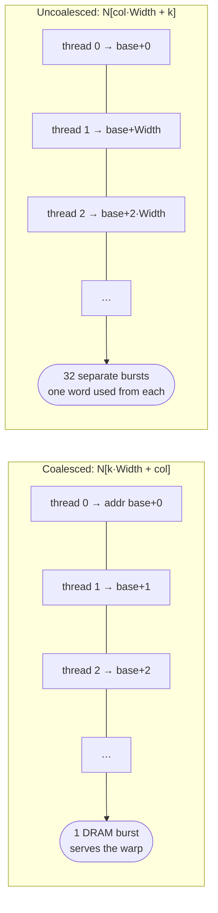
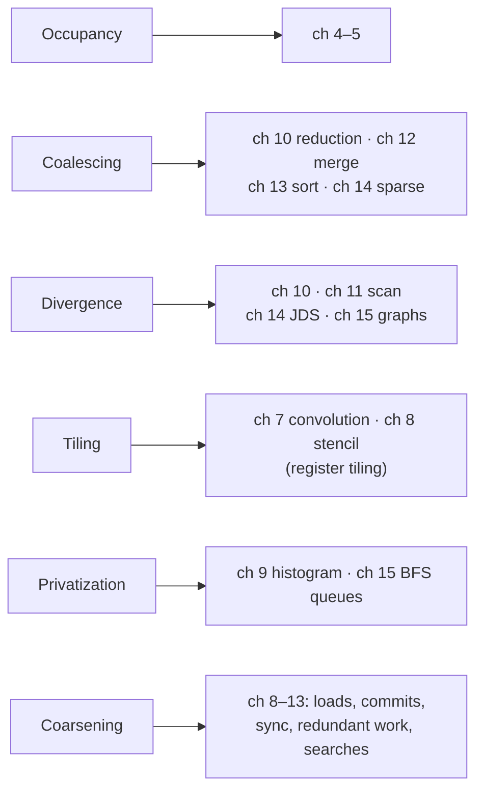

# Performance considerations

> How DRAM actually delivers bytes, and why that makes the *pattern* of a
> warp's addresses matter as much as their number. The chapter ends with the
> book's six-item optimization checklist, which every later chapter applies.

## Trading one resource for another

A kernel's speed is set by whichever hardware resource runs out first: its
**bottleneck**. Most optimizations spend more of one resource to relieve
another. Tiling, for example, spends shared memory to save DRAM bandwidth.
That helps only if the relieved resource really was the bottleneck and the
newly used one isn't. Otherwise tuning is guesswork.

## Memory coalescing

### Why DRAM is slow, and how it is fast anyway

A DRAM bit is a tiny capacitor. Reading it means letting that tiny charge
nudge a long, high-capacitance wire until a sense amplifier notices. That
takes **tens of nanoseconds**, against a sub-nanosecond clock. The book's
image: telling the flavour of a cup of coffee from its aroma at the far end of
a hallway. Cells keep shrinking to fit more bits, so latency hasn't improved.

DRAM gets throughput from parallelism instead. Each access senses a whole
range of **consecutive** locations at once, and then streams them out quickly
as a **burst**. If you use the whole burst, the DRAM looks fast. If you use one
word of it, you pay full latency for a few bytes.

### Coalescing

All 32 threads of a warp execute a load at the same time. When their addresses
are **consecutive**, so that thread 0 reads `X`, thread 1 `X+1` and so on, the
hardware **coalesces** them into one request for one burst. When they're
scattered, the warp needs many requests and most of each burst is wasted.

The test is in the index expression: **consecutive `threadIdx.x` values
should produce consecutive addresses**.

Every kernel so far happened to coalesce. If the second matrix is stored
**column-major**, for example because you're multiplying by a transpose
without materializing it, consecutive threads read elements `Width` apart and
coalescing is lost.

There are three ways out, and the rest of the book uses all three:

1. **Remap threads to data** so consecutive threads touch consecutive
   addresses (chapter 10).
2. **Re-lay out the data** (chapter 14's ELL and JDS formats).
3. **Load coalesced into shared memory, then do the irregular access
   there.** Shared memory is SRAM and doesn't care about patterns. For the
   column-major matrix this trick is called **corner turning**: when loading
   B's tile, swap the roles of `threadIdx.x` and `threadIdx.y`, so
   consecutive threads walk down a column, which is contiguous in
   column-major order.

The book's analogy is **carpooling**. Requests are cars and data are
commuters. Commuters can share a car only if their schedules match. Threads
in a warp are perfect carpoolers because SIMD makes them issue their loads at
the same moment. Caches on newer GPUs coalesce some patterns for you, but the
book expects coalescing to matter "for the foreseeable future".

## Hiding memory latency: banks and channels

Bursts aren't enough by themselves. DRAM systems add two more levels of
parallelism:

- **Channels:** separate memory controllers, each with its own bus. A 64-bit
  double-data-rate bus at 1 GHz moves 8 B × 2 × 1 GHz = **16 GB/s**. The book's
  example has a CPU wanting 32 GB/s (2 channels) and a GPU 256 GB/s (16
  channels).
- **Banks** per channel: each bank's slow cell-array access can overlap with
  another bank's bus transfer. If access latency is `R` times the transfer
  time, a channel needs at least **R + 1 banks** to keep its bus busy. With R
  = 20 and one bank, the bus is used 1/21 = **4.8%** of the time, so a 16 GB/s
  channel delivers 0.76 GB/s. In practice you want more than R + 1 banks, to
  avoid **bank conflicts** (two accesses to one bank) and to reach the
  capacity you need.

```mermaid
gantt
    title One channel bus: one bank versus two (latency ≫ transfer)
    dateFormat s
    axisFormat %S
    section 1 bank
    cell access A      :a1, 0, 20s
    burst A on bus     :crit, a2, 20, 2s
    cell access B      :a3, 22, 20s
    burst B on bus     :crit, a4, 42, 2s
    section 2 banks
    bank 0 access A    :b1, 0, 20s
    bank 1 access B    :b2, 2, 20s
    burst A            :crit, b3, 20, 2s
    burst B            :crit, b4, 22, 2s
```

Addresses are **interleaved**: consecutive bursts of an array go to
consecutive channels, then wrap to the next bank. Even a small array spreads
across the whole system.

That ties back to occupancy. Filling all those banks and channels takes
**many simultaneous requests**, so high occupancy hides DRAM latency as well
as pipeline latency. The requests also have to be coalesced and spread evenly
across channels. GPU caches mainly exist to merge requests, for instance when
two blocks load the same tile at about the same time.

## Thread coarsening

Until now every thread did the **smallest unit of work**: one element, one
pixel. That exposes maximum parallelism, which is good for transparent
scalability. But parallelism has a **price**: redundant loads, redundant
work, synchronization. If the hardware runs all the blocks at once, the price
buys speed. If it ends up **serializing** them anyway, because there are more
blocks than the GPU can hold, you've paid for nothing.

**Thread coarsening** gives each thread several units of work, so the price
is paid once. In tiled matrix multiply, two horizontally adjacent output
tiles need **the same tiles of M**. As separate blocks, they each load them.
A coarsened block with `COARSE_FACTOR = k` computes `k` adjacent output tiles.
It loads each M tile once and reuses it `k` times, with `k` accumulators per
thread and a "coarsening loop" over the N tiles.

Three pitfalls:

1. **No price, no gain.** Vector add or greyscale conversion pay nothing for
   parallelism, so coarsening them does nothing.
2. **Over-coarsening** leaves SMs idle. The best factor depends on the device
   *and* the dataset, so scalability is no longer transparent and needs
   retuning.
3. **More registers and shared memory per thread** can reduce occupancy and
   cost more than you saved.

## The optimization checklist

This is the book's Table 6.1. It's the map for Parts II and III:

| Optimization | Helps compute by | Helps memory by | How |
| --- | --- | --- | --- |
| **Maximize occupancy** | more warps to hide pipeline latency | more parallel requests to hide DRAM latency | tune threads/block, registers/thread, shared memory/block |
| **Coalesce global accesses** | fewer stalls on memory | less traffic, full bursts and cache lines | corner turning via shared memory, remap threads, re-lay out data |
| **Minimize control divergence** | higher SIMD efficiency | — | remap threads to work or data, re-lay out data |
| **Tile reused data** | fewer stalls on memory | less global traffic | keep block-reused data in shared memory or registers |
| **Privatization** | fewer stalls on atomics | less contention and serialization | update a private copy, merge into the shared one at the end |
| **Thread coarsening** | less redundant work, divergence, synchronization | less redundant traffic | several units of work per thread when the hardware would serialize anyway |

Where each one shows up later:

## Know your bottleneck

An optimization that doesn't target the bottleneck may do nothing, or make
things worse. Shared-memory tiling is great for a bandwidth-bound kernel that
reuses data. On a kernel whose occupancy is already limited by shared memory,
it makes things worse. Bottlenecks also differ between GPUs. Use a profiler to
find out which resource is the limit, rather than guessing. (The book points
to NVIDIA's profiler documentation. Today that means **Nsight Compute**, whose
"speed of light" and roofline sections answer exactly this question.)

## What to take away

- Read every global index expression and ask: do adjacent threads touch
  adjacent addresses? If not, fix the mapping, the layout, or stage it
  through shared memory.
- High occupancy is also how you keep enough memory requests in flight to
  fill the DRAM channels.
- Coarsen only where parallelism has a real price. Then tune the factor per
  GPU and per input size.
- Profile first. An optimization aimed at the wrong resource can only cost
  you.

---

Previous: [Memory architecture and data locality](./05-memory-architecture.md) ·
Next: [Part II — Parallel patterns](../2-parallel-patterns/README.md)
