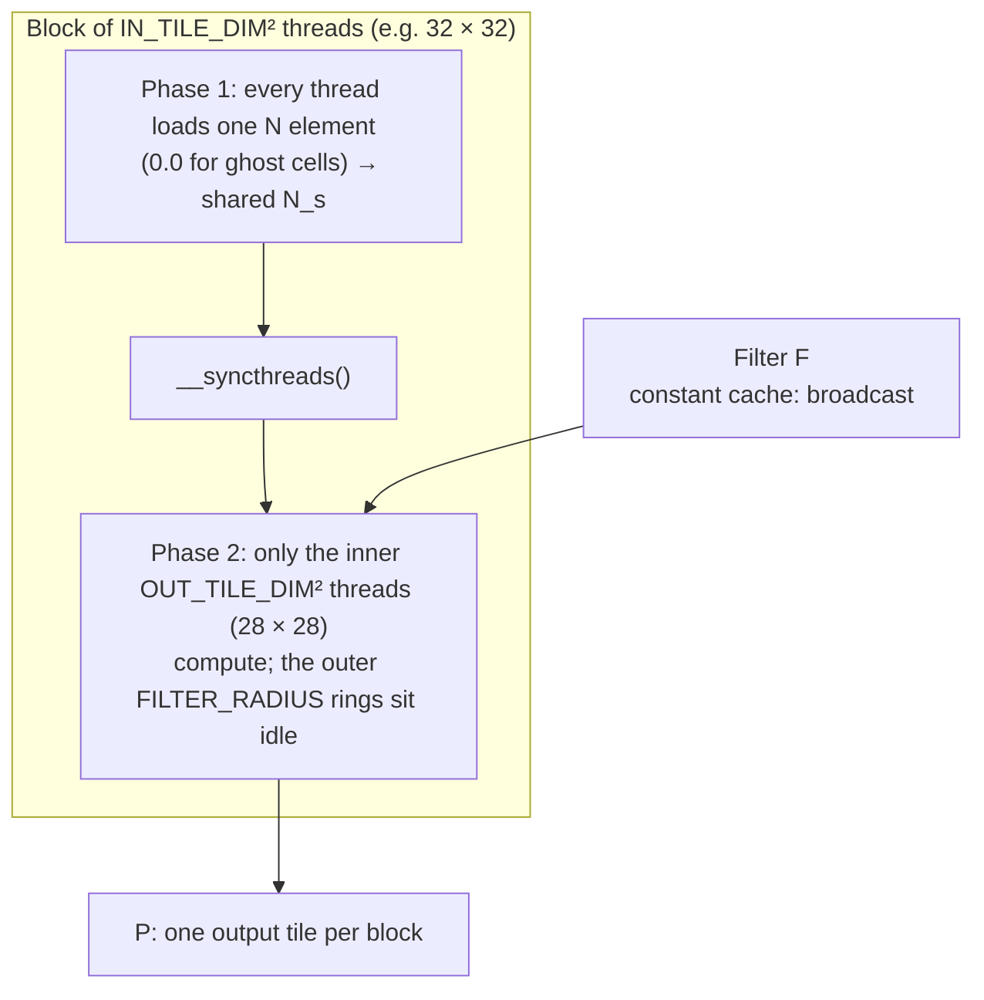

# Convolution

> Every output is a weighted sum of a neighbourhood of inputs, so neighbouring
> threads read heavily overlapping data. Convolution introduces **constant
> memory**, **input tiles bigger than output tiles**, and the question of
> when to let the cache handle the overlap instead of you.

## The pattern

**Convolution** computes each output element as a weighted sum of the
corresponding input element and its neighbours. The weights come from a
small array the book calls the **convolution filter**. The usual name,
"convolution kernel", would clash with CUDA kernels. Convolution is everywhere
in signal processing, imaging and vision, and it underlies chapter 8's
stencils and chapter 16's CNNs.

In 1D, a filter of `2r + 1` weights with **radius** `r` gives:

```
y[i] = Σ_{j = −r … r}  f[j + r] · x[i + j]
```

The book's example has x = [8, 2, 5, 4, 1, 7, 3] and f = [1, 3, 5, 3, 1]. Then
y[2] = 1·8 + 3·2 + 5·5 + 3·4 + 1·1 = 52, and y[3] = 47. In 2D, the filter is
`(2r_y + 1) × (2r_x + 1)`, usually square, and each output is the sum of an
element-wise product of the filter with the patch centred on that pixel.

Near the edges the patch hangs off the array. The missing inputs are **ghost
cells**. They're usually treated as 0, though some applications copy the
nearest edge value. In 1D, y[1] with zero ghosts is 53. In 2D, a corner output
can be missing rows and columns at once.

## A basic kernel

One thread per output pixel, in a 2D grid. Each thread loops over its patch,
skips ghost cells, accumulates in a register, and writes once.

Two problems:

- **Divergence at the edges.** Each edge thread skips a different number of
  ghost cells. For big images and small filters this costs little.
- **Memory bandwidth, the real problem.** Each multiply-add loads one input
  and one filter weight: 2 FLOP per 8 bytes, **0.25 FLOP/B**. That's the
  naive matrix-multiply number again.

## Constant memory for the filter

The filter has three helpful properties. It is **small** (radius ≤ 7, so at
most 7³ = 343 weights even in 3D). It **doesn't change** during the kernel.
And **every thread reads it in the same order**. That's exactly what constant
memory is for:

```c
#define FILTER_RADIUS 2
__constant__ float F[2*FILTER_RADIUS+1][2*FILTER_RADIUS+1];   // file scope
cudaMemcpyToSymbol(F, F_h, sizeof(F));                          // host
```

The kernel then reads `F` as a global variable, with no pointer parameter.
Constant memory lives in DRAM (64 KB in total), but it's served by a
dedicated **constant cache**. That cache doesn't have to support writes, so it
is cheap in area and power. When a whole warp reads the **same** address, as
happens with `F[fRow][fCol]`, it broadcasts the value at high bandwidth. In
effect the filter costs **no DRAM bandwidth**, and intensity doubles to
**0.5 FLOP/B**.

The book uses this moment to review caches. Unlike shared memory, they're
**transparent**: the program uses ordinary addresses and the hardware keeps
recent data. An **L1** cache sits per core or SM (16–64 KB, near core speed).
**L2** is shared across SMs (hundreds of KB to a few MB, tens of cycles). Some
CPUs add a large **L3**.

## Tiling with halo cells

The input elements that one block's outputs need form the **input tile**.
It's the output tile plus a border of width `r` on every side, called the
**halo**. So, unlike matrix multiply, **input tiles are bigger than output
tiles**:

| Output tile | Filter | Input tile | Input/output ratio |
| --- | --- | --- | --- |
| 4 × 4 | 5 × 5 | 8 × 8 = 64 | 4 |
| 16 × 16 | 5 × 5 | 20 × 20 = 400 | 1.6 |

That mismatch leaves two simple thread organizations:

1. **Block = input tile** (the book's choice). Each thread loads exactly one
   input element (or 0 for a ghost) into shared memory. After a barrier, only
   the inner threads compute outputs. The outer `r` rings are idle during
   compute.
2. **Block = output tile.** Every thread computes, but loading needs a loop,
   because there are more input elements than threads.



The pay-off depends on tile size. Per internal block, `OUT²·(2r+1)²·2`
operations divide by `(OUT + 2r)²·4` bytes loaded:

| Input tile | 8 × 8 | 16 × 16 | 32 × 32 | Bound (infinite tile) |
| --- | --- | --- | --- | --- |
| 5 × 5 filter, FLOP/B | 3.13 | 7.03 | **9.57** | 12.5 |
| 9 × 9 filter, FLOP/B | — | 10.13 | **22.78** | 40.5 |

32 × 32 is the largest tile a 1024-thread block allows. The bound is
`(2r+1)² · 2 / 4`: each element reused by every one of the `(2r+1)²` outputs
that need it. Larger filters reuse more, but they also waste more of a
fixed-size tile on halo. Small tiles are a trap: 8 × 8 tiles with a 5 × 5
filter reach only 3.13 FLOP/B. That bites hardest in **3D**, where shared
memory runs out quickly and forces small tiles.

## Letting the cache handle the halo

A block's halo cells are its neighbours' **interior** cells. By the time a
block needs them, a neighbour has probably already loaded them, so they're
likely sitting in **L2**. The book's last kernel exploits that:

- Input tile = output tile = block, all the same power-of-two size.
- Load only the **interior** into shared memory. That needs no ghost check
  beyond the usual array bounds.
- In the compute loop, read from shared memory if the element is inside the
  tile. Otherwise read it from **global memory** (usually an L2 hit), or skip
  it if it's a ghost cell.

The loading gets simpler and the compute loop gets more branches. It also
avoids the idle-thread rings and the odd tile sizes of the previous version,
which cause extra control and memory divergence.

> **Since this edition:** for real image and CNN workloads nobody hand-writes
> these kernels any more. cuDNN, and compilers such as Triton and the
> PyTorch and XLA backends, pick between direct, GEMM-based (chapter 16),
> FFT and Winograd algorithms. The constant-memory and halo reasoning is still
> how you read their performance.

## What to take away

- Put small, read-only data that every thread reads in the same order in
  `__constant__` memory. The constant cache broadcasts it for free.
- When outputs need overlapping neighbourhoods, tile with a halo. Expect the
  input tile to be bigger than the output tile, and budget for idle threads
  or loading loops.
- Compute the achieved FLOP/B for your actual tile size, not the asymptotic
  one. Small tiles and big filters fall well short.
- Halo data is often already in L2 because a neighbouring block loaded it. A
  simpler kernel that leans on the cache can win.

---

Previous: [Part II — Parallel patterns](./README.md) ·
Next: [Stencil](./08-stencil.md)
