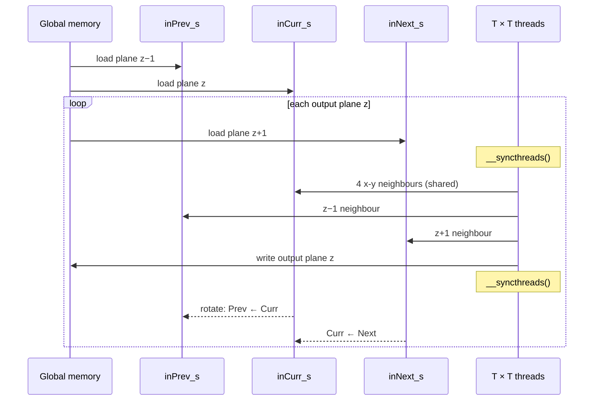
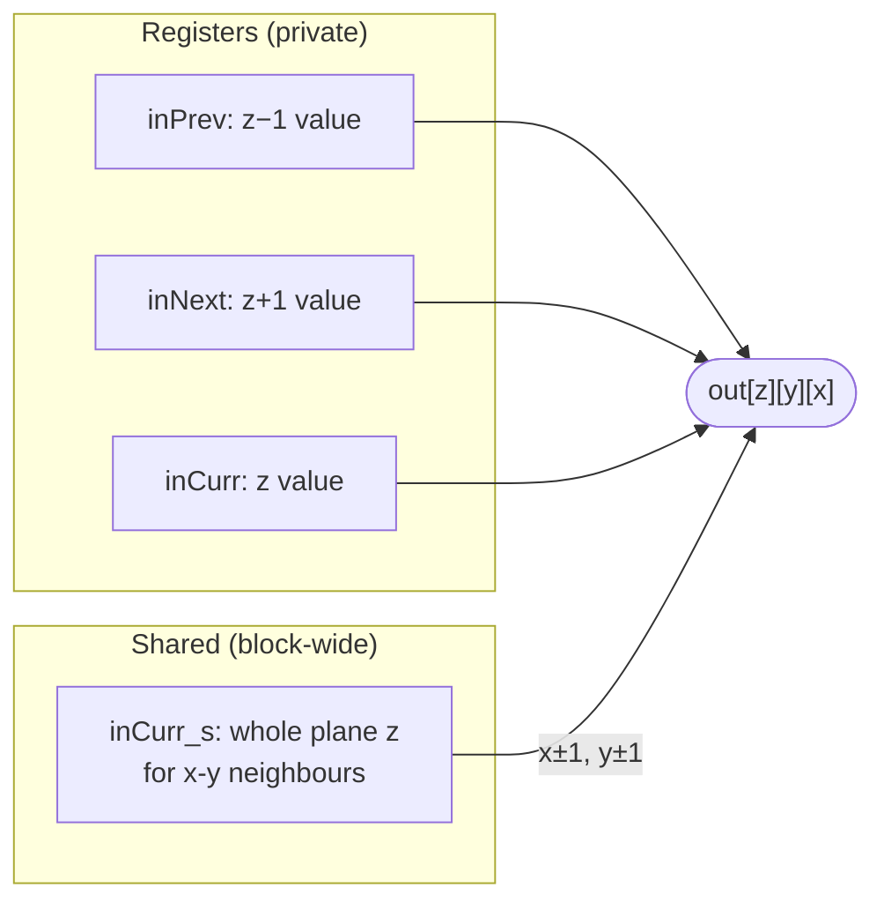

# Stencil

> A stencil looks like a convolution with a sparse filter, but it lives in 3D
> and reuses each input far less. That pushes the design away from big shared
> tiles and towards **thread coarsening** along one axis and **register
> tiling**.

## Where stencils come from

To solve a differential equation numerically, you **discretize** the domain
onto a **structured grid**: points at constant spacing `h`, with values
stored in an array. Smaller `h` means a better approximation but more
storage and computation. Precision is a second cost: FP64 is more accurate,
but it's slower on most GPUs, uses twice the bandwidth, and fills on-chip
memory twice as fast. (The book sticks to structured grids and finite
differences. Unstructured grids, used by finite-element and finite-volume
methods, are out of scope.)

Derivatives become **finite differences**. The classic first derivative is
`f′(x) ≈ (f(x+h) − f(x−h)) / 2h`, with error O(h²). On the grid that's
`FD[i] = −1/(2h)·F[i−1] + 1/(2h)·F[i+1]`: a fixed **pattern of weights
applied at every point**. That pattern is the **stencil**. The number of
points on each side is its **order**:

| Stencil | Points | Order |
| --- | --- | --- |
| 1D | 3 / 5 / 7 | 1 / 2 / 3 |
| 2D "plus" | 5 / 9 | 1 / 2 |
| 3D "plus" | 7 / 13 | 1 / 2 |

Applying the stencil to every grid point is a **stencil sweep**. Solvers do
many sweeps, one after another. The book assumes the boundary layer of the
grid holds **boundary conditions** that never change, so only interior points
are computed.

## How stencils differ from convolution

There are two differences, and both matter for performance:

1. **They're sparse.** A 2D five-point stencil uses 5 inputs per output where
   a 3 × 3 convolution uses 9, and it skips the corners. Less use per input
   means less reuse to gain from tiling.
2. **They're mostly 3D.** In 3D the gap becomes huge, and 3D tiles hit the
   1024-thread block limit at only 8 × 8 × 8.

Upper bounds on FLOP/B with perfect reuse:

| | Stencil | Matching convolution |
| --- | --- | --- |
| 2D, order 1 | 2.5 | 4.5 (3 × 3) |
| 2D, order 2 | 4.5 | 12.5 (5 × 5) |
| 2D, order 3 | 6.5 | 24.5 (7 × 7) |
| 3D, order 3 (19 points) | 9.5 | 171.5 (7 × 7 × 7) |

## Basic kernel and shared-memory tiling

The basic 3D seven-point kernel has one thread per output. It does 13 FLOP
(7 multiplies, 6 adds) on seven 4-byte loads: **0.46 FLOP/B**.

Shared-memory tiling works just as in chapter 7. Blocks are the size of the
input tile and the outer layer of threads is idle during compute. With a
`T³` input tile:

```
FLOP/B = 13·(T−2)³ / (4·T³) = 13/4 · (1 − 2/T)³   → bound 3.25
```

T is stuck at 8 (512 threads), and that hurts in two ways:

- **Halo overhead.** At T = 8 the ratio is only **1.37 FLOP/B**. Of an 8³ tile,
  58% is halo (296 of 512 points). A 32 × 32 2D convolution tile has about
  12% halo.
- **Poor coalescing.** A 32-thread warp covers four separate 8-element rows,
  so each load touches at least four distant segments of memory.

## Thread coarsening along z

The fix is to give each block a **2D** `T × T` set of threads and have it walk
through the tile **plane by plane** in z, computing one x-y output plane per
step. The seven-point stencil only needs three planes at a time:
previous, current and next.



Two things improve:

- Blocks are `T²` threads, so **T = 32** fits (1024 threads). The ratio rises
  to 13/4 · (1 − 2/32)³ ≈ **2.68 FLOP/B**, against 1.37 before and a bound of
  3.25.
- Only **3 planes** are on chip, not T. That's 3 × 32² × 4 B = **12 KB**
  per block instead of a whole cube.

## Register tiling

Look at who reads what. Each element of the previous and next planes is used
by **exactly one thread**, the one directly in front of or behind it. Only
the current plane's elements are shared with x-y neighbours. So:

- `inPrev` and `inNext` become **registers** in each thread.
- Only `inCurr_s` stays in shared memory. The thread also keeps its own copy
  of the current value in a register.

That cuts shared memory to **a third**. Many accesses also move to registers,
which are faster still. The cost is three more registers per thread, 3072 per
32 × 32 block, and more for higher-order stencils. If that hurts occupancy,
put some planes back in shared memory. Global traffic is **unchanged**: the
same reuse, just spread over registers and shared memory.



The book points out that register tiling isn't new. Every kernel that kept
its output in an accumulator, from matrix multiply to convolution, was
holding an **output** tile in registers. Here the same is done for part of
the **input**.

> **Since this edition:** the "2.5D" or z-marching style with register queues
> remains the standard for GPU stencils. Large production codes increasingly
> express stencils in a DSL or a portability layer (Kokkos, SYCL, OpenACC) and
> let the tool choose these schedules. Temporal blocking, fusing several sweeps
> into one pass, is a further step the book doesn't cover.

## What to take away

- For sparse 3D patterns, don't tile all three dimensions in shared memory.
  Use a 2D block and march along the third axis.
- Keep only the planes the stencil currently needs on chip. That's
  `2·order + 1` planes.
- Values used by a single thread belong in registers. Values shared between
  neighbours belong in shared memory.
- Halo fraction is the hidden tax on small tiles: about 58% for 8³, versus
  about 12% for a 32 × 32 2D tile.

---

Previous: [Convolution](./07-convolution.md) ·
Next: [Parallel histogram](./09-histogram.md)
