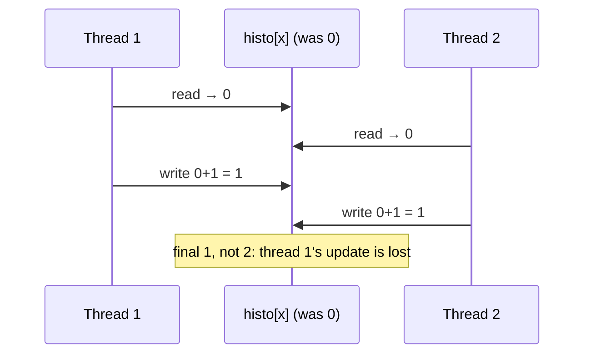
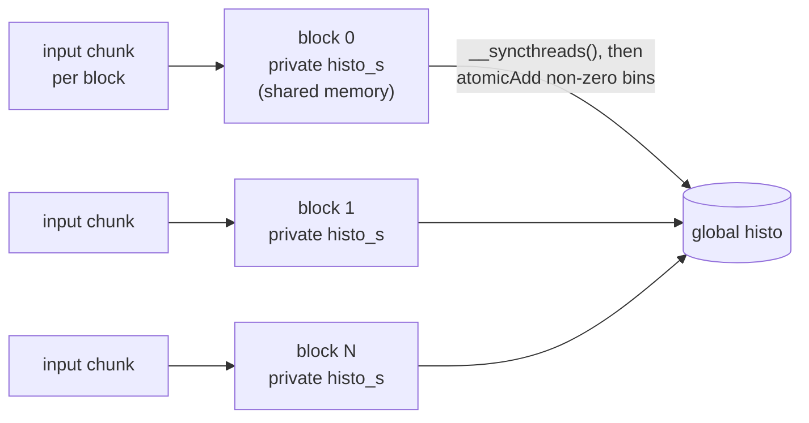

# Parallel histogram

> The first pattern where threads don't own their outputs: any thread may
> need to increment any bin. That brings **race conditions**, **atomic
> operations**, and the trick that makes atomics fast, **privatization**.

## When owner-computes stops working

Every pattern so far obeyed the **owner-computes rule**: each output element
belongs to one thread, so writes never collide. A **histogram** breaks it.
Each input says *which* bin to increment, so any thread may hit any bin. The
book's running example counts the letters of "programming massively parallel
processors" into seven four-letter bins (a–d, e–h, …, y–z).

Histograms matter far beyond charts. The shape of a histogram is a **feature**
of a dataset. Card-fraud detection compares spending histograms with the
norm, computer vision compares the luminance histograms of image regions, and
speech recognition and recommendation systems use them too.

On a CPU the loop is trivial and efficient. The input streams through cache
lines, and the tiny bin array stays in L1, so it's memory-bound on reading the
input.

## Race conditions and atomics

Incrementing a bin is a **read-modify-write**. If two threads interleave
(both read 0, both write 1), one update is **lost**. The book's real-world
versions are two customers booking the same airline seat, and two kiosks
issuing the same queue ticket. A **read-modify-write race condition** is
any situation where the result depends on the relative timing.

An **atomic operation** performs the read-modify-write as an indivisible
unit. Other atomics on the same address wait until it finishes. It doesn't
impose an *order* (either thread may go first); it only stops overlap.
`atomicAdd(&histo[bin], 1)` is an **intrinsic**: it looks like a function call
but compiles to a single hardware instruction and returns the old value.
There are also atomic sub, inc, dec, min, max, and, or, and others. The basic
kernel is just the sequential loop body with one thread per character and
`atomicAdd` in place of `++`.

## Why atomics are slow

Normal memory throughput comes from having many accesses **in flight** at
once (chapter 6). Atomics on **the same address** can't overlap. Each takes
roughly a memory read latency plus a write latency, and the next waits for it.

The book's arithmetic: 8 channels of 8-byte DDR at 1 GHz deliver 128 GB/s, or
32 G four-byte elements per second. With 200-cycle latency, one address
accepts one atomic per 400 cycles: **2.5 M atomics per second**. Seven bins
evenly used would give 17.5 M/s. Real text is skewed, heavy on the m–p and q–t
bins, so the book estimates about **7 M/s**.

Two fixes:

- **Shorten the latency.** Modern GPUs perform atomics in the **last-level
  (L2) cache**, which takes tens of cycles instead of hundreds. Hot bins tend
  to stay cached, so this alone is "at least an order of magnitude" faster
  than early GPUs.
- **Reduce contention.** That's privatization.

## Privatization

Give each **subset of threads** its own **private copy** of the histogram,
update that copy, and **merge** the copies at the end. The merge is the cost,
so in massively parallel code you privatize per group of threads (usually
**per block**), not per thread.

Per-block copies have two advantages. The block can use `__syncthreads()`
before merging; a copy shared by several blocks would need a second kernel.
And, if the bins fit, the copy can live in **shared memory**, where an atomic
costs a few cycles. The book's progression:

1. Private copies in **global** memory, offset by `blockIdx.x * NUM_BINS`.
   They're likely cached in L2, and contention drops by roughly the number of
   active blocks. At the end each block adds its non-zero bins into block 0's
   copy, with atomics, but now with low contention.
2. Private copies in **shared** memory. Initialize them to zero in parallel,
   barrier, update, barrier, then merge into global memory. Fast atomics
   within a block are one of the main reasons shared memory exists.

## Coarsening: fewer copies to merge

Each block pays for one merge. If you launch more blocks than the GPU can
hold, the hardware serializes them and you pay for extra merges for nothing.
So **coarsen**: launch fewer blocks and give each thread several inputs. How
you split the input matters:

| Partitioning | Thread `t` handles | Fits |
| --- | --- | --- |
| **Contiguous** | `t·C … (t+1)·C − 1` | CPUs: each thread streams its own cache lines |
| **Interleaved** | `t, t + T, t + 2T, …` (T = all threads) | GPUs: at each step a warp reads consecutive addresses, so loads coalesce |

On a GPU, thousands of threads would evict each other's cache lines before a
contiguous scan finished, so **interleaved** wins. (The book also suggests
each thread read four characters, one 32-bit word, per step to use the
cache-to-SM bandwidth fully.)

## Aggregation

Some data has long **runs** of the same value: a sky full of identical blue
pixels, for example. Every thread then hammers the same bin. **Aggregation**
(Merrill, 2015) has each thread keep an accumulator and the index of the last
bin it saw. While the bin repeats, it just counts. When the bin changes, it
flushes the count with one atomic, and it flushes once more after the loop.

It costs extra variables and a branch. On low-contention data it can be
**slower** than the plain kernel. On high-contention data it's much faster.
The branch rarely diverges much, because threads are mostly either all in
streaks or all flushing.

> **Since this edition:** shared-memory atomics got much faster from Maxwell
> on. CUB's `DeviceHistogram` packages privatized, coarsened histograms, and
> warp-level primitives such as `__match_any_sync` let a warp merge duplicate
> bins before issuing atomics, which is aggregation across threads. Use the
> library unless your binning is unusual.

## What to take away

- When outputs are data-dependent, use atomics for correctness. Then assume
  they'll be your bottleneck under contention.
- Atomic throughput on one address is roughly 1 / (2 × latency), so cut the
  latency (shared memory, L2) and spread the traffic (privatization).
- Privatize per block, in shared memory if it fits, and merge once at the
  end.
- On GPUs, coarsen with **interleaved** partitioning, not contiguous chunks.
- If the input has long runs, aggregate before you increment.

---

Previous: [Stencil](./08-stencil.md) ·
Next: [Reduction](./10-reduction.md)
