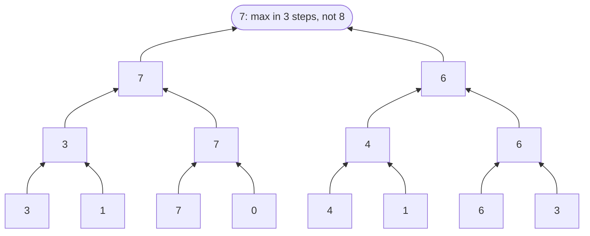
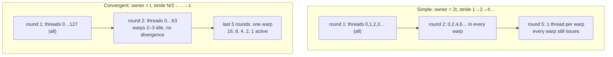
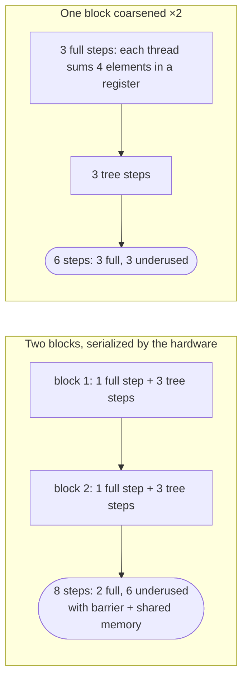

# Reduction

> Sum, max, min: collapse an array to one value. The reduction tree is easy
> to state, and this chapter tunes it step by step to show what control
> divergence and memory divergence really cost, ending with a kernel that
> scales to any input size.

## Reductions and why they parallelize

A **reduction** combines a set of values with a binary operator that has an
**identity**: 0 for sum, 1 for product, +∞ for min, −∞ for max. The sequential
version starts from the identity and folds in one element per iteration.

A parallel version reorders the operations, which is only safe if the operator
is **associative**, `(a⊕b)⊕c = a⊕(b⊕c)`. Then you can regroup freely:

```
sequential: ((((((3 max 1) max 7) max 0) max 4) max 1) max 6) max 3
tree:       ((3 max 1) max (7 max 0)) max ((4 max 1) max (6 max 3))
```

Floating-point addition isn't strictly associative, because rounding depends
on order. Applications usually accept "equal within tolerance". The book's
Appendix A covers the details. The optimized kernel below also **reorders
operands**, which additionally needs **commutativity** (`a⊕b = b⊕a`). Max,
min, sum and product have both properties. Subtraction has neither.

### The reduction tree

Pair up the inputs and combine each pair in parallel. Then pair up the results,
and so on.



| | Sequential | Tree |
| --- | --- | --- |
| Operations | N − 1 | N/2 + N/4 + … + 1 = **N − 1** (work-efficient) |
| Time steps | N | **log₂ N** (1024 → 10) |
| Peak parallelism | 1 | N/2 (512 for N = 1024) |
| Average parallelism | 1 | (N−1)/log₂N ≈ **102** for N = 1024 |

That gap between peak and average parallelism is what makes trees awkward on
hardware. The sidebar's example is the 2010 World Cup knockout: 8 teams, 3
rounds, and two quarter-finals sharing one city on different days because
there weren't enough stadiums.

## Five kernels, each fixing the last one's problem

### 1. Simple (stride doubles)

One block, N/2 threads. Thread `t` owns `input[2t]`. With `stride = 1, 2, 4, …`,
threads whose index is a multiple of `stride` add `input[owner + stride]` into
their own element, with a barrier each round.

The problem is that active threads become **further and further apart**. In
round 2 only the even threads in each warp work, in round 3 every fourth, and
in round 5 one per warp. Every warp with any active thread costs a full warp
of execution.

### 2. Convergent (stride halves)

Thread `t` owns `input[t]`. Start with `stride = blockDim.x` and halve it each
round. Threads with `t < stride` add `input[t + stride]`. The same number of
additions happen, but the **active threads are always contiguous**, so whole
warps switch off together. Divergence remains only in the last five rounds,
when fewer than 32 threads are active.



The book's accounting for N = 256 (128 threads, 4 warps):

| | Simple | Convergent |
| --- | --- | --- |
| Useful results | 255 | 255 |
| Execution resources (warp-slots × 32) | (4·5 + 2 + 1) × 32 = 736 | (4 + 2 + 1 + 5) × 32 = 384 |
| **Utilization** | **35%** | **66%** |
| Global memory requests, N = 256 | 141 | 36 (**3.9×** fewer) |
| Global memory requests, N = 2048 | 1149 | 204 (**5.6×** fewer) |

The memory column is **memory divergence**. In the simple kernel, a warp's
addresses are `stride` apart, so each access needs two requests and wastes
most of each burst. In the convergent kernel neighbours touch neighbours, and
each access is one coalesced request. The code change is a couple of index
expressions. You have to understand warps to see why it doubles performance.

### 3. Shared memory

Partial sums are written and re-read every round. So each thread loads **two**
inputs, adds them, and stores the sum in shared memory. The remaining rounds
run entirely in shared memory, and thread 0 writes the result. Global traffic
falls to N reads plus 1 write. For N = 256 that's 8 + 1 = 9 coalesced
requests, against 36 for the convergent kernel. As a bonus, the **input array
is left untouched**.

### 4. Hierarchical, for any length

Every kernel so far is one block, so at most 2048 elements, because
`__syncthreads()` only works within a block. To use the whole GPU, split the
input into **segments of `2·blockDim.x`**. Each block reduces its own segment
in shared memory, and thread 0 of each block does
`atomicAdd(output, input_s[0])`. One atomic per block costs very little.

### 5. Thread coarsening

With N/2 threads, most blocks wait in line, and **every block repeats the
wasteful tail of the tree**: half the threads idle each step, plus a barrier
and shared-memory traffic per step. If the hardware will serialize the blocks
anyway, serialize them yourself more cheaply. Give each block
`COARSE_FACTOR × 2 × blockDim.x` elements. Each thread first sums its share
into a **register**, with all threads active, no barriers and no shared
memory, and only then joins a single tree.



Don't coarsen so far that fewer blocks remain than the GPU can run at once.
The right factor depends on input size and device.

> **Since this edition:** warp-shuffle intrinsics (`__shfl_down_sync`) and
> cooperative groups let a warp finish the last five rounds in registers
> with no shared memory or barriers. That's the standard ending for
> production reductions, and CUB's `DeviceReduce` and `BlockReduce` package
> all of it. On Ampere and later, `__reduce_add_sync` does a whole-warp
> integer reduction in one instruction.

## What to take away

- A parallel reduction needs an associative operator, and the fast
  reorderings also need it to be commutative. Expect floating-point sums to
  differ slightly between runs.
- Keep active threads **contiguous** (halve the stride, don't double it).
  That removes most control divergence and memory divergence in one go.
- Do the tree in shared memory. Touch global memory once per input.
- For big inputs: reduce per block, combine with one atomic per block, and
  coarsen so each thread sums several elements in a register first.

---

Previous: [Parallel histogram](./09-histogram.md) ·
Next: [Prefix sum (scan)](./11-prefix-sum.md)
