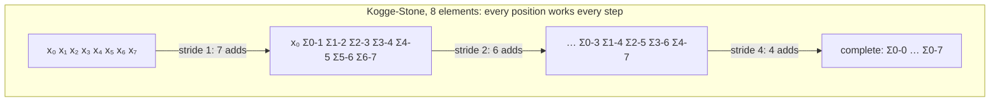
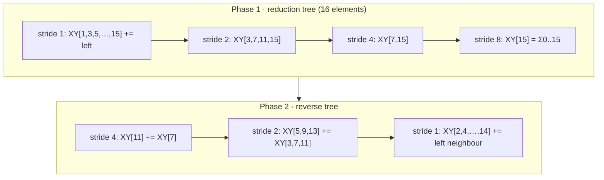
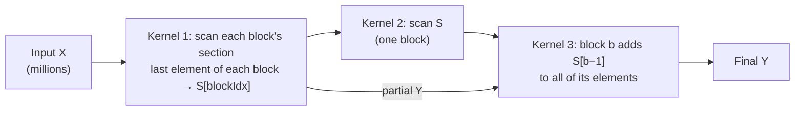

# Prefix sum (scan)

> Scan turns "each result depends on the previous one" into parallel work,
> and it is the building block behind sorting, compaction and allocation.
> It's also the book's lesson in **work efficiency**: a parallel algorithm
> that does more total work than the sequential one can lose.

## What scan is, and why it matters

An **inclusive scan** with an associative operator ⊕ turns
`[x₀, x₁, …, xₙ₋₁]` into `[x₀, x₀⊕x₁, …, x₀⊕…⊕xₙ₋₁]`. With addition,
`[3 1 7 0 4 1 6 3]` becomes `[3 4 11 11 15 16 22 25]`. An **exclusive scan**
shifts the result right and starts with the identity: `[0 3 4 11 11 15 16 22]`.
Converting between them is a shift, so the book implements only inclusive.

The book's picture is a 40-inch sausage and eight people who ordered 3, 1, 7,
0, 4, 1, 6 and 3 inches. Cutting sequentially means one cut after another. The
inclusive scan gives **every cut point at once**, so all eight cuts can happen
in parallel. The exclusive scan gives the **starting points**, which is
exactly what memory allocation needs: each requester gets a pointer to the
start of its chunk.

That's why scan is everywhere. Any computation written as a recurrence,
where each item depends on the previous one, is a candidate, including
resource allocation, work assignment, radix sort, quicksort, stream
compaction, polynomial evaluation and tree operations. A sequential scan does
**N − 1** additions. That's the bar.

## Kogge-Stone: fast, not work-efficient

Running a separate reduction for every output would be O(N²) work. **Kogge-
Stone** (1973, from fast adder circuits) **shares** partial sums between
outputs. Working in place on array `XY`, in step `k` every position `i ≥ 2ᵏ⁻¹`
adds in the value `2ᵏ⁻¹` to its left. After `k` steps, `XY[i]` holds the sum
of up to `2ᵏ` elements ending at `i`, so `log₂N` steps finish the job.

The kernel scans one **section** per block in shared memory. One subtlety: a
thread reads `XY[i − stride]` while another thread may be overwriting it in
the same step. That's a **write-after-read race**, not the read-modify-write
race of chapter 9, so atomics don't help. Two fixes:

- Compute into a **register `temp`**, then `__syncthreads()`, then write. This
  costs a second barrier per step.
- **Double-buffering**: read from one shared array and write to the other,
  swapping each step. This costs twice the shared memory but saves the
  barrier.

Reduction (chapter 10) never needed this, because no active thread there reads
a location another active thread writes in the same step.

### Work efficiency

**Work efficiency** compares the operations an algorithm performs with the
minimum, which for scan is N − 1. Kogge-Stone performs
`Σ (N − stride) = N·log₂N − (N − 1)` additions, which is **O(N log N)**. For a
512-element section that's about **8×** the sequential work, and the ratio
grows with N. On a real GPU, idle threads in partly active warps still burn
slots, so the real cost is closer to `N·log₂N`.

That matters when execution units are limited. The book's model has 1024
elements and **P = 32** units. Kogge-Stone takes about 1024 × 10 / 32 =
**320 steps**, only 3.2× fewer than sequential. If P is small enough it is
*slower* than the CPU loop, and the extra work also costs **energy**.
Kogge-Stone is the right tool for modest sections (512–1024 elements) on
hardware with plenty of units. Divergence is limited to the first warp, and
the pattern maps neatly onto **warp shuffles** on newer GPUs.

## Brent-Kung: work-efficient, more steps

**Brent-Kung** (1979, also an adder design) does it in two phases:

1. **Reduction tree (up-sweep):** a minimal tree whose sum ends at the
   *highest* position. Positions `2ⁿ − 1` are updated. That's N − 1
   additions, leaving partial sums at strategic positions.
2. **Reverse tree (down-sweep):** push those partial sums right, at strides
   N/4, …, 2, 1, into the positions still missing them. That's
   N − 1 − log₂N additions.

The total is about **2N − 2 − log₂N**, which is O(N) and never more than twice
the sequential work. The book calls such an algorithm **data-scalable**. To
avoid divergence, the kernel maps a *contiguous* run of threads onto the
positions `(t + 1)·2·stride − 1`, so whole warps drop out together. It needs
only N/2 threads, so a 1024-thread block scans **2048** elements, with each
thread loading and storing two.

The catch is speed. With unlimited hardware it takes about **twice as many
steps** as Kogge-Stone (two trees). With 1024 elements and 32 units it takes
roughly (2·1024 − 2 − 10)/32 ≈ 64 steps, plus about 5 for divergent tails:
about **74 steps, 14× faster than sequential**, against 3.2× for Kogge-Stone.
Which one wins depends on how much hardware you have per element.

## Coarsening: sequential where it's cheap

Scan's parallel overhead includes **lost work efficiency**, so if the hardware
serializes threads anyway, do the cheap sequential version instead. The
**three-phase** kernel:

1. **Load the section into shared memory, coalesced**, then each thread scans
   its own **contiguous subsection** sequentially. Contiguous chunks would
   mean uncoalesced global reads, so the shared memory absorbs that pattern.
2. **Scan the subsection totals** (one per thread) with Kogge-Stone or
   Brent-Kung.
3. Each thread **adds its predecessor's total** to its elements. Its last
   element is already final.

The work is `(N − T) + T·log₂T + (N − T)`. With 64 threads, 32 units and 1024
elements that's about **72 steps**. Section size is now limited by **shared
memory**, not by threads per block.

## Arbitrary length: hierarchical scan

For millions of elements, scan in three passes:

With 16 inputs in 4 blocks, the block totals are 7, 7, 6 and 11. Scanning them
gives S = 7, 14, 20, 31, which are the exact final values at positions 3, 7, 11
and 15. Adding S[b−1] to block b completes everything. The book notes the
resemblance to carry look-ahead in hardware adders. The cost is that partial
results go out to global memory and come back in a **separate kernel**, so
that traffic can't overlap with computation.

## Single-pass "domino" scan

A **stream-based** or domino scan does all three steps in one kernel. Block
`i` scans its section. It then **waits for block i − 1's running total**, adds
its own, **passes the result to block i + 1**, and finally adds the received
value to its elements. Only the hand-off is serial, and phases 1 and 3 overlap
across blocks.

This needs **adjacent-block synchronization**. One leader thread per block
spins on a global `flags[bid]` (set with `atomicAdd`) and reads
`scan_value[bid]`. Then it writes `scan_value[bid+1]`, calls
**`__threadfence()`** so that value is visible *before* the flag is set, and
sets `flags[bid+1]`. These accesses mostly hit L2.

The trap is that **blocks aren't scheduled in `blockIdx` order**. If blocks
i … i+N fill every SM while waiting for block i − 1, which hasn't been
scheduled yet, the GPU **deadlocks**. The fix is **dynamic block index
assignment**: each block takes its logical index from `atomicAdd` on a global
counter when it *starts*, so a block with index `i` knows `i − 1` is already
running.

> **Since this edition:** the state of the art is Merrill and Garland's
> **decoupled look-back** (2016, cited by the book). Each block publishes its
> local aggregate immediately and looks back over several predecessors rather
> than waiting on one. It's what CUB's `DeviceScan` implements. The book's own
> closing advice still holds: use a library (CUB, Thrust) unless you're doing
> this to learn.

## What to take away

- Whenever you see "each output depends on the previous", look for a scan.
  Exclusive scan is parallel allocation.
- Count total work, not just steps. An O(N log N) algorithm can lose to a
  sequential O(N) loop when hardware is limited, and it always costs more
  energy.
- Kogge-Stone suits small sections with plenty of hardware. Brent-Kung and
  coarsened three-phase scans suit large inputs and limited units.
- In-place parallel updates have write-after-read hazards. Fix them with a
  temporary and a barrier, or with double buffering.
- Any scheme where blocks wait on other blocks must not rely on `blockIdx`
  order. Hand out logical indices at run time.

---

Previous: [Reduction](./10-reduction.md) ·
Next: [Merge](./12-merge.md)
