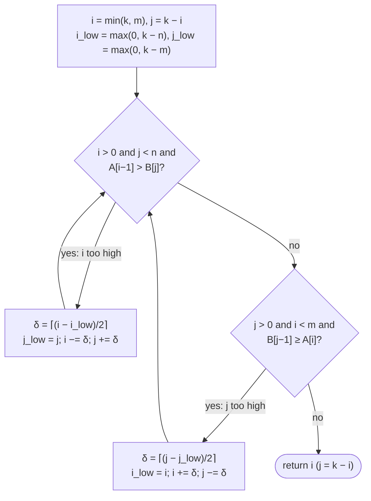
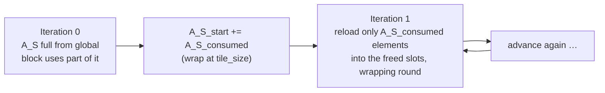

# Merge

> Merging two sorted arrays looks inherently sequential, and each thread's
> input range depends on the data values themselves. The **co-rank**
> function solves that with a binary search. Making the result fast needs
> tiling with an unpredictable consumption rate, which leads to **circular
> buffers**.

## The pattern

An **ordered merge** takes sorted arrays A (m elements) and B (n elements) and
produces sorted C (m + n elements). The book requires it to be **stable**:
equal keys keep their input order, and on a tie between A and B, **A's element
goes first**. Stability lets one sort build on another. Data sorted by one key
and then merged by another keeps the first ordering among ties.

Merge is the core of **merge sort** (chapter 13), and of the reduce step in
MapReduce frameworks such as Hadoop, which assemble sorted results with merges
arranged as a reduction tree. The sequential version walks both arrays with
indices `i` and `j`, takes the smaller head (A on a tie), and copies whichever
tail is left. It's O(m + n).

## Co-rank: deciding where each thread's input starts

Siebert and Träff (2012) parallelize by **dividing the output**. Give each
thread a contiguous range of C. Then ask which parts of A and B produce it.

The key fact: for any position `k` in C, the prefix `C[0 … k−1]` is exactly the
merge of `A[0 … i−1]` and `B[0 … j−1]` for a **unique** pair `(i, j)` with
`i + j = k`. Here `k` is the **rank** and `i, j` are its **co-ranks**. With
A = (1, 7, 8, 9, 10) and B = (7, 10, 10, 12), C[4] has rank 4 and co-ranks
(3, 1), and C[6] has co-ranks (5, 1).

So thread `t`, producing `C[k_t … k_{t+1} − 1]`, calls the co-rank function
twice. Its inputs are `A[i_t … i_{t+1}−1]` and `B[j_t … j_{t+1}−1]`, and it
runs the ordinary sequential merge on those.

This is the first pattern where **a thread's input range can't be computed
from its index**. It depends on the values. That's what the chapter means by
**dynamic input data identification**, and the same idea applies to set
intersection and union.

### Finding the co-rank

Both arrays are sorted, so the co-rank is a **binary search** for the `i`
(with `j = k − i`) satisfying:

- `A[i−1] ≤ B[j]`: i isn't too high. Ties are allowed, because A wins ties.
- `B[j−1] < A[i]`: j isn't too high.

The lower bounds speed it up. At least `k − n` elements must come from A,
because B can supply at most n, and symmetrically for B. Each step halves the
range, so the search is **O(log N)**.

## The basic kernel, and why it's slow

Each thread computes its `k_curr` and `k_next`, calls `co_rank` twice, and
calls `merge_sequential` on its slice. It's correct and elegant, and it has
poor memory behaviour:

- Adjacent threads read A[0], A[2], B[0] and write C[0], C[3], C[6], because
  each walks its own slice. **Nothing coalesces.**
- The binary searches themselves make **scattered global reads**.

## Tiled merge

Neighbouring threads' input slices are **adjacent in memory**, so a whole
block's inputs form two contiguous block-level subarrays. That suggests the
third coalescing strategy from chapter 6: load contiguous data into shared
memory, coalesced, and do the irregular accesses there.

1. **Thread 0 only** computes the block-level co-ranks for the block's output
   range and shares them via shared memory, followed by a barrier. That's two
   global binary searches per block instead of two per thread.
2. Loop over the block's output in chunks of `tile_size`:
   - All threads load the **next `tile_size` elements of A and of B** into
     `A_S` and `B_S`, coalesced. In the book's example (tile 1024, 128
     threads) that's 8 rounds of 128 loads each.
   - Each thread co-ranks **within shared memory** to find its slice, and
     merges it.
   - Advance `A_consumed`, `B_consumed` and `C_completed`.

Why load `tile_size` of **both** A and B to produce only `tile_size` outputs?
Because you can't know in advance how the output splits. In the worst case all
of it comes from one input. On average, **half of what was loaded goes
unused**, and it's simply reloaded next time. That wastes half the bandwidth.
(Calling co-rank first to load exactly what's needed is the book's exercise.)

The book's sizing example has m = 33,000 and n = 31,000, so 64,000 outputs, 16
blocks of 128 threads, and 4000 outputs per block. That's 4 iterations of 1024,
and each thread merges 8 elements per iteration.

## Circular buffers

The fix is to keep what's left over. Treat `A_S` and `B_S` as **circular
buffers**. Track `A_S_start` (where the live data begins) and `A_S_consumed`
(how much was used last time). Each iteration refills only the consumed
amount, writing past the leftovers and wrapping with `% tile_size`.

Wrapped indices would make every co-rank and merge calculation messy, because
`a_next` could be smaller than `a_curr`. The book's design answer is a
**simplified model**. The calling code pretends each tile is contiguous,
starting at `A_S_start`, and passes plain offsets. Only `co_rank_circular`
and `merge_sequential_circular` turn an offset into a real index,
`(start + offset) % tile_size`. The book's point: a good library interface
keeps a clever data structure's complexity out of the user's code.

The cost is more registers per thread for buffer bookkeeping, which can reduce
occupancy. But merge is **memory-bound**, and compute and registers are mostly
idle anyway, so spending them to save bandwidth is the right trade.

## Coarsening

Here coarsening isn't optional. Parallelism costs **one binary search per
thread**, and a fully uncoarsened kernel would do a search for every output
element. All the kernels in the chapter give each thread many outputs, which
amortizes the search.

> **Since this edition:** "merge path" (Green, McColl and Bader, 2012) is the
> same diagonal-search idea under another name. Production merges and merge
> sorts in CUB, Thrust and ModernGPU are built on it. The circular-buffer
> detail is now typically handled by asynchronous copy pipelines on
> Ampere-class and later GPUs.

## What to take away

- When a thread's input range depends on data, find it by **searching the
  output partition** (co-rank). Don't try to partition the inputs.
- Do expensive searches once per block in global memory, then once per thread
  in shared memory.
- With unpredictable consumption, plain tiling wastes bandwidth. A circular
  buffer keeps the leftovers.
- Hide index wrap-around behind helper functions so the algorithm code stays
  readable.
- Coarsen enough to amortize per-thread setup such as binary searches.

---

Previous: [Prefix sum (scan)](./11-prefix-sum.md) ·
Next: [Part III — Advanced patterns and applications](../3-advanced-patterns/README.md)
