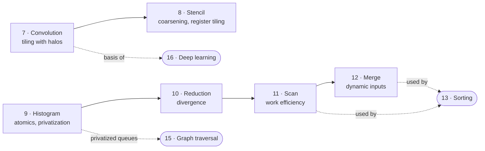

# Part II — Parallel patterns

> Six primitive patterns that recur in almost every parallel program. Each
> chapter also introduces one new hardware feature or optimization, so by the
> end the whole checklist from chapter 6 has been applied for real.

| | Pattern | What it teaches |
| --- | --- | --- |
| [Convolution](./07-convolution.md) | weighted sum of a neighbourhood | constant memory, input tiles larger than output tiles, halo cells, caching |
| [Stencil](./08-stencil.md) | sparse 3D neighbourhood, iterated | thread coarsening along z, register tiling |
| [Parallel histogram](./09-histogram.md) | data-dependent output | race conditions, atomics, privatization, aggregation |
| [Reduction](./10-reduction.md) | many values → one | reduction trees, control and memory divergence, hierarchical reduction |
| [Prefix sum (scan)](./11-prefix-sum.md) | running totals | work efficiency, Kogge-Stone vs Brent-Kung, single-pass scan |
| [Merge](./12-merge.md) | two sorted lists → one | data-dependent input ranges, co-rank, circular buffers |

---

Previous: [Performance considerations](../1-fundamentals/06-performance-considerations.md) ·
Next: [Convolution](./07-convolution.md)
