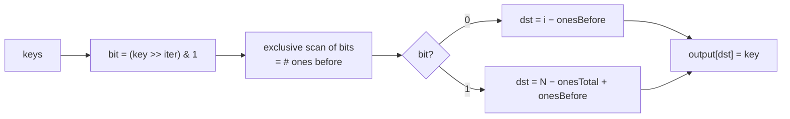
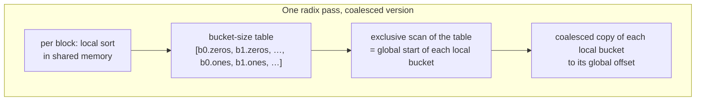
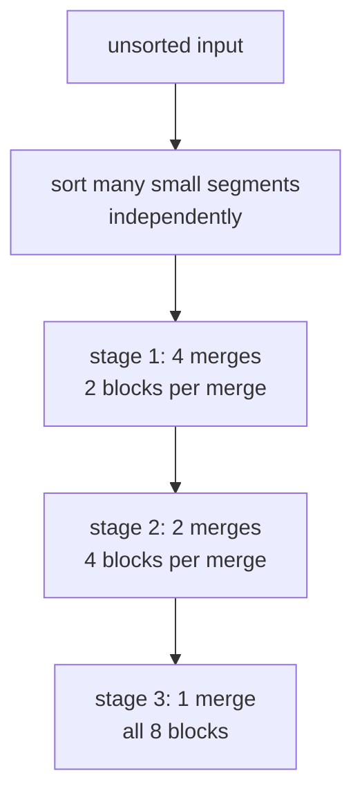

# Sorting

> Two GPU sorts built from the primitives of Part II: **radix sort**, whose
> every pass is an exclusive scan, and **merge sort**, which is chapter 12's
> parallel merge arranged as a tree. Most of the effort goes into making the
> scattered writes coalesce.

## What a sort must guarantee

The output must be in non-decreasing (or non-increasing) order, and it must be
a **permutation** of the input. Usually you sort records by a **key** field.
A **stable** sort keeps equal keys in input order. That is what lets you sort
by a secondary key first and then by the primary key, and get the right
result.

**Comparison sorts** can't beat O(N log N), but they work for any ordering you
can write a comparator for. **Non-comparison sorts** such as radix sort can do
better, but only for keys that break into digits, such as integers. The book
builds one of each (following Satish, Harris and Garland, 2009).

## Radix sort

LSD radix sort distributes keys into **buckets** by one digit, starting from
the least significant, and repeats for each digit. Each pass must be
**stable**. After pass `d`, keys are sorted by their lowest `d` digits. With a
1-bit radix, 4-bit keys take four passes.

The passes are inherently sequential, because each needs the previous pass's
full output. The parallelism is **inside a pass**: one thread per key, each
working out where its key goes.

### Where does my key go? A scan.

For a 1-bit pass:

```
destination of a 0 = (# zeros before me)        = my index − (# ones before me)
destination of a 1 = (# zeros in total) + (# ones before me)
                   = N − (# ones in total) + (# ones before me)
```

Everything depends on **"# ones before me"**, which is an **exclusive scan of
the bits**. The scan's last value plus the last bit gives the total. So a pass
is: extract the bit (`(key >> iter) & 1`), exclusive-scan the bits, compute the
destination, and scatter.



The scan needs grid-wide coordination. Use a single-pass scan (chapter 11), or
split each pass into three kernel launches.

### Making the writes coalesce

The scatter is badly uncoalesced: adjacent threads write to different buckets.
The fix is chapter 6's third strategy. **Sort locally in shared memory, then
write each local bucket out contiguously.**

1. Each block radix-sorts its own keys into local 0 and 1 buckets in shared
   memory. That needs only a block-local scan.
2. Each block records its bucket sizes in a table laid out **row-major by
   bucket**: all blocks' 0-bucket counts, then all blocks' 1-bucket counts.
3. An **exclusive scan of that table** gives every block's starting offset in
   every global bucket. Block b's zeros start after all earlier blocks' zeros.
   Its ones start after *all* zeros and earlier blocks' ones.
4. Each block copies its local buckets to those offsets. Neighbouring threads
   now write neighbouring addresses.



### Choosing the radix

An `r`-bit radix sorts `b`-bit keys in `b/r` passes. The local sort does `r`
one-bit splits in shared memory, and the table has `2ʳ` rows per block.

| Larger radix | |
| --- | --- |
| Gains | fewer passes, so fewer launches, fewer global reads and writes, fewer global scans |
| Costs | more, smaller local buckets, so **worse coalescing** on write-out; a bigger table, so a **costlier global scan** |

So the radix is a balance, not "as big as possible".

### Coarsening

More blocks means smaller local buckets (less coalescing) and a bigger table
(more scan work). Giving each thread several keys means fewer, fuller blocks,
which helps both.

## Merge sort

When keys need a custom comparison, or you want one implementation for many
key types, use a comparison sort. **Merge sort** parallelizes naturally:



Early stages have many independent merges. Late stages have few but large
merges, and chapter 12's co-rank splits each one across many blocks. That way
every stage has enough parallelism.

## Other parallel sorts

| Method | Idea | Cost | Where it fits |
| --- | --- | --- | --- |
| **Odd-even transposition** | alternately compare-and-swap even/odd and odd/even pairs | O(N²) work | simple, small inputs only (it's parallel bubble sort) |
| **Sorting networks** (Batcher's bitonic, odd-even merge, 1968) | fixed compare-exchange pattern | O(N log² N) | often fastest on **small** fixed-size sequences |
| **Merge sort** | sort tiles, then do most of the work merging | O(N log N) | bottom-up, general keys |
| **Sample sort** (Frazer and McKellar, 1970) | pick p − 1 splitters, partition into p buckets, sort each, concatenate | O(N log N) | top-down; **very large** inputs across several memories or GPUs; oversample for balanced buckets |
| **LSD radix** (this chapter) | digit by digit from the bottom, global shuffle each pass | O(b/r · N) | integers |
| **MSD radix** | partition by the top digit, recurse within buckets | O(b/r · N) | very large inputs, where each step works on progressively more local data |

The book's own conclusion: implementing GPU sorts is hard, and most people
should call a library such as Thrust.

> **Since this edition:** CUB's `DeviceRadixSort` (onesweep, 2022) does each
> pass in a single kernel with decoupled look-back, which is chapter 11's
> idea applied to bucket offsets. It is the default behind Thrust and PyTorch
> on NVIDIA hardware. Multi-GPU and out-of-core sorts still use sample-sort
> style partitioning.

## What to take away

- Radix sort on a GPU is mostly scans. "How many ones before me" sets every
  key's destination.
- Fix scattered writes by sorting locally in shared memory and writing whole
  buckets out, with a scan over the bucket-size table to place them.
- Tune the radix: fewer passes against worse coalescing and a bigger offset
  scan.
- Pick the algorithm by key type and size: radix for integers, merge for
  custom comparisons, networks for small fixed sizes, sample sort when data
  spans memories.

---

Previous: [Part III — Advanced patterns and applications](./README.md) ·
Next: [Sparse matrix computation](./14-sparse-matrix.md)
