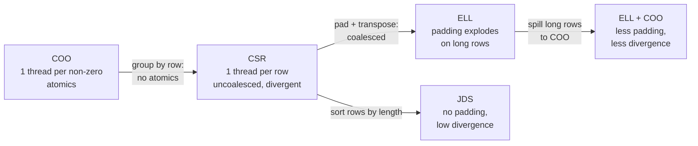

# Sparse matrix computation

> When most entries are zero, the storage format is the algorithm. Five
> formats for sparse matrix–vector multiply (SpMV) trade compactness for
> regularity, and which one wins depends on the matrix's shape.

## Why sparse, and why SpMV

A **sparse matrix** is mostly zeros. They come from science, engineering and
finance, wherever many variables are only loosely coupled. In a linear system,
each equation (row) involves only a few variables (columns).

Inverting a big sparse matrix is impractical. The inverse fills in with
non-zeros ("fill-ins") and becomes huge. Instead, solvers iterate. For
positive-definite matrices, **conjugate gradient** (Hestenes and Stiefel,
1952) guesses X, evaluates `A·X + Y`, and refines the guess. The expensive part
is that product, **SpMV**: sparse A, dense X and Y. Its standard library name
is SpMV, and the chapter uses it to compare formats.

Every format removes zeros and pays for it in **irregularity**. The book judges
them on five criteria:

1. **Space efficiency:** how much memory.
2. **Flexibility:** how easily you can add non-zeros.
3. **Accessibility:** what's cheap to look up (a row's non-zeros? a
   non-zero's row?).
4. **Memory access efficiency:** coalescing for this computation.
5. **Load balance:** equal work per thread, so little divergence.

The book's running example is a 4 × 4 matrix with 8 non-zeros: row 0 has 2,
row 1 has 3, row 2 has 2, row 3 has 1.

## COO: one thread per non-zero

**Coordinate list** stores three parallel arrays, `rowIdx`, `colIdx` and
`value`, one entry per non-zero. At 1% density, COO with its overhead needs
about 3% of the dense storage.

SpMV/COO assigns **one thread per non-zero**:
`atomicAdd(&y[rowIdx[i]], value[i] * x[colIdx[i]])`.

- Accesses to the arrays **coalesce**, and every thread does equal work.
- Entries can be in **any order**, so COO is ideal for **building** a matrix
  from a file and for **appending** non-zeros.
- But several threads share each row, so it **needs atomics**. And you can't
  cheaply find "all non-zeros of row r".

## CSR: one thread per row

**Compressed sparse row** groups non-zeros by row and replaces `rowIdx` with
**`rowPtrs`**: `rowPtrs[r]` is where row r starts, and `rowPtrs[numRows]`
marks the end. SpMV/CSR gives each thread one row, so it loops from
`rowPtrs[row]` to `rowPtrs[row+1]`, sums into a register, and writes `y[row]`
once, **with no atomics**.

- It's smaller than COO (row pointers are `rows + 1`, not one per non-zero).
- Inserting a non-zero means shifting all later rows. COO → CSR conversion on
  the GPU is a histogram plus a scan (an exercise in the book).
- **Uncoalesced:** in step one, threads 0–3 read `value[0]`, `[2]`, `[5]` and
  `[7]`, far apart.
- **Divergent:** rows have different lengths, so threads loop different
  numbers of times in almost every warp.
- If there are few rows, there's too little parallelism, and COO extracts
  more.

## ELL: pad and transpose for coalescing

**ELL**, named after the ELLPACK package (Rice and Boisvert, 1984), starts
from CSR. **Pad** every row to the longest row's length, then store the
resulting rectangle **column-major**. Element `t` of row `r` lives at
`t·numRows + r`. In step `t`, threads 0, 1, 2, … read consecutive addresses:
**coalesced**. `rowPtrs` disappears.

- Padding can explode. A 1000 × 1000 matrix at 1% density averages 10
  non-zeros per row, so CSR is about 2% of dense size. If **one** row has 200
  non-zeros, ELL pads every row to 200: about 40% of dense size, **20× CSR**.
- It's more flexible than CSR, because you can drop a new non-zero into a
  padding slot. It has both kinds of access, row → non-zeros and
  non-zero → row (`row = i % numRows`).
- **Load balance is unchanged**: threads still loop for their row's real
  length, so divergence is as bad as CSR's.

## Hybrid ELL-COO: cap the padding

Long rows cause both of ELL's problems. So **cut the overflow off**: keep up to
a chosen width per row in ELL and put the excess in a **COO** side store. Run
SpMV/ELL on the regular part and SpMV/COO, or the CPU, on the rest. In the
book's example, the widest row drops from 5 to 2 and the padding from 22
elements to 3. Every ELL thread then does just two iterations.

Splitting costs time. That's wasted on a one-off SpMV, but **amortized in an
iterative solver**, where A stays fixed for hundreds of iterations while x and
y change. You lose some accessibility: an overflowing row's non-zeros are no
longer all in one place.

## JDS: sort rows by length

**Jagged diagonal storage** **sorts rows by non-zero count**, keeping a
`row` array to remember the original order. It then stores the non-zeros
column-major, with an `iterPtr` array marking where each iteration's elements
start. Neighbouring threads get rows of **similar length**, so **divergence
drops**, and accesses coalesce **without padding**.

- Reordering rows just reorders equations, so the answer is unchanged. You
  un-permute y at the end, and the sort amortizes over solver iterations.
- Because there's no padding, iteration starts can't be aligned to the
  hardware's boundaries, so coalescing is slightly worse than ELL's.
- It's the **least flexible** format (adding a non-zero may force a re-sort).
  Row access is like CSR's.
- A variant cuts the sorted rows into sections and stores **ELL per section**,
  padding only to each section's maximum.

## The trade-offs side by side

Whatever the format, SpMV has **no reuse of the matrix**. Every non-zero is
used once, so it sits near **0.25 FLOP/B** and is memory-bound on CPUs and GPUs
alike. Low FLOPS numbers for SpMV aren't a sign of bad code. The book also
stresses that, unlike every earlier pattern, performance here **depends on the
data**: the same kernel is fast on one matrix and slow on another. Bell and
Garland (2009) is the reference study.

> **Since this edition:** cuSPARSE now favours CSR with smarter kernels
> (warp- or vector-per-row and merge-path load balancing) and **blocked or
> sliced ELL** variants. Ampere-class tensor cores also accelerate **2:4
> structured sparsity**, a hardware-friendly regular pattern that is the
> logical end point of this chapter's "regularize the irregular" theme.

## What to take away

- Choose the format for the computation and the matrix, not by habit. Build in
  COO, compute in something regular.
- Coalescing comes from column-major layout across rows (ELL, JDS).
  Load balance comes from equal row lengths (padding, sorting, spilling).
- Cap pathological rows. One very long row can make ELL 20 times bigger than
  CSR.
- Preprocessing (sorting, splitting) pays off when the matrix is reused across
  many solver iterations.
- Expect SpMV to be bandwidth-bound. Judge it in GB/s, not FLOPS.

---

Previous: [Sorting](./13-sorting.md) ·
Next: [Graph traversal](./15-graph-traversal.md)
