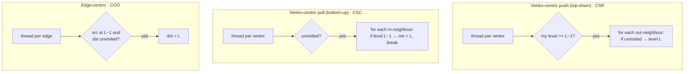
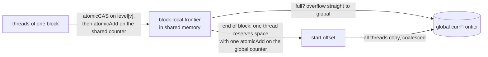

# Graph traversal

> Breadth-first search on a GPU, used to show every hard thing about graph
> computing: choosing a representation, assigning threads to vertices or to
> edges, skipping useless work with **frontiers**, and taming the atomics
> that frontiers bring.

## Graphs are sparse matrices

A graph's **adjacency matrix** has `A[i][j] = 1` when there's an edge i → j.
Real graphs, such as social networks and road maps, are **sparsely connected**:
average degree is far below N − 1. So they're stored as the sparse formats of
chapter 14, with the `data` array dropped when every edge weight is 1. The
book's 9-vertex, 15-edge example takes 25 entries in CSR against 81 for the
dense matrix.

| Format | Arrays | Gives cheap access to |
| --- | --- | --- |
| **CSR** | `srcPtrs`, `dst` | a vertex's **outgoing** edges |
| **CSC** | `dstPtrs`, `src` | a vertex's **incoming** edges |
| **COO** | `src`, `dst` | an edge's two endpoints |

**Degree distribution** matters too. A road network has low, uniform degrees.
A follower graph has a few vertices with enormous degree. The representation,
the algorithm and the graph's shape have to be chosen together.

## Breadth-first search

BFS labels every vertex with its **level**: the minimum number of edges from a
**root**. In the example, rooted at vertex 0, the path 0-2-5 (level 2) beats
0-1-3-4-5 and 0-1-4-5. Moving the root one edge away changes the labelling
completely. To get a shortest path, walk back from the target, always to a
predecessor one level lower. Ties mean several equally short paths.

The book's application is **maze routing in chip design**. Routing blocks are
vertices, and blocks already used by wires or components are blockages. BFS
from one net terminal spreads out as a **wavefront** (4, 8, 12, … vertices per
level) until it reaches the target. Tracing back gives the wire, and
heuristics pick among equally short routes.

All the parallel versions share one structure: **one kernel launch per level**.
The launch boundary is the grid-wide barrier that ensures level `L` is
complete before level `L + 1` starts. The host loops until a "new vertex
visited" flag stays clear.

## Three ways to assign threads

**Push** (Harish and Narayanan, 2007): only vertices from the last level do
work. Setting the "visited something" flag needs no atomic, because every
thread writes the same value. That's **idempotent**.

**Pull**: every unvisited vertex scans its in-edges, but it **stops at the
first parent** it finds.

| | Push | Pull |
| --- | --- | --- |
| Who loops | only last-level vertices | every unvisited vertex |
| Loop length | whole neighbour list | until the first parent is found |
| Better for | **early** levels (small frontier, most vertices unvisited) | **later** levels (big frontier, early exits likely) |

So **direction-optimized BFS** pushes first and then switches to pull.
Low-degree graphs have many levels and switch late. **Small-world**,
high-degree graphs explode within a few levels and switch early. It needs
both CSR and CSC, unless the graph is undirected, when they're the same.

**Edge-centric**: one thread per edge. It has **more parallelism** (there are
more edges than vertices), which suits small graphs. It has **no load
imbalance**, because every thread checks one edge, which suits skewed degrees;
this is chapter 6's "remap threads to work". But it checks **every edge every
level**, where a vertex thread could skip a whole irrelevant list with one
check. COO also takes more space than CSR or CSC.

### BFS is SpMV

These kernels look like chapter 14's SpMV kernels because they nearly are. A
BFS level can be written as a sparse matrix-vector product plus some vector
operations. More generally, many graph algorithms have this **linear-algebraic
formulation**, standardized as **GraphBLAS** (after Kepner and Gilbert's 2011
book, which the reference list cites as "Jeremy, K."). You get mature sparse
libraries for free, at the cost of algorithm-specific optimizations such as
pull's early exit.

## Frontiers: launch only the useful threads

Every version so far launches a thread per vertex or per edge **every level**,
and most of them find nothing to do. A **frontier** is the explicit list of
vertices reached in the previous level (Luo, Wong and Hwu, 2010). Launch only
`|prevFrontier|` threads. Each pushes to its neighbours and **appends newly
reached vertices to `currFrontier`**. The host stops when the new frontier is
empty.

Appending makes the idempotent trick unsafe. If two threads both see a
neighbour as unvisited, both append it and it gets processed twice. So:

- **Check and label atomically** with
  `atomicCAS(&level[v], UINT_MAX, currLevel)`. Only the thread that sees
  `UINT_MAX` come back has won. Contention is moderate, since only some
  threads share a neighbour.
- **Append with `atomicAdd(&numCurrFrontier, 1)`**. Contention is **high**,
  because every thread hits the same counter.

## Privatized frontiers

That counter is chapter 9's histogram problem again, and it has the same
remedy:

Shared-memory atomics are fast and contend only within a block. Overflow
spills directly to global memory. At the end, one global `atomicAdd` per block
reserves a range, and the block copies its local frontier there with
**consecutive threads writing consecutive addresses**.

## Other optimizations

- **Launch overhead.** The first and last levels often have tiny frontiers,
  and a kernel launch per level costs more than the work. A **single-block
  kernel** can run several consecutive levels with `__syncthreads()` between
  them, and hand back to the multi-block kernel once its local frontier
  overflows.
- **Load balance.** With "celebrity" vertices, one thread can hold up the
  whole grid. Besides going edge-centric, you can **bucket frontier vertices by
  degree** (Merrill and Garland, 2012): small-degree vertices get a thread
  each, medium a warp, large a whole block.
- **Still open, per the book:** graphs bigger than GPU memory, and
  preprocessing graphs into formats that expose more parallelism or locality.

> **Since this edition:** Gunrock, cuGraph (RAPIDS) and GraphBLAS
> implementations package exactly these techniques: direction optimization,
> frontier queues, and degree-based load balancing. Graph neural networks have
> made sparse "message passing", essentially SpMM, a mainstream GPU workload.

## What to take away

- Match the representation to the access you need: CSR for push, CSC for pull,
  COO for edge-parallel.
- Push early and pull late. Switch sooner on small-world graphs.
- Use frontiers to stop launching idle threads, but expect atomics on
  "visited" and on the queue counter.
- Privatize the frontier queue per block in shared memory and copy it out
  coalesced. It's the histogram trick again.
- Fix skewed degree with edge-centric threads or degree buckets
  (thread/warp/block per vertex).

---

Previous: [Sparse matrix computation](./14-sparse-matrix.md) ·
Next: [Deep learning](./16-deep-learning.md)
