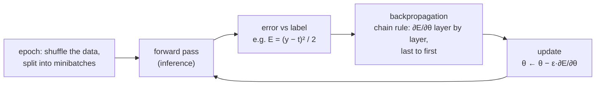
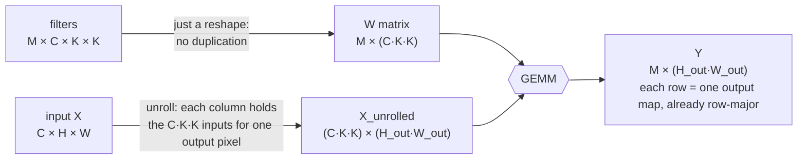

# Deep learning

> From a single perceptron to a convolutional neural network, and then how a
> convolutional layer becomes a CUDA kernel and, better, a matrix multiply.
> This chapter explains why deep learning runs on GPUs: its core layers are
> highly parallel and arithmetically dense.

## Machine learning in one page

**Machine learning** (a term Arthur Samuel coined at IBM in 1959) learns
application logic from examples instead of from hand-written rules. It wins
where you can give examples but can't write the rules, as in speech
recognition, vision, translation and recommendations. The book lists five task
types:

| Task | Example |
| --- | --- |
| **Classification** | which food is in this photo |
| **Regression** | tomorrow's closing stock price |
| **Transcription** | OCR |
| **Translation** | English → Chinese |
| **Embedding** | sentence → vector that preserves meaning |

The chapter focuses on classification.

### Perceptrons and layers

A classifier maps an input to one of k classes: `y = f(x; θ)`, where the
**model** θ holds the learned **weights**. The simplest is Rosenblatt's (1957)
**perceptron**, `y = sign(W·x + b)`. The **activation function** (`sign`)
adds the non-linearity. In 2D, the book's model with weights (2, 3) and bias
−6 draws the line `2x₁ + 3x₂ − 6 = 0`. The point (5, −1) gives
sign(13) = 1. Computing a class like this is **inference**.

One line can't carve out every region. "Both coordinates above 0.5" needs two
lines. So a **multilayer perceptron** feeds each layer's outputs into the
next. The first layer maps continuous inputs to a few discrete values, and
later layers draw lines in that small space. More complex regions need more
layers.

A **fully connected layer** with n inputs and m outputs is an `m × n` weight
matrix, so evaluating it is a **matrix-vector multiply**. For images that's
ruinous: n is millions of pixels, m is hundreds of classes, and objects appear
at many scales and positions. **Convolutional layers** cut the cost two ways.
Each output looks only at a **local patch**, and all outputs **share the same
weights**. The result is an **output feature map**, computed as a 2D
convolution (chapter 7).

### Training

Training solves for θ from **labelled** data (supervised learning).

- **Error (cost) function:** squared error is always positive, so errors don't
  cancel. The ½ simplifies the derivative.
- **Stochastic gradient descent:** repeat over shuffled **epochs** until the
  parameters stop changing. Shuffling avoids poor solutions.
- **Backpropagation** (LeCun et al., 1990, in the book's citations) applies
  the chain rule to find ∂E/∂θ for each parameter. `sign` isn't
  differentiable at 0, so you swap in a smooth look-alike. The book's version
  is `(1 − e⁻ˣ)/(1 + e⁻ˣ)`, which runs from −1 to 1. That's actually
  tanh(x/2), not the more common 0-to-1 logistic sigmoid. **ReLU**
  (`max(0, x)`) is the other common choice.
- **Learning rate ε:** bigger means faster but less stable. It is usually
  reduced over the epochs.
- **Minibatches:** accumulate error over a batch and update once, instead of
  after every example.
- **Multiple layers:** a layer's ∂E/∂x is the previous layer's ∂E/∂y, so
  gradients flow backwards one layer at a time. **Feedforward** networks have
  no loops, so the backward pass is straightforward.

## Convolutional neural networks

The book gives the history. CNNs date from the late 1980s and were applied to
speech, OCR and faces by the early 1990s. They were then overshadowed by
hand-engineered features until about 2006, when unsupervised pre-training
(Hinton et al.) revived deep networks, with speech recognition first and GPUs
making training about 10× faster than CPUs. Vision followed in **2012**.
Krizhevsky, Sutskever and Hinton's network (about **60 million parameters**,
650,000 neurons, 1.2 million ImageNet images, a week on **two GPUs**) won
ILSVRC with **15.3%** error against 26.2% for the runner-up.

The worked example is **LeNet-5**, for digit recognition:

```mermaid
flowchart LR
    IN["INPUT<br/>1 × 32 × 32"] -->|"C1: conv 5×5<br/>6 maps"| C1["6 × 28 × 28"]
    C1 -->|"S2: 2×2 subsample"| S2["6 × 14 × 14"]
    S2 -->|"C3: conv 5×5<br/>6×16 = 96 filters"| C3["16 × 10 × 10"]
    C3 -->|"S4: 2×2 subsample"| S4["16 × 5 × 5"]
    S4 -->|"C5: conv 5×5<br/>16×120 = 1920 filters"| C5["120 × 1 × 1"]
    C5 -->|"F6: fully connected<br/>120 → 84"| F6["84"]
    F6 -->|"Gaussian output"| OUT["10 classes"]
```

(The book dates LeNet-5 to "the late 1980s" while citing LeCun et al. 1998.
The 1998 paper is where LeNet-5 itself was published. Earlier LeNets are from
1989–90.)

- **Convolutional layer:** inputs `X[C, H, W]`, filters `W[M, C, K, K]`,
  outputs `Y[M, H−K+1, W−K+1]`. Each output map is the **sum over all input
  maps** of a 2D convolution, which is one 3D convolution per output map, so
  `M × C` 2D filters in all. LeNet treats a 2-pixel border as ghost cells, so
  32 → 28. The sequential code is six nested loops: m, h, w, then c, p, q.
- **Subsampling (pooling):** average each 2 × 2 block, add a per-map bias,
  apply the activation. The map count stays the same and each side halves.
- **Fully connected F6:** `sigmoid(W·X + b)`, i.e. 84 perceptrons each seeing
  all 120 inputs.

### Backpropagation through a CNN

For a fully connected layer `y = w·x`: **∂E/∂x = wᵀ·∂E/∂y** (to pass the
gradient back) and **∂E/∂w = ∂E/∂y · xᵀ** (an outer product, to update the
weights). For a convolutional layer, ∂E/∂x is a **"backward convolution"** of
∂E/∂y with the flipped filter. That's because every input pixel contributed
to a K × K neighbourhood of outputs. ∂E/∂W accumulates `X · ∂E/∂Y` over every
output pixel. Minibatches add an outer loop over N samples, so all arrays
become 4D.

## A CUDA convolutional-layer kernel

The forward pass has four "easy" parallel loops, **n, m, h, w**, giving
N × M × H_out × W_out independent outputs. The inner **c, p, q** loops would
need atomics, so they stay serial. The book's mapping:

- **Block** = a `TILE_WIDTH × TILE_WIDTH` tile of one output map (16 × 16 =
  256 threads).
- **Grid** = `(M, T, N)`. x is the output map, z is the sample, and **y is the
  tile index, linearized** because there are only three grid dimensions. A
  thread recovers its tile row with `blockIdx.y / W_grid` and its column with
  `blockIdx.y % W_grid`.

It's massively parallel but **bandwidth-bound**, like chapter 7's naive
convolution. Constant memory for the filters and shared-memory tiling are the
fixes, left to the reader.

## Convolution as GEMM

Better still is to turn the layer into one big **matrix multiply** and call
cuBLAS (Chellapilla et al., 2006). This is now usually called **im2col**:

In the small example (C = 3 inputs of 3 × 3, M = 2 outputs of 2 × 2, 2 × 2
filters), a 2 × 12 filter matrix times a 12 × 4 unrolled matrix gives the
2 × 4 output. Overlapping patches mean inputs get **duplicated**. The centre
pixel appears 4 times, edge pixels twice and corners once, so 16 entries
stand for 9 pixels, an expansion of **16/9 ≈ 1.8**. In general the expansion
is `(K²·H_out·W_out)/(H_in·W_in)`, which approaches **K²** for large maps.

Why it pays:

- GEMM is the most optimized operation on every platform, and its FLOP/B
  grows with matrix size.
- The matrices stay large in every layer. Early layers have small C but large
  H × W, and late layers the reverse, so `C·H_out·W_out` stays big.

What it costs:

- Up to K² times the memory. So the book unrolls **one sample at a time** into
  a reused buffer, which limits parallelism and can make the GEMMs too small.
- Extra traffic, because X_unrolled is written out and read back.
- The unroll kernel gives one thread per (channel, output pixel) and has it
  write a K × K strip down a column. Adjacent threads then write adjacent
  addresses, so the writes coalesce.

## cuDNN

**cuDNN** (Chetlur et al., 2014) is NVIDIA's deep-learning primitive library,
used under Caffe, TensorFlow, Theano and Torch. Data must already be on the
device, routines are thread-safe, and tensors are described by opaque
descriptors with arbitrary strides. Its convolution takes `D[N, C, H, W]` and
`F[K, C, R, S]` with strides `u, v` and padding, and **chooses among
algorithms**: GEMM-based, Winograd (Lavin and Gray, 2016; the book's reference
list prints "Scott G."), FFT, and others. Its GEMM path never materializes
X_unrolled in DRAM. It **builds the unrolled tiles lazily in on-chip memory**
and overlaps loading the next tile with computing the current one (after Tan
et al., 2011). It pays some extra index arithmetic to run at matrix-multiply
speed.

> **Since this edition:** the book is CNN-centric. Since 2017 the dominant
> architecture is the **Transformer**, whose cost is mostly GEMMs plus
> attention. Kernels such as **FlashAttention** apply this book's tiling and
> on-chip-memory lessons to attention. Training now uses BF16, FP8 and lower
> precisions on **tensor cores**, and compilers such as Triton and XLA, along
> with CUTLASS templates, generate many kernels that used to be hand-written.
> The chapter's central claim, that deep learning is matrix multiplication
> wearing a costume, has aged very well.

## What to take away

- Every layer type is a variant of the perceptron: a weighted sum and a
  non-linearity. Fully connected layers are matrix-vector products, and
  batched they become matrix-matrix products.
- Training is forward, error, backward (chain rule) and update, repeated over
  shuffled minibatches. The backward pass costs about as much as the forward
  pass.
- Parallelize a convolutional layer over batch × output map × output pixel.
  Keep the reductions inside each thread.
- Turning convolution into GEMM trades extra memory and traffic for access to
  the best-tuned kernel on the machine. Libraries hide the cost by unrolling
  tiles on chip.
- In practice, call cuDNN or your framework. Write custom kernels only for
  operations it doesn't fuse.

---

Previous: [Graph traversal](./15-graph-traversal.md) ·
Next: [Iterative MRI reconstruction](./17-mri-reconstruction.md)
