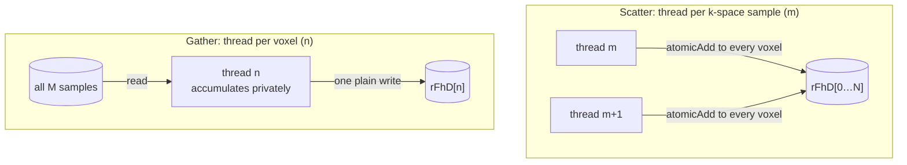
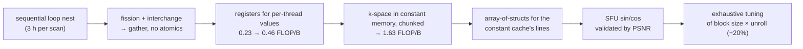

# Iterative MRI reconstruction

> A real application, followed from a sequential loop nest to a tuned kernel.
> The lesson is a sequence of steps you can reuse: choose **gather over
> scatter**, restructure loops until that's possible, move data into the right
> memories, check accuracy before using fast hardware math, then tune by
> experiment.

## The problem

An MRI scan has two phases. **Acquisition** samples the **k-space** (spatial
frequency) domain along a trajectory. **Reconstruction** turns those samples
into an image. Clinicians want three things that conflict: short scans
(throughput, patient comfort, fewer motion artifacts), high resolution, and a
high **signal-to-noise ratio (SNR)**.

The trajectory decides how expensive reconstruction is:

| Trajectory | Reconstruction | Trade-off |
| --- | --- | --- |
| **Cartesian** (uniform grid) | one inverse **FFT** | cheap and standard in clinics |
| **Non-Cartesian** (spiral, radial, rosette) + **gridding** | interpolate onto a grid (a convolution, chapter 7), then FFT | fast, but artifacts |
| **Non-Cartesian** + **iterative linear solver** | statistically optimal, models the scanner's physics | best image, but historically hours of compute |

Non-Cartesian trajectories are less sensitive to patient motion and less
demanding on scanner hardware, and they allow measurements like **sodium
maps**. Sodium is much scarcer in tissue than water, so it needs high SNR, and
its maps can show early signs of tissue death or response to chemotherapy. The
book's point is that GPUs turned the iterative method from impractical (hours
on a CPU) to clinically usable (minutes).

## The math, briefly

The iterative method (Haldar and Liang, implemented in Stone et al., 2008)
solves `(FᴴF + λWᴴW)·ρ = FᴴD` for the image ρ. F models the imaging physics,
D holds the scanner samples, W encodes anatomical priors taken from a
high-SNR water scan, and ᴴ is the conjugate transpose. For a modest **128³**
image, F has **2 million columns**, far too big to invert, so a **conjugate
gradient** solver iterates instead.

- **Q** (which encodes FᴴF): F only models the scanner and trajectory, so Q is
  computed **once per trajectory**. It took days on a CPU.
- **FᴴD**: computed for **every scan**. It took about **3 hours** on a CPU for
  128³. This is the target.
- The CG solve itself: under 1% of the original run time.

Q has the same computational structure as FᴴD, just more of it, so the
chapter optimizes FᴴD.

```c
for (m = 0; m < M; m++) {                 // k-space samples (~10^5–10^6)
  rMu[m] = …;  iMu[m] = …;                // per-sample complex product
  for (n = 0; n < N; n++) {               // voxels (2M for 128^3)
    expFhD = 2*PI*(kx[m]*x[n] + ky[m]*y[n] + kz[m]*z[n]);
    rFhD[n] += rMu[m]*cos(expFhD) - iMu[m]*sin(expFhD);
    iFhD[n] += iMu[m]*cos(expFhD) + rMu[m]*sin(expFhD);
  }
}
```

There's plenty of parallelism, but two bottlenecks show up immediately. The
inner loop manages only **0.25–0.75 FLOP/B** (depending on how you count
sin/cos), and arithmetic to trig is just **13 : 2**, so slow sin/cos will
dominate.

## Step 1: choose a parallel structure (gather, not scatter)



The obvious mapping, one thread per outer-loop iteration (a k-space sample),
is **scatter**. Each thread adds into *every* voxel, so it needs atomics on
millions of locations, and the output is far too big to privatize in shared
memory. **Gather** gives each thread **one output voxel**. It reads every
input but writes only its own element, so it needs **no atomics**.

Getting there takes two classic compiler transformations:

1. **Loop fission.** The `rMu`/`iMu` statements sit between the two loops, so
   the nest isn't **perfectly nested** and can't be interchanged. Split them
   into their own loop. That's legal because no iteration's first part depends
   on an earlier iteration's second part. It becomes its own small kernel,
   `cmpMu`, one thread per sample. Running it first loses no parallelism,
   because the second loop needs its results anyway.
2. **Loop interchange.** Swap the remaining loops so n is outside. That's
   legal because every iteration is independent. Now `cmpFhD` runs **N
   threads**: 2,097,152 for 128³, as 2048 blocks of 1024. Larger images need
   multidimensional grids, several launches, or several voxels per thread.

The book also rules out one thread per (m, n) pair. That's N × M threads,
far more than the device needs.

## Step 2: get around memory bandwidth

The gather kernel does about 13 FLOP and **14 memory accesses** per iteration:
**0.23 FLOP/B**.

- **Registers.** `x[n]`, `y[n]`, `z[n]`, and the running `rFhD[n]` and
  `iFhD[n]`, are the same in every iteration for a given thread. Hold them in
  **5 registers** and write the outputs once at the end. Accesses per
  iteration drop from 14 to 7, giving **0.46 FLOP/B**. That costs
  5 × 1024 = 5120 more registers per block, which still fits in the 65,536 per
  SM.
- **Constant memory.** `kx[m]`, `ky[m]` and `kz[m]` change every iteration but
  are **the same for every thread** at a given iteration, and read-only. That
  is the ideal constant-cache pattern: one load is broadcast to the warp, and
  at least 31 of every 32 accesses hit the cache (≥ 96%). Constant memory holds
  only 64 KB, so the host **chunks** the k-space data. It copies a chunk with
  `cudaMemcpyToSymbol`, launches the kernel, and repeats, with one extra launch
  for a remainder. Only `rMu[m]` and `iMu[m]` still come from global memory,
  giving up to **1.63 FLOP/B**. (On newer GPUs, `const __restrict__` pointers
  get the same effect through the read-only data cache.)
- **Layout for the cache.** In practice the speedup disappointed on some
  devices. Separate `kx`, `ky` and `kz` arrays need **three constant-cache
  lines per iteration**. With 64 warps per SM at different iterations, the
  working set (up to 192 lines) exceeds a cache of about 32 lines, so warps
  evict each other's data. The fix is an **array of structs**, `k[m].x/.y/.z`,
  so one line serves all three, and a single `cudaMemcpyToSymbol` of
  12 × CHUNK bytes.

That last fix runs **opposite** to the usual global-memory advice, where
struct-of-arrays coalesces better. The difference is the access pattern: here
every thread in the warp reads the *same* element, not consecutive ones.

## Step 3: use hardware trigonometry, after validating it

Graphics needs fast sin and cos for view transforms, so GPUs have **special
function units (SFUs)**. The fast intrinsics are much quicker and **less
accurate**. The book writes them as `__sin()` and `__cos()`. In CUDA they're
actually spelled **`__sinf()` and `__cosf()`** (or turned on globally with
`-use_fast_math`).

Validate the accuracy against the application, not by instinct. Generate
synthetic k-space data from a known **phantom** image, reconstruct it, and
compare by **PSNR**, with clinicians setting the acceptable threshold:

| Reconstruction | PSNR |
| --- | --- |
| Gridding + inverse FFT | **16.8 dB**, with visible artifacts |
| Iterative, CPU double precision | 27.6 dB |
| Iterative, CPU single precision | 27.6 dB |
| Iterative, GPU with hardware sin/cos | **27.5 dB**, acceptable, and visually clean |

## Step 4: tune by experiment

Threads per block and the **`#pragma unroll`** factor interact. Unrolling cuts
loop overhead but adds registers, which can reduce occupancy. An exhaustive
search of combinations beat heuristic tuning by about **20%**. Ryoo et al.
(2008) show how to prune the search with Pareto-optimal curves.



The optimizations together give about **10×** over the basic parallel kernel.
Then **Amdahl's Law** strikes back. FᴴD went from nearly 100% of the run time
to about **50%**, and the CG solver, once under 1%, is now the other half. Any
further gain must come from accelerating the solver too. That's what
parallelizing real applications usually looks like.

## What to take away

- Prefer **gather** (each thread owns an output) over **scatter** (threads
  share outputs through atomics), even if that means more reads.
- Fission and interchange are the tools that turn scatter loops into gather
  loops. Check the dependences, then apply them.
- Put per-thread invariants in registers and warp-uniform read-only data in
  constant memory (chunked to 64 KB). Then lay it out so the cache's lines
  serve each iteration whole.
- Fast hardware math is fine only once you've measured its accuracy against
  the application's own quality metric.
- After a big speedup, profile again. The bottleneck has moved.

---

Previous: [Deep learning](./16-deep-learning.md) ·
Next: [Electrostatic potential map](./18-electrostatic-potential.md)
