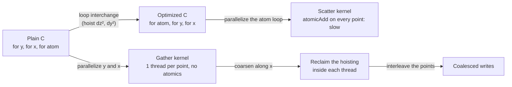
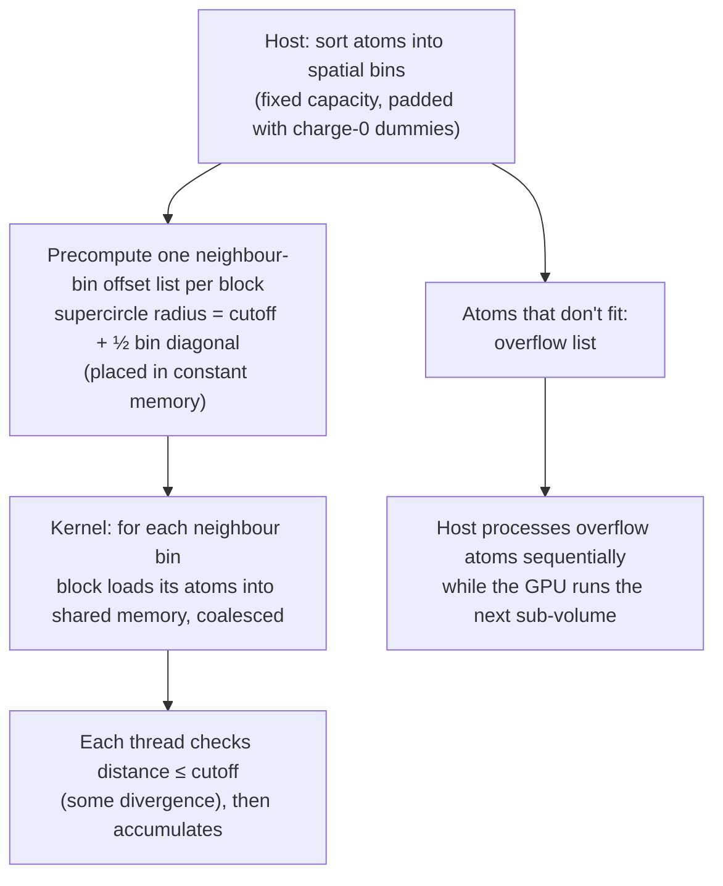

# Electrostatic potential map

> A second case study, from molecular visualization. The best sequential
> code turns out to be the worst code to parallelize. Coarsening wins the
> lost efficiency back, a careful thread-to-point mapping keeps writes
> coalesced, and a small loss of accuracy turns an O(V²) algorithm into an
> O(V) one.

## The application

**VMD** (Visual Molecular Dynamics, Humphrey et al., 1996) is used for
displaying and analysing biomolecules. The book counts more than 200,000
registered users and calls it a "computational microscope" for things too
small for optics. One of its jobs is computing an **electrostatic potential
map** on a 3D grid around a molecule, used for example to find where ions can
be placed before a simulation. It used to run as a batch job. The goal was to
make it fast enough to use **interactively** on a desktop GPU.

**Direct Coulomb summation (DCS)** (Stone et al., 2007) is the accurate
method. The potential at grid point j is the sum over all atoms i of
`charge_i / r_ij`. The work is **atoms × grid points**, which is huge for a
real system.

## Scatter versus gather, again

The plain C version loops over grid y, then grid x, then **atoms**
(innermost). Each atom is four floats: x, y, z and charge. The **optimized**
C version interchanges the loops so **atoms are outermost**. That lets it
compute `dz²` once per atom per slice and `dy²` once per atom per row, much
less arithmetic.

Here's the trap. Parallelizing that optimized loop (one thread per atom) gives
a **scatter** kernel: every thread adds into every grid point, which needs
atomics. The atomic-free **gather** kernel (one thread per grid point) comes
from the **unoptimized** loop order, where every thread recomputes `dy` and
`dz` for every atom. The book calls this a frequent dilemma: **the best
sequential code isn't the best starting point for parallel code.**

To make the two outer loops a perfect nest, the y-coordinate calculation moves
into the inner body. That's a tiny amount of recomputation, chosen over loop
fission, which would need a second kernel and a y array in global memory.

How the host drives it:

- **One 2D slice at a time.** Copy the slice to the device, then for each
  **chunk of atoms** that fits in **constant memory** (CHUNK × 4 floats ≤ 64
  KB), copy the chunk and launch. When all chunks are done, copy the slice
  back.
- Every thread reads the same atom at the same time. That's the ideal
  constant-cache broadcast, so DRAM bandwidth stops being the limit. The
  gather kernel does **9 FLOP per 4 constant loads**.

## Thread coarsening: reclaim the hoisting

The gather kernel is now limited by **instruction count**: four
constant-memory loads for every nine FLOPs, and redundant `dy`/`dz` work.
Every point in a row shares the same y, so `dy² + dz²` is the same for all of
them. **Coarsen**: each thread computes **four grid points** in the same row.

Per atom, the thread loads x, y, z and charge **once into registers**,
computes `dysqdzsq = dy² + dz²` once, and derives the four x-distances by
adding multiples of the grid spacing. For four points:

| | Uncoarsened (4 threads) | Coarsened (1 thread) |
| --- | --- | --- |
| Constant-memory loads | 16 | **4** |
| Floating-point operations | 48 | **24** |

That saves time *and energy*. The cost is a few more registers per thread,
not enough to cut occupancy here.

## Coalescing the writes

Profiling then shows uncoalesced **writes**. Each thread writes four
*adjacent* points, so neighbouring threads write addresses 4 apart. Fix it by
**interleaving**: a thread's four points are `blockDim.x` apart (`i`,
`i + blockDim.x`, `i + 2·blockDim.x`, `i + 3·blockDim.x`). On each of the four
writes, neighbouring threads hit neighbouring addresses. The x offsets inside
the loop become multiples of `blockDim.x · gridspacing`.

## Cutoff binning: changing the algorithm

DCS doesn't **scale**. Grow the simulated volume V and both atoms and grid
points grow with V, so the work grows as **V²**. Real biological systems are
too big for that, however parallel the machine.

There's a physical escape. A contribution falls off as 1/r, so **distant
atoms matter little** and can be handled separately by a cheaper implicit
method. If each grid point sums only atoms within a **cutoff radius**, the
work becomes **linear in V**, at a small cost in accuracy.

The sequential cutoff code is atom-centric: each atom visits nearby grid
points. That's scatter again. The GPU version (Rodrigues et al., 2008) stays
grid-centric:

- **Bins.** Atoms are sorted into boxes aligned with the grid. For example,
  0.5 Å spacing and 8 × 8 × 8 blocks give 4 Å cubes. Each block gets a
  **neighbourhood list** of relative bin offsets. It's computed **once per
  block** with a conservative **supercircle** (cutoff plus half the bin
  diagonal), because working out the exact geometry per thread is expensive.
  A typical molecular cutoff is 12 Å. The book's 2D example has 9 fully and 12
  partly covered bins, 21 in all.
- **Shared memory, not constant memory.** Different blocks now need different
  atoms, so the 64 KB constant cache no longer fits. The block loads each
  neighbour bin from global memory into shared memory together, and threads
  filter by distance. That filtering causes some divergence.
- **Uneven bins.** Coalescing needs equal-size, aligned bins, so sparse bins
  are padded with **dummy atoms of charge 0**. They waste memory, bandwidth and
  time. So cap the bin size at a value that fits most bins, send the excess to
  an **overflow list**, and let the **CPU** process it. If the overflow is
  under about 3% of atoms, the CPU can handle it while the GPU computes the
  next sub-volume, hiding it almost entirely.

> **Since this edition:** VMD, NAMD and the other molecular-dynamics codes
> (GROMACS, AMBER, OpenMM) now run nearly entirely on the GPU, with
> particle-mesh Ewald handling the long-range part that the cutoff discards.
> The scatter → gather → coarsen → bin progression is still the standard way
> to explain these codes.

## What to take away

- Don't parallelize the fastest sequential code by reflex. Start from the loop
  order that gives gather parallelism, then win back the sequential
  optimizations through coarsening.
- Coarsen so each thread reuses values it loaded or computed (here `dy² + dz²`
  and the atom's data) across several outputs.
- When coarsening, interleave a thread's outputs by `blockDim.x` so writes
  still coalesce.
- Big wins at scale come from changing the algorithm's complexity (here
  cutoff binning, V² → V), not from tuning the kernel.
- Handle irregular leftovers (overflow atoms) on the CPU, overlapped with GPU
  work. That's what heterogeneous computing is for.

---

Previous: [Iterative MRI reconstruction](./17-mri-reconstruction.md) ·
Next: [Parallel programming and computational thinking](./19-computational-thinking.md)
