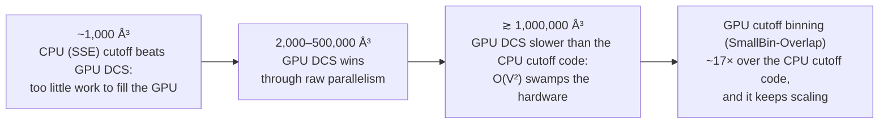
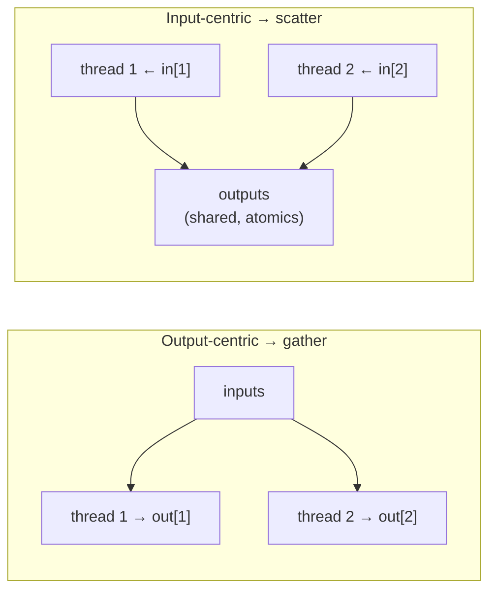

# Parallel programming and computational thinking

> The book steps back from code. Parallel programming is three decisions:
> **which algorithm**, **how to decompose the problem**, and **how to tune
> it**. This chapter generalizes the first two using every pattern seen so
> far, then makes the case that the biggest wins come from rethinking the
> method, not recompiling it.

## Why parallelize at all

The book names three goals, often mixed:

1. **Same problem, less time.** A risk analysis that takes 200 hours
   sequentially must finish in the 4 hours after markets close.
2. **Bigger problem, same time.** The portfolio grows, and the analysis must
   still fit the window.
3. **Better answer, same time.** A more accurate model with more risk-factor
   interactions now fits the window.

All three come down to speed, and all three only matter for **large problems,
complex models, or many iterations**. Small, quick jobs don't need it.

### Amdahl's Law, applied

A molecular-dynamics time step has several modules: a neighbour list,
vibrational and rotational forces, **non-bonded forces**, and position and
velocity updates. Non-bonded forces dominate, so they go to the GPU and the
small modules stay on the CPU:

| Scenario | Speedup |
| --- | --- |
| Non-bonded = 95% of run time, 100× faster on the GPU, the rest unchanged | 1 / (0.05 + 0.0095) ≈ **17×** |
| Same, with GPU work fully overlapped with CPU work | 1 / 0.05 = **20×** |

The 5% you didn't parallelize caps the result at 20×, however fast the GPU
gets. It's the MRI lesson from chapter 17 again, where the CG solver went from
about 1% of the run time to the bottleneck. Two common responses:

- **Task parallelism** for the small modules: run them on several CPU cores,
  or as several small concurrent kernels using **streams** (chapter 20).
- **Hierarchical data parallelism**: split the domain across cluster nodes
  with **MPI**, so each node's CPU handles its chunk's small modules and its
  GPU handles the heavy one (chapter 20).

## Algorithm selection

An **algorithm** must have three properties. It must be **definite** (every
step unambiguous), **effectively computable** (every step doable by a
computer), and **finite** (it terminates). Several algorithms usually solve a
problem, and none wins on every axis. The book collects the trade-offs seen
so far:

| Chapter | Algorithms | Trade-off |
| --- | --- | --- |
| 11, Scan | Kogge-Stone vs Brent-Kung | **parallelism vs work efficiency**, often settled with a hybrid or coarsening |
| 13, Sort | Radix vs merge | **efficiency vs generality** (radix only handles some key types) |
| 18, Electrostatics | Direct summation vs cutoff binning | **complexity vs accuracy** |

The electrostatics comparison (the book's Figure 19.2) shows why algorithm
choice beats tuning:

Among the binning variants, plain **SmallBin** pays extra instructions to
stage atoms into shared memory, which doesn't pay off at moderate volumes.
**SmallBin-Overlap** also hides the CPU's overflow processing behind the next
kernel.

## Problem decomposition

Once you've picked an algorithm, split the work. The two basic strategies:

**Output-centric** decomposition usually means **gather**. Each thread owns an
output, accumulates privately in registers, and shares inputs through
constant or shared memory. **Input-centric** decomposition usually means
**scatter**: threads collide on outputs and need slow atomics. Gather is
usually better on GPUs. But you also have to weigh **how much parallelism
each exposes**, **how easily you can tell which inputs feed which output**,
and **load balance**. The book revisits every pattern through this lens:

| Computation | Decomposition used | Why |
| --- | --- | --- |
| Images, matrix multiply, convolution, stencil | output-centric | no atomics; plenty of outputs, obvious inputs, even work |
| Histogram | **input-centric** | output-centric would mean few threads (few bins), each scanning *all* inputs, with uneven bins |
| Merge | output-centric | no atomics either way, but finding an input thread's output position is harder and loads would be uneven |
| SpMV | COO input-centric; CSR, ELL and JDS output-centric | COO buys parallelism and balance with atomics; the hybrid uses both; the best choice depends on the matrix |
| BFS | push and edge-centric input-centric; pull output-centric | updates are idempotent, so atomics don't decide it; parallelism and balance do; depends on the graph |
| MRI FᴴD, electrostatics | output-centric | gather avoids atomics; binning fixes the input mapping and overlap fixes the imbalance |

## Computational thinking

The book defines **computational thinking** (after Wing, 2006) as formulating
domain problems as computation steps and algorithms. It calls it an art,
learned by moving back and forth between concrete experience and abstract
concepts, and best learned bottom-up in one concrete model (here CUDA) before
generalizing. The foundational skills:

- **Computer architecture:** memory organization, caching and locality,
  bandwidth, SIMT vs SPMD vs SIMD, floating-point precision vs accuracy.
- **Programming interfaces and compilers:** execution models, memory types,
  synchronization, data layout, thread-granularity transformations.
- **Domain knowledge:** problem formulation, hard vs soft constraints,
  numerical methods, accuracy and stability.

The book's ladder for attacking a computation-hungry application:

| Approach | What it means | Payoff |
| --- | --- | --- |
| **Good** | recompile, or use cuBLAS, cuFFT, Thrust, MATLAB, OpenACC | quick wins for domain scientists, but not the full potential |
| **Better** | rewrite with parallel-programming skill: decomposition and optimization | good work for computer scientists, but algorithm choice needs domain insight |
| **Best** | all three steps together, including **rethinking the numerical method** (as cutoff binning did) | largest speedups and new science; interdisciplinary |

Its exhortation: there will be no Nobel or Turing prizes for "just recompile".
The point of all this computing power is to make science **better**, not only
faster.

## What to take away

- Before porting, measure what share of the run time you can parallelize, and
  decide what happens to the rest (overlap it, use task parallelism, or use
  MPI).
- Pick the algorithm for the hardware and the problem size. An O(N²) method on
  a GPU can lose to an O(N) method on a CPU.
- Default to output-centric (gather) decompositions. Switch when parallelism,
  input-to-output mapping or load balance argue otherwise (histograms, some
  graphs, some sparse matrices).
- The biggest gains come from people who understand both the hardware and the
  domain well enough to change the method.

---

Previous: [Electrostatic potential map](./18-electrostatic-potential.md) ·
Next: [Part IV — Advanced practices](../4-advanced-practices/README.md)
