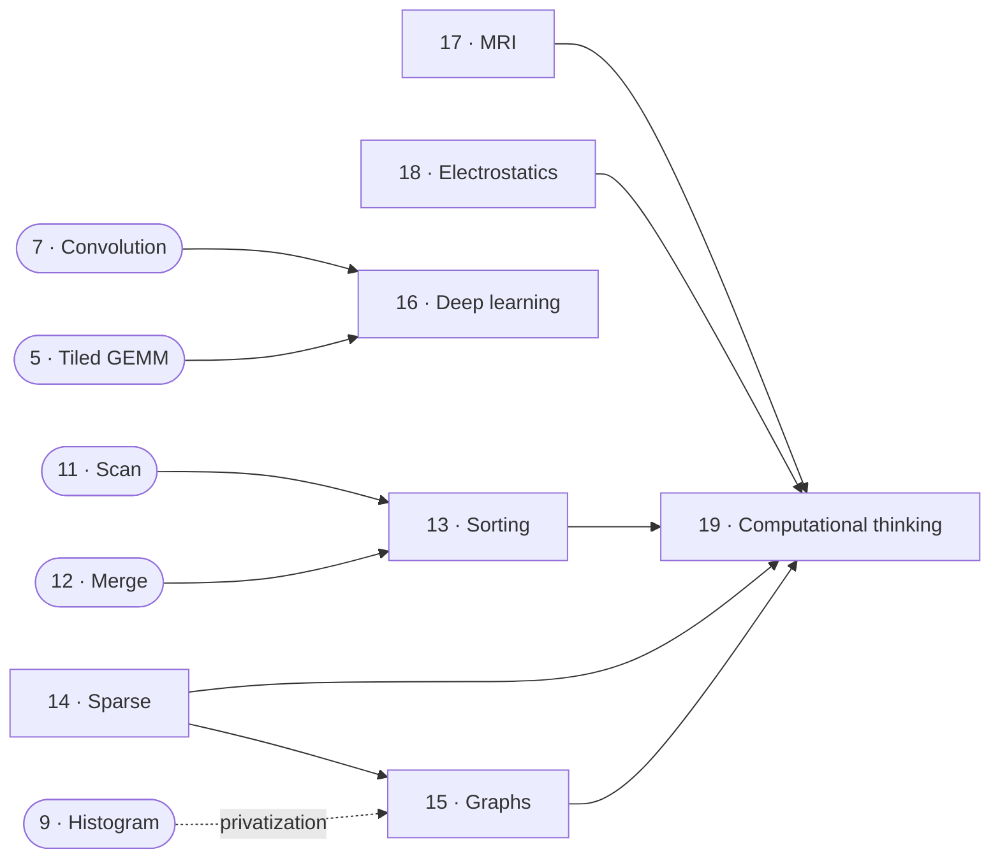

# Part III — Advanced patterns and applications

> Larger patterns built from Part II's primitives, and three application case
> studies that take real code from a sequential loop to a tuned kernel. The
> part ends by generalizing the method: choose the algorithm, decompose the
> problem, then tune.

| | What it shows |
| --- | --- |
| [Sorting](./13-sorting.md) | Radix sort as repeated scans; coalescing scattered writes through shared memory; parallel merge sort; other sorts |
| [Sparse matrix computation](./14-sparse-matrix.md) | COO, CSR, ELL, hybrid ELL-COO and JDS for SpMV: compaction against regularity |
| [Graph traversal](./15-graph-traversal.md) | BFS: push vs pull vs edge-centric, frontiers, privatized queues, load balance |
| [Deep learning](./16-deep-learning.md) | Perceptrons to CNNs, training by backpropagation, a convolutional-layer kernel, convolution as GEMM, cuDNN |
| [Iterative MRI reconstruction](./17-mri-reconstruction.md) | Scatter to gather via loop fission and interchange, registers, constant memory, hardware trig, tuning |
| [Electrostatic potential map](./18-electrostatic-potential.md) | Optimized sequential code vs parallelizable code, coarsening, coalescing, cutoff binning |
| [Parallel programming and computational thinking](./19-computational-thinking.md) | Goals, Amdahl in practice, algorithm selection, output- vs input-centric decomposition |

---

Previous: [Merge](../2-parallel-patterns/12-merge.md) ·
Next: [Sorting](./13-sorting.md)
