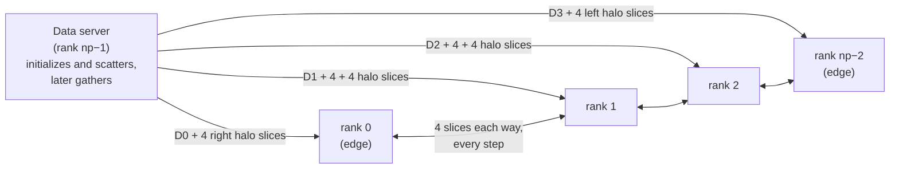

# Programming a heterogeneous computing cluster

> When one GPU isn't enough, you use many nodes, each with CPUs and GPUs,
> coordinated with MPI. The chapter scales chapter 8's stencil across a
> cluster and introduces the two CUDA features that make communication
> overlap with computation: **pinned memory** and **streams**.

## Why clusters, and why MPI

Practically no top supercomputer used GPUs before 2009. The push for **energy
efficiency** changed that, and many of the top systems now combine CPUs and
GPUs in every node; their **Green500** rankings show the efficiency pays.
Clusters are programmed mostly with **MPI**, the Message Passing Interface
(Gropp et al., 1999). It assumes **distributed memory**: processes share
nothing and exchange **messages**, addressing each other by logical number,
like phone numbers, without knowing the network underneath.

| MPI | CUDA counterpart |
| --- | --- |
| every process runs the same program (**SPMD**) | every thread runs the same kernel |
| **rank** (`MPI_Comm_rank`), 1D | `blockIdx.x·blockDim.x + threadIdx.x` |
| `MPI_Barrier` | `__syncthreads()` |
| "if rank 0, report the error" | "if thread 0, do the chore" |

## The running example: a distributed stencil

The example is a 3D heat-transfer simulation in a duct, solved with the
**Jacobi** method using a **25-point stencil** (four neighbours each way along
x, y and z, plus the point itself). The grid is stored with x fastest and z
slowest, so **each z-slice is contiguous** in memory. It's **domain-
partitioned** along z: partitions D0–D3 go to separate MPI processes. Each
partition needs **4 halo slices** from each neighbour, and from only one
neighbour at the ends.

### The MPI essentials

- `MPI_Init`, `MPI_Comm_rank`, `MPI_Comm_size`, `MPI_Abort` and
  `MPI_Finalize` set up and tear down. A **communicator** names a group of
  processes, and `MPI_COMM_WORLD` means all of them. Always check you actually
  got enough processes. The example needs at least 3.
- Roles by rank: ranks `0 … np−2` compute, and rank `np−1` is a **data
  server** for I/O. In the example it fills the grid with random data instead
  of reading files.
- **Point-to-point:**
  `MPI_Send(buf, count, type, dest, tag, comm)` and
  `MPI_Recv(buf, maxCount, type, src, tag, comm, &status)`. `MPI_ANY_TAG`
  accepts any tag. A receive may name more elements than actually arrive.
  The example exploits that so every compute process uses the same
  receive call and buffer layout (left halo | partition | right halo); rank 0
  just starts receiving 4 slices in.

The server sends `dimx·dimy·(dimz/n + 4)` points to the two edge processes
and `+ 8` slices to the internal ones. It steps its send pointer back 4 slices
each time, so each message includes the left halo.

## Overlapping computation and communication

The naive loop alternates "compute everything" and "exchange halos", so either
the network or the GPU sits idle. Better is to split each step in **two
stages**:

1. **Stage 1:** compute the **boundary slices** first. Those are the 4 slices
   on each side that neighbours will need as halos. That's 12 input slices per
   side (halo + boundary + 4 interior).
2. **Stage 2:** compute the **interior** slices while, **in parallel**, the
   new boundary slices are copied to the host and exchanged with the
   neighbours, and the received halos copied back.

```mermaid
gantt
    title One time step on one compute process
    dateFormat s
    axisFormat %S
    section stream0
    left + right boundary kernels    :a1, 0, 2s
    D→H copies of boundary slices    :a2, 2, 1s
    MPI_Sendrecv ×2 (host)           :crit, a3, 3, 3s
    H→D copies of new halos          :a4, 6, 1s
    section stream1
    interior kernel (dimz − 8 slices) :b1, 0, 8s
```

If the interior takes longer than the exchange, communication is completely
hidden. That's why each partition needs enough interior slices.

Two CUDA features make stage 2 possible.

### Pinned (page-locked) memory

`cudaMemcpy` uses **DMA**, which works on physical addresses. Ordinary
`malloc` memory can be paged out mid-copy. So the runtime copies through an
internal **pinned** buffer: two copies, and **synchronous**. Allocating host
buffers with **`cudaHostAlloc`** (pinned) allows one direct DMA and, crucially,
**`cudaMemcpyAsync`**, which requires pinned memory. The four halo staging
buffers here are **bounce buffers**: data bounces device → host → remote
process and back.

### Streams

A **stream** is an ordered queue of operations: copies and kernel launches.
Operations **within** a stream run in order. Operations in **different**
streams may run concurrently. This is CUDA's task parallelism, promised back
in chapter 2. In the example:

- **stream0:** boundary kernels, then D→H copies, then (after
  `cudaStreamSynchronize(stream0)`) the MPI exchange, then H→D halo copies.
- **stream1:** the interior kernel, running alongside all of that.
- `cudaDeviceSynchronize()` ends the step, then the input and output buffers
  swap (**double buffering**, as in chapter 11).

`MPI_Sendrecv` combines a send to one neighbour with a receive from the other.
Two calls (left and right) do the whole exchange. Setting a missing
neighbour's rank to **`MPI_PROC_NULL`** makes those calls no-ops at the ends,
so no special cases are needed. `MPI_Barrier` lines everyone up before the
first exchange and before the final gather.

## Collective communication

`MPI_Barrier` is one **collective**. Others are **broadcast**, **reduce**,
**gather** and **scatter**. The book's advice is to prefer them to
hand-written sends and receives, because vendors optimize them heavily. They
also make code shorter and clearer.

## CUDA-aware MPI

**CUDA-aware MPI** implementations (the book names MVAPICH2, IBM Platform MPI
and Open MPI) accept **device pointers** directly. You drop the pinned bounce
buffers and the `cudaMemcpyAsync` calls around the exchange and pass `d_output
+ offset` to `MPI_Sendrecv`. You still need **two streams and two kernels** so
the boundary is ready to send early. Initial scatter and final gather can go
device-to-device too.

> **Since this edition:** multi-GPU communication within and across nodes now
> mostly goes through **NCCL** (collectives over NVLink and InfiniBand with
> GPUDirect RDMA) or NVSHMEM. Deep-learning training at scale is mostly
> all-reduce over NCCL. Within a node, NVLink and NVSwitch make GPUs exchange
> data far faster than PCIe through the host. The compute/communicate overlap
> pattern in this chapter is exactly what those libraries automate.

## What to take away

- Partition the domain into contiguous slabs (here z-slices) so each halo
  exchange is a single contiguous message.
- Compute what your neighbours need first, then compute the interior while
  the exchange happens.
- Asynchronous copies need pinned host memory, and overlap needs separate
  streams. Same-stream operations stay in order.
- Use `MPI_PROC_NULL` instead of special-casing the edges, and prefer
  collectives over hand-rolled loops of sends.
- If your MPI is CUDA-aware, or you use NCCL, pass device pointers and skip
  the bounce buffers.

---

Previous: [Part IV — Advanced practices](./README.md) ·
Next: [CUDA dynamic parallelism](./21-dynamic-parallelism.md)
