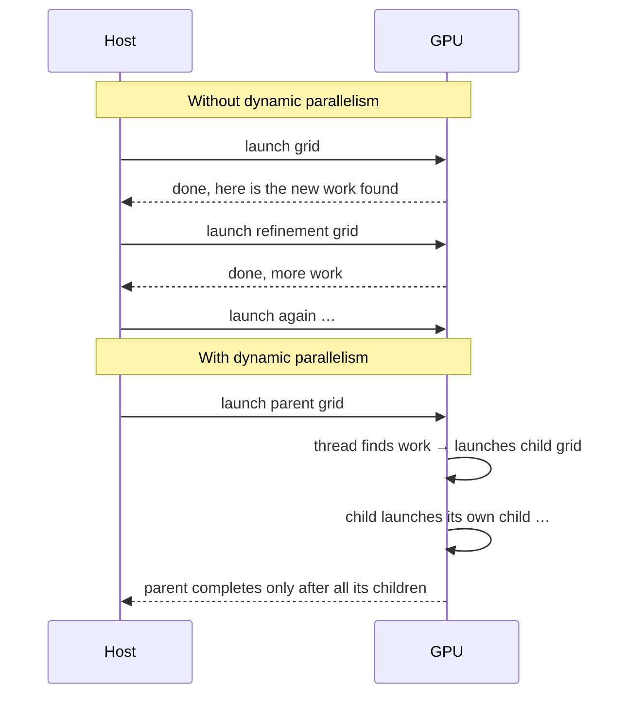
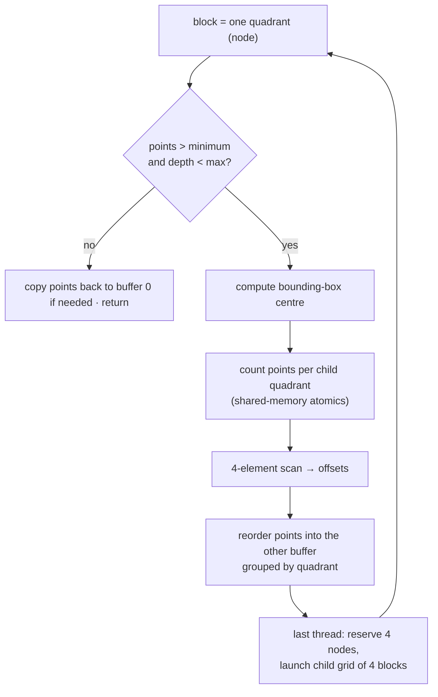

# CUDA dynamic parallelism

> Kernels that launch kernels. When work is discovered at run time, as with
> refining a mesh, subdividing a curve or building a tree, a thread can start a
> new grid itself instead of going back to the host. It's convenient and
> expressive, but launches cost resources and there are sharp edges.

## The problem it solves

Many simulations have work that **varies across space and time**. The book's
example is a turbulent combustion flow that's calm on the left and violent on
the right. A **fixed fine grid** wastes work on the calm side. A **fixed coarse
grid** loses accuracy on the violent side. You want a **dynamic grid** that
refines only where needed.

Without dynamic parallelism, only the host launches grids. A grid that
discovers new work must finish, report to the host, and wait for the host to
launch more. That adds host load, host↔device traffic, and latency. The
alternatives are awkward: serialize the extra work in loops, or contort the
algorithm.

## The mechanics

A kernel launches another kernel with the **same syntax** as the host:
`kernel<<<Dg, Db, Ns, S>>>(args)`. Here `Ns` is dynamic shared memory and `S`
is a stream, which must have been created **in the same block**.

The book's generic example is a thread that does some work and then **loops
over a variable-length list**, as in a BFS vertex's neighbours, a CSR row's
non-zeros, or a coarse cell's refinements. That pattern has two problems:
work inside the loop that could run in parallel doesn't, and loop lengths vary
within a warp, which means divergence. Splitting it into a **parent** kernel
(do the setup, then launch) and a **child** kernel (one thread per loop
iteration) fixes both. You could restructure by hand, say into chapter 15's
edge-centric BFS, but for some algorithms that is "awkward, complicated, and
error prone".

## Example 1: Bezier curves (variable work per item)

A **quadratic Bezier curve** through control points P0, P1 and P2 is
`B(t) = (1−t)²P0 + 2(1−t)t·P1 + t²P2` for `t ∈ [0, 1]`. Curvier curves need
more points to look smooth.

| Without dynamic parallelism | With dynamic parallelism |
| --- | --- |
| One **block per curve**. The block measures curvature, then loops over as many points as that implies | One **thread per curve** in the parent. It measures curvature, `cudaMalloc`s exactly enough memory **on the device**, then launches a **child grid** sized to that curve |
| Blocks get very different amounts of work, so SMs are poorly used | Child grids vary, but blocks are balanced |
| Every curve's storage sized to the maximum | Storage sized per curve, potentially much less memory |

Two details:

- **Launches are asynchronous.** The parent thread continues straight away
  unless it explicitly waits. But a parent grid **doesn't complete until all
  its children have**: there is an implicit synchronization at the end.
- **Device-allocated memory must be freed by device code.** The example adds a
  `freeVertexMem` kernel that the host launches afterwards.

## Example 2: quadtrees (recursion)

A **quadtree** (Finkel and Bentley, 1974) recursively splits 2D space into four
quadrants until each holds at most a minimum number of points. **One block per
node**:

Points ping-pong between two buffers by depth, and finished leaves copy back so
the result ends up in buffer 0. The building blocks are familiar: a
privatized count (chapter 9), a tiny scan (chapter 11), and a scatter by
offset (chapter 13).

## Things that bite

- **Memory visibility.** A child can see **global, constant and texture**
  memory, never the parent's **shared or local** memory, so never pass
  pointers to those. Parent and child see consistent memory at only **two
  points**: when the child is launched (the parent's earlier writes are
  visible) and after the parent **synchronizes** on the child's completion.
- **Pending launch pool.** A fixed pool tracks outstanding launches, **2048 by
  default**. Exceed it and a virtualized pool is used, which the book says can
  be **an order of magnitude or more slower**. With 4096 Bezier curves, half
  the launches would spill. Set
  `cudaDeviceSetLimit(cudaLimitDevRuntimePendingLaunchCount, N)` to the
  expected number of launches beforehand.
- **Streams.** Device-side streams are **private to a block**. Without one,
  all threads of a block launch into the block's default NULL stream, so **all
  their child grids run one after another**. The Bezier example would lose
  most of its parallelism. Give each thread its own stream
  (`cudaStreamCreateWithFlags(&s, cudaStreamNonBlocking)`).
- **Nesting depth.** The book gives the hardware limit as **24 levels**, and
  recursive kernels should check it. Parent-child synchronization adds a
  tighter **synchronization depth**, because the parent's state has to be
  saved somewhere.
- **Small launches waste the GPU.** Launch children with many blocks, or at
  least many threads per block. Nested parallelism works best for **thick**
  trees (many threads per node) with a **high branching factor**, and only
  fairly shallow trees are efficient.

> **Since this edition:** CUDA 12 introduced a revised dynamic-parallelism
> model ("CDP2") that **removed device-side `cudaDeviceSynchronize`**, the
> explicit parent-waits-for-child call this chapter relies on. Instead,
> special named streams (`cudaStreamTailLaunch`, `cudaStreamFireAndForget`)
> express "run after me" and "run independently". In practice many codes
> avoid dynamic parallelism altogether and use persistent kernels,
> work queues or **CUDA Graphs** (including device-launched graphs), which
> reduce launch overhead more predictably.

## What to take away

- Use dynamic parallelism when work is discovered unevenly at run time and
  restructuring by hand would be painful: adaptive meshes, recursive
  subdivision, irregular nested loops.
- Child launches are asynchronous. The parent finishes only after its
  children, and it can see their results only after it synchronizes.
- Give each launching thread its own stream, and size the pending-launch pool
  to the launches you expect.
- Pass children only global, constant or texture memory. Free device-side
  allocations from device code.
- Launch big children and keep recursion shallow. Many tiny grids waste the
  machine.

---

Previous: [Programming a heterogeneous computing cluster](./20-heterogeneous-cluster.md) ·
Next: [Advanced practices and future evolution](./22-advanced-practices.md)
