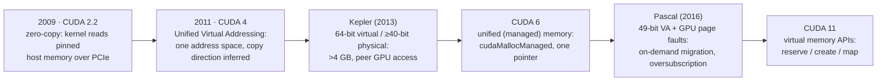

# Advanced practices and future evolution

> A tour of the CUDA features the book's simple model left out: how host
> and device memory grew together, what kernels became able to do, how the
> hardware got faster at the things early GPUs were bad at, and how tools find
> what to optimize. Knowing the history clears up a lot of confusion between
> features.

## Host/device interaction: from two worlds to one

The book's model so far has separate host and device memories, linked by
explicit `cudaMemcpy`. That causes three problems. I/O devices work on host
memory, so data takes extra hops. Early device memory was small, so big data
structures had to be **chunked** (as chapter 18 sliced its grid). And some
data structures can't be chunked at all. The fixes arrived over a decade:

| Feature | What it does | Catch |
| --- | --- | --- |
| **Zero-copy** | `cudaHostAlloc(…, cudaHostAllocMapped)` plus `cudaHostGetDevicePointer`. The kernel reads host memory directly | Runs at interconnect speed, typically **under 10%** of device bandwidth. Use only for data touched occasionally and sparsely |
| **Unified Virtual Addressing (UVAS)** | One virtual space shared by host and device (pioneered by the authors' GMAC library, Gelado et al., 2010). The runtime can tell where a pointer points, so `cudaMemcpy` no longer needs a direction | Shared addresses don't make memory accessible: the host still can't dereference a `cudaMalloc` pointer. Linked structures need everything allocated with `cudaHostAlloc` |
| **Large address spaces** (Kepler) | 64-bit virtual, ≥ 40-bit physical | Allows more than 4 GB, the same pointer values on host and device, and **direct access to other GPUs' memory**, replacing host-driven copies for halo exchange |
| **Unified memory** (CUDA 6) | `cudaMallocManaged`: one pointer valid on CPU and GPU, with migration and coherence by the runtime. Porting is mostly swapping `malloc` for `cudaMallocManaged` and calling a kernel | On Kepler and Maxwell the runtime flushed all CPU-modified data to the GPU before every launch, CPU and GPU couldn't touch an allocation at the same time, and size was capped at GPU memory |
| **Pascal page faults** | 49-bit addressing covers the CPU's 48-bit space. A GPU **page fault** migrates pages on demand (or maps them for remote access), and CPU and GPU invalidate each other's copies | No flush at launch. The GPU can walk host-built **linked structures** and use host memories of hundreds of GB (the book's example is CAD). The CPU can read GPU-resident data, which helps legacy libraries |
| **Virtual memory APIs** (CUDA 11) | `cuMemAddressReserve`, `cuMemCreate`, `cuMemMap` | Build custom layouts, for example one pointer to a 3D volume spread over several GPUs |

## Kernel execution control

- **Real function calls** (Kepler, CUDA 5). Earlier compilers had to inline
  everything. Real calls, backed by a fast per-thread call stack, made device
  code **composable**. They also allow closed-source device libraries,
  recursion, and **`printf`/`malloc` in kernels**. The book values `printf`
  for production support: users can turn on a state dump and send a useful bug
  report. Remaining limits: virtual functions only on objects built in device
  code, and no dynamic device libraries.
- **C++11 and lambdas** (CUDA 8). Device lambdas, lambdas passed as kernel
  parameters (a generic sort taking its comparator), and experimental
  "extended" `__host__ __device__` lambdas.
- **Exceptions and debugging.** There's limited exception support, but the
  debugger can step, break, and **stop on the first invalid memory access**.
  The authors found it very useful for out-of-bounds accesses and races.
- **Concurrent grids** (Fermi). Several grids from one application can run at
  once. You no longer have to batch kernels together to fill the GPU, and a
  small high-priority grid (for example, remote work on a cluster's critical
  path) can start without waiting behind a large local one.
- **Hardware queues** (Kepler) schedule blocks from many streams efficiently,
  and **dynamic parallelism** (chapter 21) lets the GPU create work itself.
- **Interruptible grids** (Fermi): long jobs can be cancelled, which enables
  user-level schedulers that rebalance across GPUs.
- **Cooperative kernels.** Launch at most as many blocks as fit on the GPU,
  and the runtime **guarantees they all run at once**. Blocks can then share
  mutexes and work queues without deadlock, using
  `cudaLaunchCooperativeKernel` (and a multi-device variant). The book dates
  this to CUDA 11, but cooperative launches and Cooperative Groups actually
  arrived in **CUDA 9 (2017)**.

## Memory bandwidth and compute throughput

- **Double precision.** Early GPUs ran FP64 about **8× slower** than FP32.
  From Fermi on it's about **half**, so HPC ports no longer had to justify
  moving to single precision.
- **Lower precision.** Pascal added FP16. The book's A100 example gives 156
  TFLOPS of 16-bit tensor-core throughput against 19.5 TFLOPS FP32. (Chapter 1
  of the same book gives 312 for FP16. The 156 figure is the A100's
  **TF32** tensor rate, and FP16 tensor is 312.)
- **Predication** (Fermi, after Mahlke et al., 1995) handles short branches
  without real divergence. That helps data-driven codes such as ray tracing.
- **Configurable L1/shared memory** (Fermi on): split on-chip memory between
  cache, for "easy performance" on straight CPU ports, and shared memory, for
  tuned codes such as stencils.
- **Faster atomics** (Fermi, then Kepler, then Maxwell's shared-memory
  atomics) remove some need for scan- and sort-based workarounds to scatter.
- **Faster random access** (Fermi and Kepler caches) eases coalescing
  pressure. **HBM2** on Pascal gave up to 3× Maxwell's bandwidth, and
  **NVLink** gave P100 up to 5× PCIe 3.0 for GPU↔GPU and GPU↔CPU traffic.

## Programming environment

- **One address space for global, shared and local memory** (Fermi). The same
  load and store instructions and pointers work in all three, so one device
  function can take a pointer to any of them. This made full C/C++ pointers and
  reusable libraries practical.
- **Higher-level interfaces:** OpenACC directives, **Thrust** generic
  algorithms, CUDA Fortran with strong multidimensional-array support, and
  C++AMP.
- **Profiling with critical-path analysis.** CUDA 7.5 added PC sampling for
  per-line hot spots. But the longest kernel isn't always the one to fix.

```mermaid
gantt
    title Which kernel should you optimize?
    dateFormat s
    axisFormat %S
    section CPU
    CPU work A              :a1, 0, 8s
    CPU waits               :crit, a2, 8, 3s
    section GPU
    Kernel X (long, but overlapped with A) :b1, 0, 7s
    Kernel Y (on the critical path)         :crit, b2, 8, 3s
```

Kernel X is longer, but it's hidden behind CPU work A, so speeding it up
changes nothing. Kernel Y is shorter but the CPU is waiting on it, so it's
the right target. CUDA 8's Visual Profiler (2016) greys out everything off the
critical path.

> **Since this edition:** the profiler named here has been replaced by
> **Nsight Systems** (timelines and critical paths) and **Nsight Compute**
> (per-kernel roofline and bottleneck analysis). C++ support has grown
> (libcu++, CCCL), and **CUDA Graphs** capture whole launch sequences to cut
> launch overhead. Grace Hopper systems give CPU and GPU **hardware-coherent**
> shared memory over NVLink-C2C, the end point of the unified-memory story
> above. Python-first routes (CuPy, Numba, Triton, CUDA Python) are now how
> many developers write GPU code.

## Future outlook

The book's prediction: CUDA will keep raising productivity and supporting
modern software engineering, so more applications get reasonable performance
at low development cost, and code written with tools such as Thrust gets
faster automatically. New hardware capabilities take years to be fully used
by SDKs and runtimes, which leaves plenty of room for tools research.

## What to take away

- Explicit copies are still the predictable choice for performance. Unified
  memory buys easy porting and oversubscription, at the price of page-fault
  latency you should measure.
- Use zero-copy only for data a kernel touches rarely. It runs at interconnect
  speed.
- Device-side `printf`, function calls, lambdas and a unified pointer space
  make CUDA code composable. Use them for maintainability.
- Profile the whole application's timeline and optimize the critical path,
  not the biggest kernel.

---

Previous: [CUDA dynamic parallelism](./21-dynamic-parallelism.md) ·
Next: [Conclusion and outlook](./23-conclusion.md)
