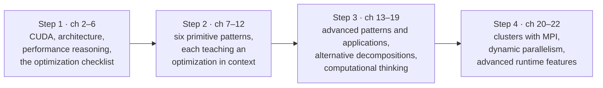

# Conclusion and outlook

> The authors look back at how the book delivered its promise of turning
> parallel programming from a black art into a thought process, and look
> forward to a world where computing, not instruments, drives innovation.

## Goals revisited

The book promised that massively parallel programming becomes manageable with
the right intuition: **computational thinking**, plus a **systematic** way of
removing whatever limits performance. It delivered in four steps:

The intended result: when you meet a new problem, you reason about threading
arrangements, loop structures, decompositions and data layouts deliberately,
not by trial and error.

## Future outlook

From the **G80 (2007)** to the **A100 (2020)**, the book counts a **452×**
increase in GPU computing throughput and **18×** in memory bandwidth over 13
years. The gap between the two numbers is the reason this book spends so much
time on data movement. GPU use has spread from dense matrices and Monte Carlo
methods to sparse methods, graphs and adaptive refinement, and it ignited the
deep-learning revolution.

The authors' larger claim is a **paradigm shift**. Innovation used to be
*driven by physical instruments, assisted by computing*. Now it is *driven by
computing, assisted by instruments*:

| Field | Then | Now |
| --- | --- | --- |
| Driving | GPS: satellite sensing plus shortest-path computation | live traffic from phones and the cloud; self-driving cars built on machine learning with sensors |
| Medicine | MRI and PET: sensors plus image reconstruction | individualized medicine built on computational genomics with sequencers |
| Chips | better light sources plus design-rule checking | light sources have stalled; computationally designed lithography masks shape interference patterns |

Since parallelism is the only way left to grow computing performance (chapter
1), demand for parallel hardware and for people who can program it will keep
growing. The authors single out **parallel access to storage** as an area
with large untapped potential. Their sign-off is that this is the dawn of a
golden age of computing, and they tell the reader to enjoy the ride.

> **Since this edition:** the prediction about demand was, if anything, an
> understatement. From 2023 on, large-language-model training made GPUs the
> limiting resource for much of the technology industry. Their point about
> storage parallelism has also played out, in GPUDirect Storage and in data
> pipelines designed around the GPU.

## What to take away

- The skills transfer. SPMD, ranks, barriers, tiling, privatization and
  coarsening reappear in MPI, OpenMP, SYCL, Triton and whatever comes next.
- Compute throughput grows much faster than memory bandwidth (452× against 18×
  in this period), so data movement will keep being the problem.
- The most valuable work combines domain knowledge with parallel thinking to
  change *how* a problem is solved, not just how fast the old method runs.

---

Previous: [Advanced practices and future evolution](./22-advanced-practices.md) ·
Next: [Appendix A — Numerical considerations](../5-appendix/README.md)
