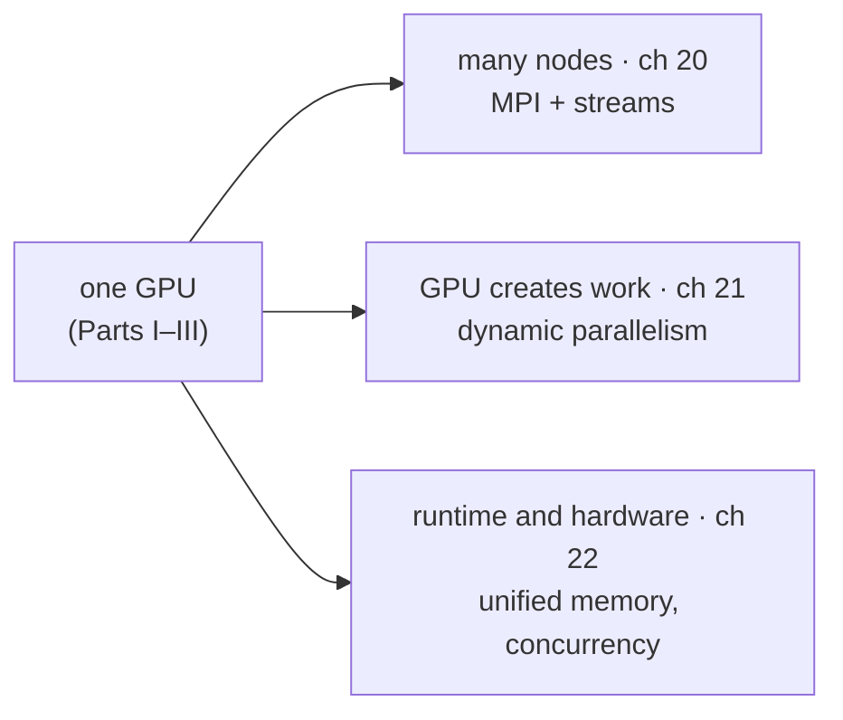

# Part IV — Advanced practices

> What an expert needs beyond single-GPU kernels: scaling across a cluster
> while hiding communication behind computation, letting the GPU launch its
> own work, and the runtime and hardware features that changed how
> host and device cooperate.

| | |
| --- | --- |
| [Programming a heterogeneous computing cluster](./20-heterogeneous-cluster.md) | MPI basics, domain partitioning, halo exchange, pinned memory, CUDA streams, overlap, CUDA-aware MPI |
| [CUDA dynamic parallelism](./21-dynamic-parallelism.md) | Kernels launching kernels: Bezier curves, quadtrees, memory visibility, launch pools, streams, nesting depth |
| [Advanced practices and future evolution](./22-advanced-practices.md) | Zero-copy to unified memory, function calls, concurrent and cooperative kernels, precision, atomics, critical-path profiling |
| [Conclusion and outlook](./23-conclusion.md) | The four steps of the book, and why computing now drives innovation |

---

Previous: [Parallel programming and computational thinking](../3-advanced-patterns/19-computational-thinking.md) ·
Next: [Programming a heterogeneous computing cluster](./20-heterogeneous-cluster.md)
