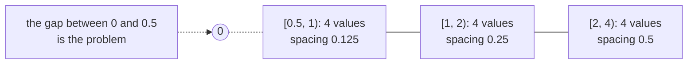
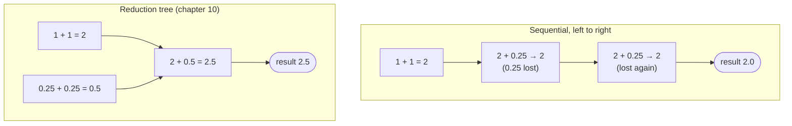
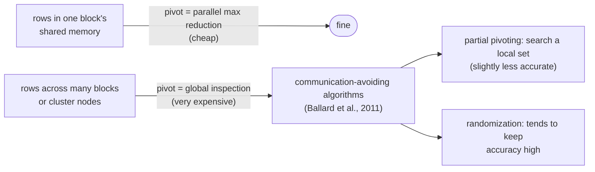

# Appendix A — Numerical considerations

> Parallel code reorders arithmetic, and floating-point arithmetic isn't
> associative, so parallel results differ from sequential ones and sometimes
> fail outright. This appendix explains IEEE-754 from first principles with a
> toy 5-bit format, then shows what that means for reductions and linear
> solvers.

## Why it matters

Fast floating point was once a mainframe feature. Microprocessors of the 1980s
were about three orders of magnitude slower, until parts such as the Pentium
III and Athlon in the 1990s caught up. Floating point is now standard on
CPUs and GPUs. Its wide range and fine resolution near zero make it the
representation for physics, graphics and finance, the same workloads that
drive parallel computing. So you need to understand **precision** (what the
format can represent), **accuracy** (how much error each operation adds) and
**stability** (whether an algorithm finds the answer at all).

## IEEE-754 representation

A number is stored as **sign S**, **exponent E** and **mantissa M**:
`value = (−1)^S × 1.M × 2^(E − bias)`. Almost every manufacturer follows
IEEE-754, including its 2008 revision.

- **Normalized mantissa.** Requiring the form `1.M` makes every value's
  encoding unique (0.5 is `1.0B × 2⁻¹`, not `0.1B × 2⁰`). The leading "1." is
  implied and not stored, so an m-bit mantissa gives **m + 1 bits of
  precision**.
- **Excess (biased) exponent.** Add `2^(e−1) − 1` to the exponent's two's
  complement. With 3 bits that's excess-3, with codes `000` (−3) up to `110`
  (+3). The codes increase monotonically, so a **cheap unsigned comparator**
  orders signed exponents correctly. The all-ones pattern is **reserved**.

Using a 6-bit toy format (1 sign, 3 exponent, 2 mantissa), 0.5 is `0 010 00`.

## Representable numbers

The book's 5-bit toy format (1 sign, 2 exponent bits in excess-1, 2 mantissa
bits) makes the structure visible:

Five observations:

1. **Exponent bits set the major intervals**, one per power of two.
2. **Mantissa bits set the precision**: with N bits there are 2ᴺ values per
   interval. Each extra bit halves the maximum rounding error.
3. **Zero isn't representable** in a pure normalized format.
4. **Values get denser toward zero**, which is good, since a $1 error matters
   more on $10 than on $1 billion.
5. But **right next to zero there's a gap**. The interval nearest zero has
   2ᵐ times the error of the next one up. Convergence tests on tiny values,
   and small values used as divisors, suffer.

Three ways to handle zero:

| Convention | When E = 0 | Effect |
| --- | --- | --- |
| No zero | normal numbers | zero can't be represented |
| **Abrupt underflow** (some 1980s minicomputers, some fast units today) | the value is 0 | simple, but the gap near zero gets **2× wider** |
| **Denormalization** (IEEE) | mantissa is `0.M`, with the same exponent as the next interval | **evenly spaced values fill the gap**, at a hardware cost |

Denormals are expensive. Modest hardware can take thousands of cycles per
denormal operand, which is why early CUDA GPUs didn't support them. CUDA
devices support denormal **doubles from compute capability 1.3** and
denormal **floats from 2.0**.

## Special bit patterns

| Exponent | Mantissa | Meaning |
| --- | --- | --- |
| all 1s | ≠ 0 | **NaN** |
| all 1s | = 0 | **±∞** |
| all 0s | ≠ 0 | denormalized |
| all 0s | = 0 | **0** |

FP32 is 1 + 8 + 23 bits and FP64 is 1 + 11 + 52. The extra **29 mantissa
bits** cut maximum representation error by a factor of 2²⁹, and the extra
exponent bits widen the range. **Infinity** comes from overflow (a huge value
divided by a tiny one), and any finite value divided by ±∞ gives 0. **NaN**
comes from meaningless operations such as 0/0, 0·∞, ∞/∞ and ∞ − ∞, or from
uninitialized data.

- A **signalling NaN** (top mantissa bit clear) raises an exception when used.
  It's good for catching uninitialized data in mission-critical code. The book
  notes current GPUs **don't support** it, because precise signalling is hard
  under massive parallelism.
- A **quiet NaN** (top bit set) just propagates and prints as "NaN" for a
  human to spot.

## Accuracy and rounding

**Precision** is a property of the format. **Accuracy** is a property of the
operations. Error arises when a result needs more mantissa bits than exist.
Adding numbers with different exponents means right-shifting the smaller
mantissa to align them. In the toy format, `1.00B×2¹ + 1.00B×2⁻²` would need
`1.001B×2¹`, which doesn't fit, so it rounds, with an error of **0.5 ULP**
(units in the last place). Perfect hardware never exceeds 0.5 ULP, and the
book says that's what CUDA addition and subtraction achieve. **Division and
transcendental functions** use polynomial approximations and can be worse.
Some early GPUs' reciprocal was off by **2 ULP**. Newer hardware is much more
accurate, but the fast SFU intrinsics of chapter 17 still trade accuracy for
speed.

## Algorithm considerations: summation order

Addition is associative in math, not in floating point. Summing
`1.00B×2⁰ + 1.00B×2⁰ + 1.00B×2⁻² + 1.00B×2⁻²` in the toy format:

Here the parallel order happens to be *more* accurate. A slightly different
input makes it *less* accurate. Either way **parallel and sequential results
differ**, which surprises developers who assume associativity. Remedies:

- **Pre-sort** the data in ascending order (minding signs), so similar
  magnitudes are added together and sequential runs inside a thread add small
  values first. This is one reason sorting is so common in massively parallel
  numerical codes.
- **Compensated (Kahan) summation** (Kahan, 1965) carries a correction term for
  even more robust sums.

## Linear solvers and numerical stability

An algorithm is **numerically stable** if it finds a solution whenever one
exists, whatever the input. **Gaussian elimination** solves the system
`3X + 5Y + 2Z = 19`, `2X + 3Y + Z = 11`, `X + 2Y + 2Z = 11`: divide each
equation by its leading coefficient, subtract to eliminate X, repeat for Y,
then **back-substitute** to get Z = 3, Y = 2, X = 1. In matrix form, rows
become operations, the matrix becomes triangular and then the identity. It
parallelizes simply: one thread per row in one block, with a barrier after
each division and each subtraction step, and threads dropping out as their row
finishes.

But plain elimination is **unstable**. Change the first equation to
`5Y + 2Z = 16`, with the same solution, and step 1 divides by zero. The fix is
**pivoting**: swap in a row with a non-zero leading coefficient, ideally the
**largest absolute value**. That needs a max reduction (chapter 10) across
rows.

Within one block, pivoting is a parallel max reduction over shared memory.
Across blocks or nodes, that global search is very expensive, which motivates
**communication-avoiding** algorithms. They use **partial pivoting** over a
local set of rows (slightly less accurate) or **randomization** (which tends
to preserve accuracy).

> **Since this edition:** low precision has become central. FP16, **BF16**
> (FP32's exponent range with fewer mantissa bits), TF32 and FP8 formats
> dominate AI training and inference, usually with FP32 accumulation and
> scaling tricks to manage range. The appendix's lessons carry over directly:
> fewer mantissa bits means bigger ULPs, and summation order matters even
> more.

## What to take away

- Precision is set by mantissa bits. Accuracy is set by how each operation
  rounds. Range is set by exponent bits. They are three different questions.
- Expect parallel reductions to give slightly different (not wrong) answers
  from sequential code. Validate against a tolerance, sort first, or use
  compensated summation when it matters.
- Denormals fill the gap near zero, but cost speed on some hardware. Know
  whether your GPU flushes them.
- Fast hardware math functions can exceed 0.5 ULP. Measure their effect on
  your application's own quality metric.
- Numerically stable solvers need pivoting, and pivoting needs global
  communication. At scale, prefer communication-avoiding variants.

---

Previous: [Conclusion and outlook](../4-advanced-practices/23-conclusion.md) ·
Next: [Overview](../README.md)
