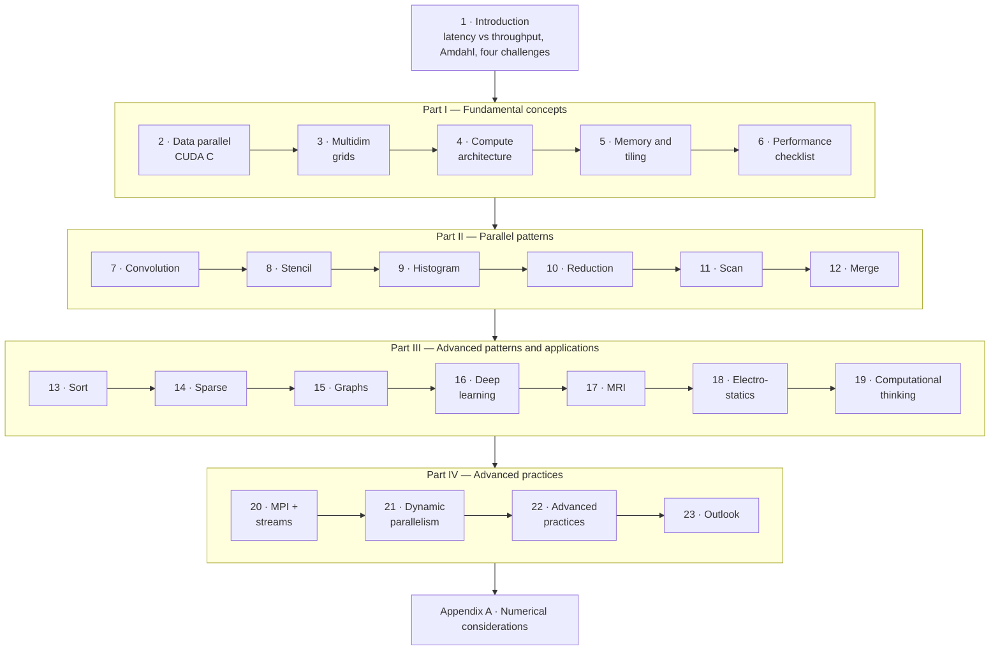

# Programming Massively Parallel Processors — Distilled

> Wen-mei W. Hwu, David B. Kirk and Izzat El Hajj, *Programming Massively
> Parallel Processors: A Hands-on Approach* (4th ed., Morgan Kaufmann, 2022),
> rewritten as a short book: CUDA, the GPU's architecture, the parallel
> patterns, the case studies and the advanced practices, in the original
> order, with the mechanisms drawn.

## What this is

The original is the standard GPU-programming textbook, built from the
University of Illinois course. It has 23 chapters in four parts plus a
numerical appendix, about 550 pages. This is the same 23 chapters and
appendix in the same order, at a fraction of the length. It keeps the
mechanisms, the trade-offs, the book's own worked numbers (A100 bandwidth,
occupancy cliffs, FLOP/B ratios, divergence counts), and its vocabulary:
tiling, coalescing, privatization, thread coarsening, work efficiency,
co-rank, gather versus scatter. It drops the code listings, exercises and
most worked examples.

It's a **distillation written in our own words**, not a copy. No passage of
the book is reproduced. The source was read chapter by chapter to check that
the numbers, lists, definitions and attributions here are the book's. Where
the book is internally inconsistent or has a slip (an intrinsic's name, a
citation, a date), the chapter says so.

**Buy the book.** What it has that this doesn't: the complete, compilable
kernels, the exercises at the end of every chapter, and the step-by-step
figures that trace indices through tiny examples. You learn CUDA by writing
it, and the book is built for that.

## Who it is for

An engineer who writes ordinary software and wants to understand GPUs:

- why a naive port runs at 2% of the hardware's peak;
- what tiling, coalescing and occupancy actually mean;
- why reductions, scans, histograms and sorts look so different on a GPU;
- what cuBLAS, cuDNN, CUB and NCCL are doing for you.

You should read C comfortably. You don't need graphics, numerical analysis or
any prior parallel programming.

## Which edition, and what has changed since

This is the **4th edition (2022)**, with the **Ampere A100** as its newest
GPU. It's a big revision of the 3rd edition (2016), with many new pattern
chapters. Since then Hopper and Blackwell, tensor-core-centric kernels,
Transformers, Python-first tooling (Triton, CuPy) and NCCL-based multi-GPU
training have arrived. The **principles haven't aged**: memory bandwidth
still decides most performance, and tiling, coalescing and privatization are
still how you get it. Each chapter ends with a short **"Since this
edition"** note where something has moved on. Those notes are **our
additions, not the book's**.

## The book's single idea

> A GPU is a throughput machine whose arithmetic outruns its memory. Every
> technique in the book (tiling, coalescing, privatization, coarsening,
> choosing gather over scatter, choosing work-efficient algorithms) exists to
> deliver data to thousands of threads fast enough, and to keep those threads
> from waiting on each other.

## The shape of it

| | What it answers |
| --- | --- |
| [Introduction](./01-introduction.md) | Why GPUs, why parallel, and what makes it hard? |
| [Part I — Fundamental concepts](./1-fundamentals/README.md) | How do I write a kernel, and why is it slow? |
| [Part II — Parallel patterns](./2-parallel-patterns/README.md) | How do the six primitive patterns run fast, and what does each teach? |
| [Part III — Advanced patterns and applications](./3-advanced-patterns/README.md) | How do real algorithms and applications get decomposed and tuned? |
| [Part IV — Advanced practices](./4-advanced-practices/README.md) | How do I scale to clusters, launch work from the GPU, and use the modern runtime? |
| [Appendix A — Numerical considerations](./5-appendix/README.md) | Why do parallel results differ, and when do algorithms fail numerically? |

## How to read it

Part I is required reading. Everything after it uses its vocabulary. After
that, Part II's chapters each stand mostly alone. If you have one evening,
read:

1. [Memory architecture and data locality](./1-fundamentals/05-memory-architecture.md): FLOP/B, the roofline and tiling.
2. [Performance considerations](./1-fundamentals/06-performance-considerations.md): coalescing and the optimization checklist.
3. [Reduction](./2-parallel-patterns/10-reduction.md): divergence made concrete.
4. [Prefix sum (scan)](./2-parallel-patterns/11-prefix-sum.md): work efficiency, and the primitive under sorting and allocation.
5. [Iterative MRI reconstruction](./3-advanced-patterns/17-mri-reconstruction.md): the whole method applied to a real application.

## Where it sits in this knowledge base

- [Computer Systems: A Programmer's Perspective — Distilled](../book-csapp/README.md):
  the CPU side of the same story. Caches, locality, the memory mountain and
  Amdahl's Law. Read its memory-hierarchy chapter before chapter 5 here.
- [Operating Systems: Three Easy Pieces — Distilled](../book-ostep/README.md):
  threads, locks and virtual memory, the background for chapter 9's races and
  chapter 22's unified memory.
- [Operating Systems](../operating-systems/README.md): the
  [memory hierarchy](../operating-systems/1-knowledge/memory/memory-hierarchy-and-caching.md)
  and [race conditions](../operating-systems/1-knowledge/concurrency/race-conditions.md).
- [Algorithms & Data Structures](../algorithms-data-structures/README.md):
  [sorting](../algorithms-data-structures/1-knowledge/algorithms/sorting-and-searching.md)
  and [graph algorithms](../algorithms-data-structures/1-knowledge/algorithms/graph-algorithms.md),
  the sequential versions of chapters 13 and 15.
- [Distributed Systems](../distributed-systems/README.md): what chapter 20's
  MPI cluster looks like when nodes can fail.
